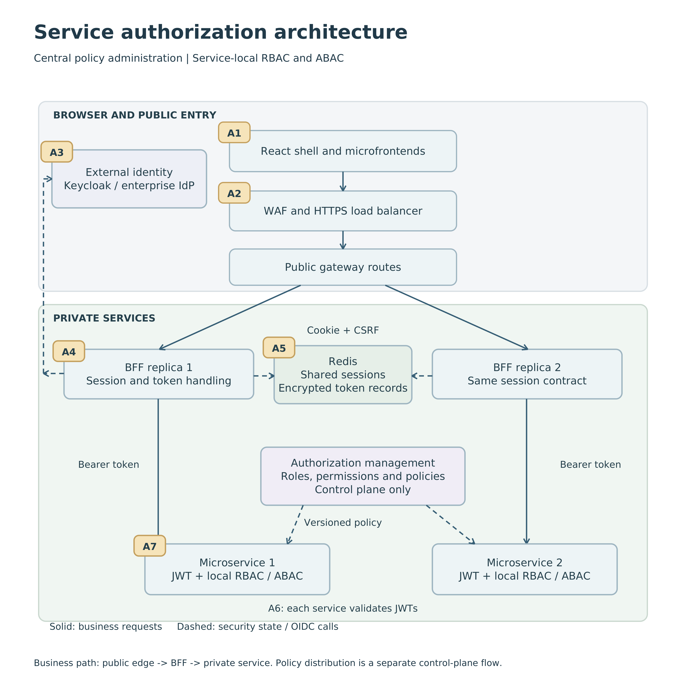
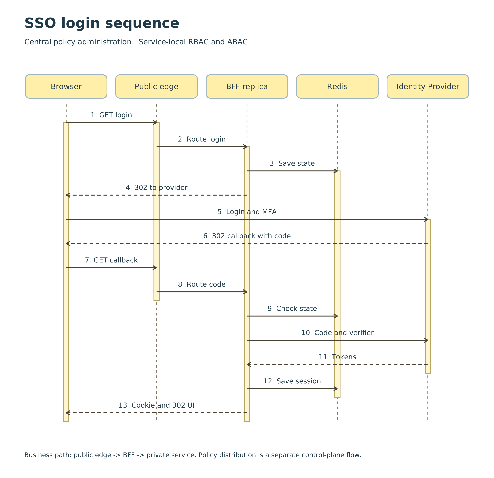
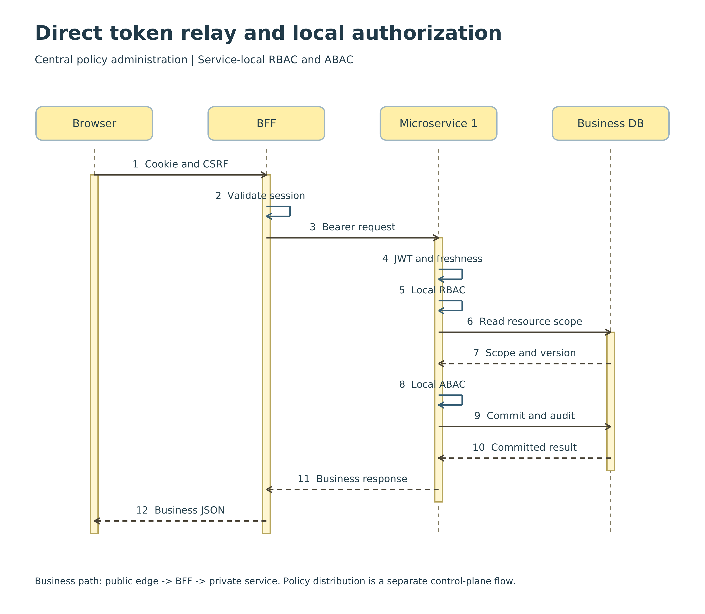
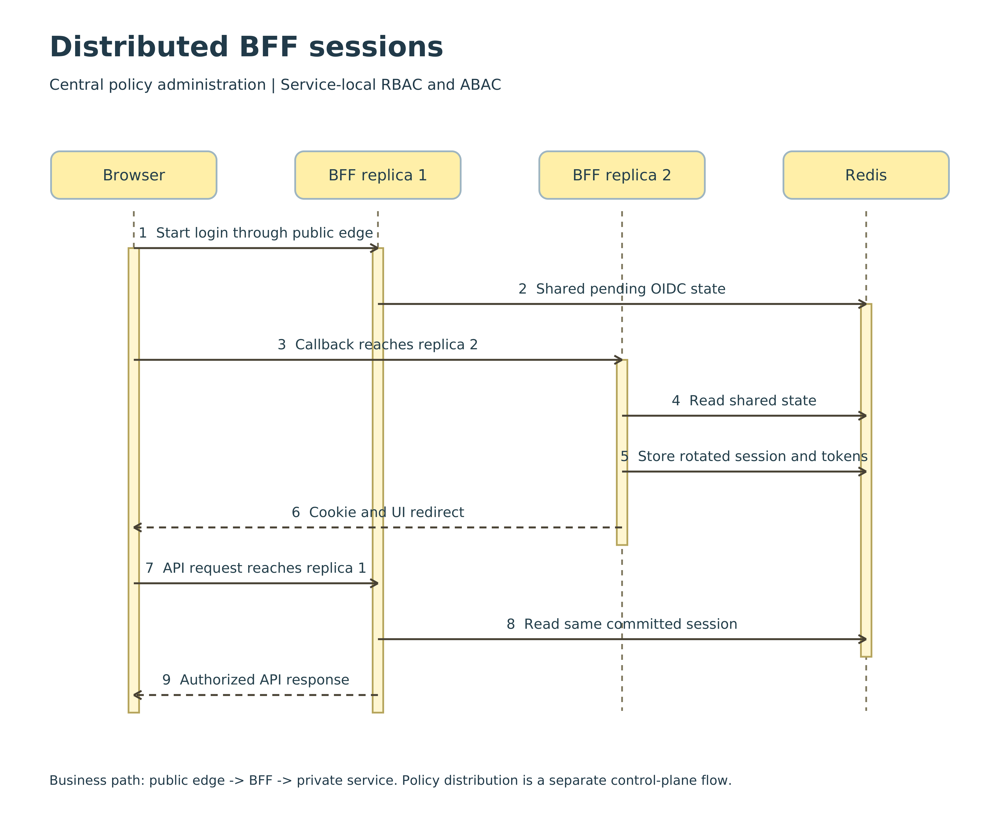
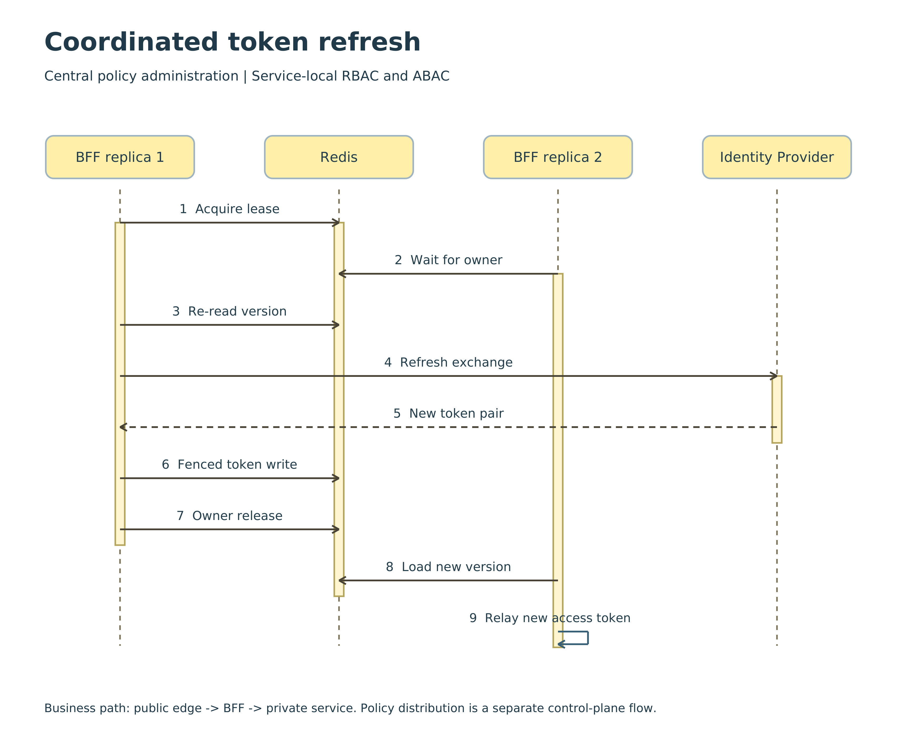
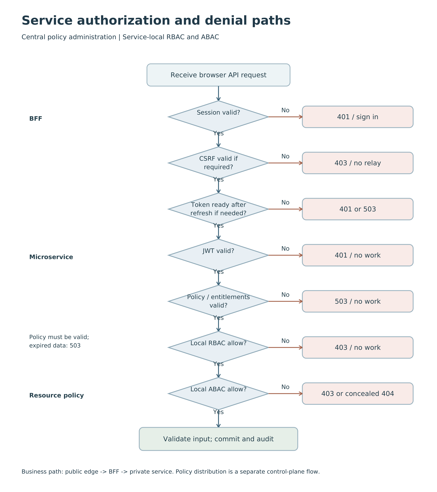
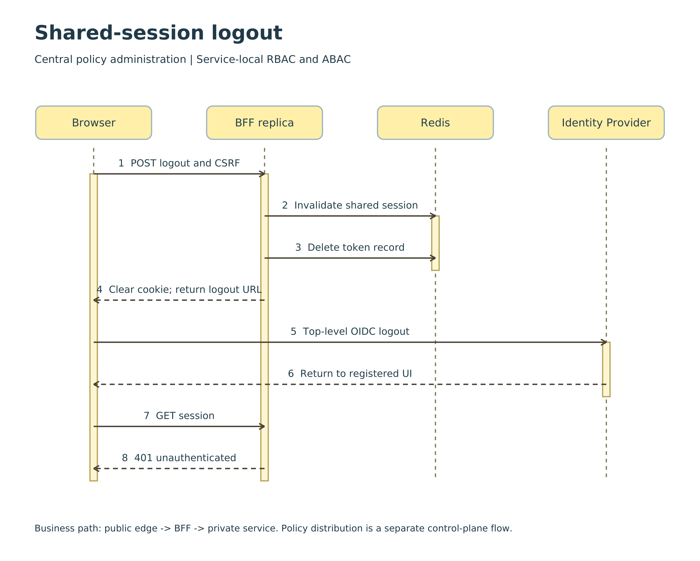

# AOBP Centralized SSO Authentication and Authorization with BFF

Architecture overview and implementation approach

React microfrontends · Spring Boot BFF · Redis · Microservices

*Architecture design | 2 November 2026*

This editable edition implements the accepted service-local authorization decision and retains the numbered document structure. Diagrams are redrawn from vector source as high-resolution PNGs, with SVG and Mermaid alternatives. Keep the `images`, `svg` and `diagram-source` folders beside this file when moving the document.

## 1. Introduction and Objective

The objective is to establish a centralized authentication and authorization architecture for AOBP, using a Backend for Frontend (BFF) to protect browser access to independently deployed microservices.

The React application is deployed separately from the gateway and BFF. Users access one application origin. The BFF performs OpenID Connect (OIDC) login, stores tokens on the server and gives the browser an opaque session cookie. It relays the user access token when calling a protected microservice.

**Main architectural principle:** the enterprise Identity Provider owns user identity, credentials, lifecycle, attributes and external group membership. AOBP does not create a separate local user directory or store user passwords. AOBP stores application authorization configuration and audit records. Short-lived BFF session state and subject references support authentication; they are not local user profiles.

## 2. High level Architecture

The design retains the reference architecture's separation between identity integration, business permissions and resource policies. Microservice 1 and Microservice 2 are generic examples; the same controls apply to additional services.

- **One logical application:** stable AOBP business permissions are independent of service deployment boundaries. Runtime service registration is not required in the authorization database.

- **Centralized SSO:** Keycloak brokers enterprise SSO, or an approved OIDC provider connects directly to the BFF. The BFF owns the application login callback.

- **Server-side token handling:** the browser receives a session cookie. Access and refresh tokens remain in protected server-side storage.

- **Business RBAC and scope ABAC:** each microservice evaluates operation permissions and resource policies before executing work.

- **Horizontal scaling:** BFF replicas share Redis-backed security state. The same logical session can be processed by any healthy replica.

- **Deployment-independent enforcement:** the security model applies with or without a service mesh. Mesh mTLS supplements end-user authorization.

### 2. High level Architecture continued



[Scalable SVG](svg/01_secure_access_architecture.svg) · [Editable Mermaid source](diagram-source/01_secure_access_architecture.mmd)

*Figure 1. Read top to bottom. Both BFF replicas share Redis and use the same OIDC provider. A1-A7 identify attack points reviewed in Section 13; A6 is JWT validation at each microservice. A8 covers authorization administration/data/audit; A9 covers deployment administration. The BFF calls services directly. Dashed policy-distribution links are control-plane traffic, not a per-request decision hop.*

### 2. Architecture responsibilities and boundaries

| Component | Responsibility |
| --- | --- |
| React shell and microfrontends | Render the application and call same-origin BFF endpoints; do not hold OAuth tokens. |
| API Gateway | Expose the application entry point; route BFF login/API requests and enforce traffic limits. Optional coarse checks do not replace service authorization. |
| BFF replicas | Perform login, session and CSRF checks, refresh authorized clients and relay access tokens. |
| Redis | Store shared sessions, encrypted token records and refresh coordination state. |
| Identity Provider | Authenticate and federate users; issue signed tokens and own external entitlements. |
| Authorization Management Service | Centrally administer and distribute versioned roles, mappings, permissions, policies and scope grants. |
| Microservice 1 and 2 | Validate access tokens and enforce both RBAC operation permissions and ABAC resource policies on business operations. |
| Authorization Database | Store application roles, permissions, entitlement mappings, policies and scoped grants. |

### Routing and trust boundaries

| Request | Allowed destination |
| --- | --- |
| UI document and approved MFE assets | Public edge to separately deployed UI services |
| /oauth2/** and /login/oauth2/code/** | Public edge to BFF; exact login and callback allowlist |
| /bff/session, /bff/csrf, /bff/logout | Public edge to BFF; session contract |
| /bff/api/microservice-1/** or microservice-2/** | Public edge to BFF; fixed operation allowlist |
| Internal bearer API routes | BFF to selected microservice directly; no public API ingress |

In AWS EKS, a public HTTPS ALB with WAF targets approved public-edge pods. BFF and microservices use internal ClusterIP Services in private subnets. A private gateway is optional for justified routing, quotas or protocol controls; it is not required for RBAC and is not on the default BFF-to-service path. Enforce this topology with security groups and an enabled network-policy implementation; a ClusterIP address alone is not access control.

Terminate public TLS at the approved edge, then explicitly configure TLS for each internal hop; use mTLS/workload identity for service calls where required. Keep authentication and authorization checks active even when traffic is encrypted. Limit provider egress to approved OIDC hosts and protect DNS/proxy trust settings.

## 3. Implementation Approach

### Step 1 Register the BFF in the Identity Provider

Register **aobp-bff** as a confidential OIDC client. Enable Authorization Code flow with PKCE S256, store its credential in the secret manager, and configure exact HTTPS callback and post-logout addresses. Disable implicit and password grants for this application.

The React shell does not need its own token-handling OIDC client for this BFF flow. Its sign-in button navigates to the BFF login endpoint through the gateway. A separate mobile or machine client has its own registration and security flow.

| Property | Example |
| --- | --- |
| Application origin | https://aobp.example.com |
| Login initiation | /oauth2/authorization/aobp |
| Registered callback | https://aobp.example.com/login/oauth2/code/aobp |
| Post-logout destination | https://aobp.example.com/ |
| OAuth client | aobp-bff |

### Step 2 Register the protected API

Represent the protected backend as an API resource/audience in the Identity Provider. For this design, Microservice 1 and Microservice 2 share the logical **aobp-api** audience because they are in one trust boundary. Every service explicitly validates that audience.

| Property | Example |
| --- | --- |
| Logical API audience | aobp-api |
| Authorized browser client | aobp-bff |
| Delegated access scope | Provider-specific AOBP API scope |
| Token accepted by services | User access token, not ID token or refresh token |

A shared audience simplifies onboarding but broadens where a stolen bearer token can be presented. For separately trusted APIs, use distinct audiences and an approved per-resource token acquisition or exchange flow. Never relay a token to an unintended audience.

### Step 3 Configure enterprise identity integration

Configure Keycloak federation to the enterprise Identity Provider and map stable external group IDs and trusted scope attributes. Enforce the organization's MFA and lifecycle policies. Prefer immutable issuer and subject identifiers over email or display name.

### 3. Implementation Approach continued

### Step 4 Define AOBP roles

Roles represent business responsibilities rather than service names. Manage them in the AOBP Authorization Database. A valid login does not by itself assign application permissions.

| AOBP role | Description |
| --- | --- |
| ADMIN | Application authorization administration |
| MANAGER | Management operations |
| OPERATOR | Standard operational changes |
| VIEWER | Read-only operations |

### Step 5 Map IdP groups to AOBP roles

Trusted entitlement integration resolves token groups or approved IdP API results. The centrally managed mappings are distributed to each service. Store issuer, entitlement type and a stable external entitlement ID in each mapping. Missing or malformed entitlements grant no access.

| External entitlement | AOBP role |
| --- | --- |
| AOBP_OPERATIONS stable group ID | OPERATOR |
| AOBP_MANAGERS stable group ID | MANAGER |
| AOBP_VIEWERS stable group ID | VIEWER |

### Step 6 Define business permissions

Use capability-oriented permissions such as **DATA.READ**, **DATA.UPDATE** and **CONFIG.MANAGE**. Different microservices can enforce the same permission. Map each service operation to its permission in that service's controlled policy configuration.

### Step 7 Assign permissions to roles

| Role | Example permissions |
| --- | --- |
| VIEWER | DATA.READ |
| OPERATOR | DATA.READ, DATA.UPDATE |
| MANAGER | DATA.READ, DATA.UPDATE; additional approved management actions |
| ADMIN | CONFIG.MANAGE; business data access only when explicitly granted |

### Step 8 Define scope policies

Combine the role decision with trusted subject and resource attributes. User A may update resources in SCOPE_A while User B, with the same OPERATOR role, may update resources in SCOPE_B. Read the resource's authoritative scope from business storage. Never trust a client-selected scope header as evidence of access.

## 4. Authentication Runtime

The browser begins the login flow; the BFF completes the protocol and stores the resulting tokens. The gateway routes these requests and must not intercept the BFF callback or logout endpoints.



[Scalable SVG](svg/02_sso_login_sequence.svg) · [Editable Mermaid source](diagram-source/02_sso_login_sequence.mmd)

*Figure 2. Arrows follow execution order. Redirects go through the browser; code exchange and token delivery happen server-to-server. The provider and browser are the only participants in the login/MFA interaction. The public edge represents WAF/load balancer and gateway routing.*

**Security checkpoint A3:** validate the pending login transaction, exact callback, state, nonce and PKCE. On failure, stop before establishing an authenticated session. Never include OAuth tokens in a UI redirect URL.

### 4. Authentication Runtime continued

### Runtime sequence

1. The UI calls **GET /bff/session**. If it receives 401, it displays Sign in and navigates to the login initiation endpoint when the user chooses it.

2. The BFF creates state, nonce and a PKCE verifier/challenge. It saves the pending authorization request in shared session storage and redirects the browser to the configured provider.

3. The provider authenticates the user. The callback is handled by any healthy BFF replica using shared state. The OIDC library validates the response and exchanges the code using the client credential and PKCE verifier.

4. The BFF validates the ID token, including issuer, audience and nonce, rotates the browser session ID and stores encrypted authorized-client tokens. It redirects to the configured UI origin.

5. The browser receives an HttpOnly, Secure, host-only **AOBPSESSION** cookie. Use SameSite=Lax for this top-level GET callback design, a 30-minute inactivity limit and an explicitly enforced absolute lifetime, initially eight hours.

6. GET /bff/session returns display information and UI capabilities with Cache-Control: no-store. It returns no OAuth tokens. Production UI code never reads the session cookie.

## 5. Token Relay to Microservices

Token relay means the BFF attaches the current user's access token to a separate outbound API request. It preserves the user security context; it does not make the BFF the final authority for resource access.



[Scalable SVG](svg/03_token_relay_sequence.svg) · [Editable Mermaid source](diagram-source/03_token_relay_sequence.mmd)

*Figure 3. The public edge forwards the browser request to the BFF and is omitted from the lifelines. Redis is read during step 2 and refresh follows Section 7. A denied RBAC or ABAC response stops the flow before business work; the BFF calls the resource-owning service directly, which enforces both RBAC and ABAC using a valid local policy snapshot.*

The resource scope is read from authoritative data. The service evaluates RBAC and ABAC before its transaction/version-checked operation. For Microservice 2, substitute that service and its controlled route/policy mapping; the identity and credential rules remain the same.

### 5. Token Relay example and credentials

### Example request to Microservice 1

```http
Browser -> Gateway -> BFF
GET /bff/api/microservice-1/v1/resources/resource-123
Cookie: AOBPSESSION=<opaque-session-id>
```

1. The gateway routes the browser request to a BFF replica. The BFF loads the shared session and checks that it is authenticated.

2. The BFF resolves the authorized client linked to that session. It obtains a token with sufficient remaining lifetime for the expected downstream call; refresh handling is described in Section 7.

3. The BFF builds a new request to a configured internal destination. It strips client-supplied identity and authorization metadata and supplies its own bearer header.

```http
BFF -> Microservice 1 directly over private TLS
GET /api/v1/resources/resource-123
Authorization: Bearer <user-access-token>
traceparent: <validated-trace-context>
```

4. Microservice 1 validates signature, allowed algorithm, issuer, audience and time claims. It evaluates DATA.READ and the persisted resource scope before returning data.

5. The BFF returns the business JSON without token headers, internal cookies or private upstream addresses. The flow to Microservice 2 follows the same rules using its own allowlisted route.

### What each layer receives

| Boundary | Credential |
| --- | --- |
| Browser to BFF through gateway | Opaque session cookie; CSRF header for state changes |
| BFF to Microservice 1 or 2 | Authorization: Bearer <access-token> |
| BFF to provider token endpoint | Client authentication plus code/verifier or refresh token |
| Authorization management to service evaluator | Authenticated/signed versioned policy snapshot; workload identity; no browser cookies or refresh tokens |

Do not relay refresh tokens, ID tokens or browser cookies to microservices. Avoid default WebClient configuration that attaches tokens to every URL. Destination and method allowlists prevent the BFF becoming an open proxy. Machine integrations bypass browser-session endpoints and use a separately secured OAuth client-credentials API path.

## 6. Distributed BFF Sessions with Redis

Deploy BFF replica 1 and BFF replica 2 behind the gateway. They use the same client registration, compatible session serialization, cookie policy, encryption keys and Redis namespace. No replica is the permanent owner of a user session.



[Scalable SVG](svg/04_distributed_bff_sessions.svg) · [Editable Mermaid source](diagram-source/04_distributed_bff_sessions.mmd)

*Figure 4. One session can move between replicas. Provider redirects and code exchange follow Figure 2 and are omitted here. Every browser request still traverses the public edge; no browser directly connects to a BFF pod or Redis.*

**What this proves:** replica independence after shared state is committed. It does not guarantee recovery of a code already consumed at the provider or of refresh tokens rotated immediately before a crash.

### 6. Distributed state and operational controls

### How requests move between replicas

1. Replica 1 starts login and stores the pending OIDC request in Redis. The provider callback may arrive at replica 2, which retrieves the same login state.

2. On successful login, the handling replica rotates the session ID. A separate stable authorized-client storage ID preserves the link to the encrypted token record across that rotation.

3. A later API request may reach either replica. It loads the shared session, finds the authoritative authorized client, and uses or refreshes its token.

4. If one replica stops, another can continue a committed session. A failure during login/code exchange or token rotation can still require reauthentication. Shared Redis does not make external token exchanges atomic.

### Redis data responsibilities

| Record | Purpose and control |
| --- | --- |
| Spring Session record | Security context, login request, CSRF state and stable token-storage reference; bounded TTL. |
| Authorized-client record | Encrypted access/refresh tokens, expiry, token version and owner reference; authoritative for all replicas. |
| Refresh coordination | Per-client lease, owner token and fencing/version state; short bounded lifetime. |
| Revocation/session indexes | Locate subject/provider sessions for logout; optional token digest blocks retained only until relevant token expiry. |

Do not store duplicate plaintext tokens in the general session. Use an explicit authorized-client repository rather than assuming Spring Session automatically provides encrypted token storage or distributed refresh coordination.

### Availability and isolation

Use TLS, Redis ACLs, private networking, protected backups and environment-specific namespaces. Protect all session data, not only token fields. Set TTL cleanup for token records and enforce absolute session lifetime independently of activity.

Sticky sessions are unnecessary for correctness when state is shared. Redis availability and consistency remain dependencies. Avoid stale security reads from replicas; asynchronous Redis failover can lose recent writes or leases. Test that scenario and force reauthentication when token state is uncertain. Do not fall back to local sessions on outage.

## 7. Access Token Refresh

Only the BFF refreshes user tokens. The UI and microservices do not receive or use the refresh token. Refresh preserves an existing authorization; it cannot expand the user's permissions.



[Scalable SVG](svg/05_token_refresh_sequence.svg) · [Editable Mermaid source](diagram-source/05_token_refresh_sequence.mmd)

*Figure 5. Replica 1 owns the refresh lease. Replica 2 waits, then loads the committed token version. The wait does not submit a second refresh call. Apply bounded wait and fail-closed recovery when ownership or token state becomes uncertain.*

**Security checkpoint A5:** neither replica may blindly reuse an old rotating refresh token. The diagram shows the normal case; provider-side rotation and Redis persistence remain separate failure boundaries.

### 7. Refresh failure and concurrency handling

### Refresh sequence

1. Before relay, compare token expiry against expected request duration plus clock skew. Use a configured safety window, initially 60 seconds, then tune it against measured downstream latency.

2. If refresh is needed, acquire a bounded lease keyed by the stable authorized-client ID. Re-read the token version after acquiring it; another replica may already have refreshed.

3. The owner calls the provider token endpoint with its client credential and current refresh token. If rotation is enabled, accept and persist the new refresh token together with the access token.

4. Commit using an atomic owner-checked and version/fence-checked write. Release the lease only if still owner. Waiters have a bounded wait, then load the new version or return a controlled failure.

5. For invalid_grant or revoked authorization, end the local authorization and require login. For temporary provider failure, return 503 without performing the business action. Never blindly retry an uncertain refresh exchange.

A lease and fenced write protect local state, but they do not fence the provider's token endpoint. If a process pauses beyond its lease or crashes after rotation and before persistence, competing exchanges or lost tokens may force login. Test these windows explicitly; do not claim exactly-once refresh across systems.

## 8. Service Level RBAC Authorization

Business authorization belongs in the resource-owning microservice. The public gateway provides routing, rate limits and optional coarse token/scope checks. The BFF owns browser authentication, sessions, CSRF and token relay. A private gateway is not required for business RBAC.

### Request processing in order

1. The public edge routes the browser request to the BFF.
2. The BFF validates the session, CSRF where required, and a fixed operation/destination allowlist.
3. The BFF obtains a usable access token and creates a new TLS request directly to Microservice 1 or Microservice 2.
4. The receiving service validates JWT signature, issuer, audience, algorithm and time claims.
5. The service resolves the operation's required permission from server-controlled configuration and evaluates RBAC using valid centrally managed policy/entitlement data.
6. It loads authoritative resource attributes and evaluates ABAC plus business-state conditions.
7. Only an allowed operation may commit, with input validation, concurrency controls and durable audit.

```text
Browser -> public edge / gateway -> BFF -> Microservice 1 or 2
Authorization management -> versioned policy distribution -> local service evaluators
```

The second line is a control-plane flow. It is not executed as a required remote policy decision for every business request. A gateway may be retained privately for justified routing or traffic management; every service still enforces both RBAC and ABAC. Do not duplicate business permission mappings at the gateway as a second authority.

### Central administration with local enforcement

The Authorization Management Service owns versioned role definitions, issuer-scoped entitlement mappings, permissions, named policies and scope grants. It authenticates service workloads and publishes approved, signed/versioned policy bundles or authenticated snapshots. It is a control-plane component, not a required synchronous hop for every business request. Each service validates the configured publisher/signature and schema, enforces version/validity bounds, and evaluates both RBAC and ABAC locally. Spring services may use shared policy classes; polyglot services may use a local policy evaluator with the same versioned contract. Domain services own their resource-specific rules.

Policies use stable permission names, independent of service deployment names. A service selects the required permission from its controlled operation mapping. It supplies the verified issuer/subject, trusted entitlements and authoritative resource attributes; the browser cannot select its actor, policy, permission or scope grant. Query, bulk and export paths enforce the same rules.

Policy distribution uses change notifications plus periodic reconciliation and a bounded maximum age. A service may continue using a last-known-good snapshot only while it remains explicitly valid and permitted by policy. Missing, invalid or expired mandatory policy/entitlement data causes a controlled 503 with no business mutation; a valid policy denial is 403. Sensitive operations can require a fresh entitlement check through an authenticated central endpoint under a documented availability contract.

Log policy version, entitlement source/freshness and a safe decision reason. Revocation targets must cover token claim age, policy/grant caches and notification delay. Refreshing a policy bundle does not remove stale group claims from an existing JWT; meeting a tighter SLA requires token revocation, fresh entitlement resolution or reauthentication. Never silently extend validity during an outage.

### Token relay and enforcement details

Token relay forwards the current user's **access token** in `Authorization: Bearer ...`; it does not grant permission by itself. Each service acts as an OAuth resource server and validates the configured issuer, signature/allowed algorithm, intended audience and time claims. An ID token authenticates the BFF login; it is not an API credential. A refresh token is sent only to the provider token endpoint.

For Spring services, enable method authorization explicitly with `@EnableMethodSecurity`; adding the security starter alone does not enable it. Apply operation authorization at the application/service layer, with a trusted permission resolver or `AuthorizationManager`. Map provider groups/roles through the governed entitlement contract; default `SCOPE_` authorities do not automatically become AOBP business permissions. Resource authorization loads authoritative data inside the protected use case, with transaction/version checks before mutation. Account for proxy/self-invocation boundaries when using annotation-based enforcement.

Every path must follow the same rules: REST controllers, service-to-service requests, background workload identities, list/export queries and WebSocket subscriptions/messages. Authenticate long-lived connection establishment and re-evaluate applicable session, permission and resource constraints for subsequent operations. Enforce query scope before pagination/count/export, not by hiding records in the UI.

These are implementation requirements and design choices, not a claim that one framework annotation or an API gateway automatically provides complete authorization. Verify behaviour against the supported framework/IdP versions selected for deployment. Reviewed primary references on 2 November 2026: [Spring method security](https://docs.spring.io/spring-security/reference/servlet/authorization/method-security.html), [JWT resource server](https://docs.spring.io/spring-security/reference/servlet/oauth2/resource-server/jwt.html), and [OWASP authorization](https://cheatsheetseries.owasp.org/cheatsheets/Authorization_Cheat_Sheet.html).

### 8. Request activity and denial paths

The BFF checks the browser session, CSRF and usable token. Each microservice checks JWT, policy freshness, RBAC and resource ABAC. Failure at any required gate stops business work.



[Scalable SVG](svg/06_request_activity_and_denials.svg) · [Editable Mermaid source](diagram-source/06_request_activity_and_denials.mmd)

*Figure 6. JWT, RBAC and ABAC gates are inside each microservice. A valid local policy snapshot permits evaluation without a synchronous central call. Expired mandatory policy data causes 503, not allow. Input validation and transactional business checks remain required before commit.*

## 9. Resource Level ABAC Authorization

The microservice RBAC check answers whether the user may perform an operation. Its ABAC check determines whether that operation is allowed on this specific resource. Apply both checks to reads, writes, list results, exports and alternative entry points.

### Example using a generic resource

| Context | Value |
| --- | --- |
| Authenticated user | User A; trusted issuer and subject |
| Resolved role | OPERATOR |
| Role permissions | DATA.READ, DATA.UPDATE |
| Authorized scope | SCOPE_A |
| Requested resource | resource-123 |
| Scope read from business storage | SCOPE_B |

**RBAC = ALLOW.** The OPERATOR role grants DATA.UPDATE.
**ABAC = DENY.** The resource belongs to SCOPE_B while the subject has only SCOPE_A.
**Final decision = DENY.** No mutation is committed.

### Evaluation sequence

1. Microservice 1 obtains the authenticated issuer/subject from its validated security context, not from request fields.

2. It reads resource-123 and its scope from authoritative business data. For creates, validate the proposed scope against trusted subject grants before persistence.

3. It evaluates the named scope policy locally using valid centrally managed policy data and trusted resource attributes. A domain-specific adapter supplies authoritative resource context; policy selection is controlled by the server.

4. It commits only if role permission and scope policy both allow. Use a transaction/version check so the authorized resource scope cannot change unnoticed between policy evaluation and update.

5. It records the outcome with subject, action, resource reference, policy version and trace ID. Return a consistent 403, or a documented 404 concealment response for inaccessible objects.

### Why this remains safe across service boundaries

Microservice 2 follows the same policy contract even if it is implemented in another language. A mesh can authenticate workloads and encrypt traffic, but it does not prove that User A may update a SCOPE_B resource. A common authorization contract provides consistent decisions without sharing browser sessions with domain services.

## 10. Authorization Database

Retain the minimal model from the reference architecture. Application authorization data is separate from identity ownership and from the Redis session/token store. A subject reference in a grant is not a locally managed user account.

| Entity | Key fields and purpose |
| --- | --- |
| AOBP_ROLE | role_code PK; description; enabled |
| PERMISSION | permission_code PK; description |
| IDP_ROLE_MAPPING | mapping_id PK; issuer; entitlement_type; entitlement_id; role_code FK |
| ROLE_PERMISSION | role_code FK; permission_code FK; composite unique key |
| USER_ACCESS_SCOPE | issuer; subject_id; scope_type; scope_value; effective_from/to as needed |
| POLICY | policy_code PK; version; expression/configuration; enabled |
| AUDIT_EVENT | event_id; timestamp; issuer/subject; action; resource; outcome; policy_version; trace_id |

Require uniqueness on the external entitlement mapping plus target role. Use referential constraints for role-permission links. Audit changes to mappings, role grants, policies and scope grants. Restrict authorization administration separately from normal operational access.

### Where scope comes from

Prefer trusted IdP attributes or an approved enterprise source when they already own access scope. If AOBP owns application-specific scope grants, USER_ACCESS_SCOPE stores only issuer/subject references and those grants. It does not become a duplicate profile store. Define precedence and conflict handling rather than combining contradictory grants silently.

### What tokens contain

The access token identifies the subject and intended API, with issuer, audience, expiry and approved external entitlement claims. AOBP business permissions may be resolved at runtime from the database; they need not all appear in the token. Updating a database mapping does not change an already-issued token's claims.

### Storage boundaries

| Store | Data owner |
| --- | --- |
| Enterprise IdP / broker | Credentials, federation, external groups and user lifecycle |
| Redis | Ephemeral BFF security session and encrypted authorized clients |
| Authorization Database | AOBP roles, permissions, mappings, scope grants and policy audit |
| Microservice databases | Business resources and authoritative resource attributes |

## 11. Browser Protection and Logout



[Scalable SVG](svg/07_logout_sequence.svg) · [Editable Mermaid source](diagram-source/07_logout_sequence.mmd)

*Figure 7. Logout removes the shared browser session before leaving AOBP for provider logout. Both BFF replicas reject the invalidated session. Revocation of already-issued access tokens is a separate service-side control with a defined enforcement SLA.*

The BFF returns only a server-generated, allowlisted provider logout URL. Local session invalidation succeeds independently of provider logout. API clients must not interpret local logout as evidence that every previously issued JWT has stopped working at all services.

### 11. Browser protection and logout controls

### CSRF and microfrontends

All microfrontends call relative BFF URLs through a shared frontend API module. Independently deployed assets can be served through the common origin; that does not require embedding OAuth credentials in each remote.

GET /bff/csrf supplies a session-bound CSRF token and header name. POST, PUT, PATCH and DELETE require that header in addition to the cookie. Obtain a fresh CSRF token after authentication or logout. Keep credentialed cross-origin access disabled unless an explicit origin contract is needed; CORS and SameSite do not replace CSRF validation.

HttpOnly prevents JavaScript reading the session cookie, but injected script can still submit authorized requests. Apply CSP, output encoding, dependency controls and trusted MFE release/manifest governance. A compromised remote runs with the shell's browser privileges.

### Logout sequence

1. The UI sends a CSRF-protected POST to /bff/logout. Do not log out by an unprotected state-changing GET.

2. The handling replica invalidates the shared session, removes authorized-client tokens and clears the cookie. All replicas must stop accepting that session; do not retain permissive local caches.

3. The BFF returns an allowlisted provider logout URL, and the browser navigates to it. End the provider session with the supported OIDC logout flow, then return to the registered UI address. Local logout remains effective if the provider is unavailable.

4. For provider-initiated logout, validate back-channel logout tokens and use issuer plus sid/subject indexes to find and invalidate the appropriate sessions. Reject replayed or invalid logout events.

5. Verify GET /bff/session returns 401 and that the old session cannot execute a mutation through either BFF replica.

### Access token validity after logout

A JWT already issued to the BFF may remain cryptographically valid until expiry. Deleting its session does not instantly revoke that token at every API. Set a short access-token lifetime and define a revocation SLA. Where immediate enforcement is required, use token-digest blocks, introspection or validated revocation events across all relevant APIs. Retain a block through token expiry plus allowed skew.

Role/group changes have a similar delay when cached or embedded in JWTs. Refresh entitlements, invalidate policy caches and use live checks for sensitive operations where required. Redis loss, failover and DR recovery must not silently restore authorization that was intended to be revoked.

## 12. Expiry Errors and Operational Monitoring

### Token expiry during a request

The BFF refreshes before relay when lifetime is insufficient. If a token expires before the service validates it, the service returns 401. Reauthentication or a safe retry must not assume the mutation never happened. Do not blindly refresh and replay POST/PATCH requests; use a documented idempotency key or reconcile the business result.

If expiry occurs after a token was accepted, services usually finish that request without another expiry check. Define explicit rechecks for unusually long or sensitive work. For asynchronous jobs, authorize job submission and use a separate workload identity for execution rather than persisting a user refresh token in the job.

### Consistent error responses

| Status | Meaning and handling |
| --- | --- |
| 401 | No valid session/token or revoked authorization; UI may initiate top-level login. |
| 403 | Authenticated request denied by permission/policy or invalid CSRF. |
| 404 | Missing resource or consistently concealed inaccessible object. |
| 409 | Concurrent modification, repeated decision or duplicate operation. |
| 429 | Rate limited; respect Retry-After and mutation retry rules. |
| 503 | Required session, identity dependency unavailable or mandatory local policy/entitlement data unavailable or expired; fail closed. |

Return application/problem+json using RFC 9457, with safe title/detail, application error code and request ID. API calls return JSON rather than a redirect to an HTML login page. Never expose tokens, session IDs, internal URLs or stack traces.

### Logs traces and dashboards

Propagate W3C trace context across gateway, BFF and microservices, with policy distribution tracked separately. Record structured JSON logs with UTC timestamp, service, route template, status, latency, request ID and trace/span IDs. Redact Authorization, Cookie, token and client-secret values at source.

Track latency/error percentiles, login and refresh failures, CSRF/policy denials, Redis latency, refresh lease contention and evaluator availability. Use bounded labels; avoid user/resource IDs as metric dimensions. Link traces to access-controlled audit records. Technical trace sampling must not discard durable business or security audit.

For a live session store outage, return a controlled unavailable response. For unavailable IdP signing keys, accept only tokens verifiable under the configured cached-key policy. Never turn off verification to restore availability.

## 13. Security Risks and Verification

The following attack points are design-review scenarios, not findings from a completed penetration test. A1-A7 are marked in Figure 1; A8 and A9 cover the supporting stores and deployment control plane. Each mitigation has an owner and an expected verification result.

| Point | Attack entry / primary concern | Control owner |
| --- | --- | --- |
| A1 | Browser and MFE assets: XSS, malicious remote and session misuse | Frontend / security |
| A2 | Public edge: denial of service, malformed requests and proxy-header spoofing | Platform |
| A3 | SSO callback: login CSRF, code substitution, open redirect or wrong issuer | Identity / BFF |
| A4 | BFF APIs: CSRF, session fixation, SSRF and credential forwarding | BFF |
| A5 | Redis and refresh: token theft, stale writes, rotation races and outage | BFF / platform |
| A6 | Service API entry: JWT forgery/replay and unapproved caller access | Service teams |
| A7 | Business APIs: object access bypass, injection and over-posting | Service teams |
| A8 | Policy, data and audit: privilege escalation, exfiltration or repudiation | Data / security |
| A9 | Kubernetes and CI/CD: malicious deployment, secret theft and lateral movement | Platform / DevSecOps |

### Threat model and trust assumptions

Review spoofing at A3/A6; tampering at A4/A5/A7; repudiation at A8; information disclosure at A1/A5/A8; denial of service at A2/A5/A9; and privilege escalation at A6-A9. These are STRIDE categories used to organize the review, not severity ratings.

Assume that the browser and supplied headers are untrusted, that internal workloads can be compromised, and that dependency failures are possible. Trust only verified identity, configured destinations, authenticated workload callers and authorized resource data. Review residual risks against actual data sensitivity and deployment exposure.

### 13. Attack paths and mitigation at the public boundary

### A1 Browser and microfrontend execution

**Attack:** untrusted content or a compromised MFE release executes script under the application origin. It can submit actions with the session even though HttpOnly hides the cookie. **Mitigation:** encode output, sanitize approved rich text, avoid unsafe HTML insertion, restrict CSP script/connect/frame sources, approve immutable MFE release manifests and scan dependencies. Apply frame-ancestors to prevent unapproved framing.

**Verify and detect:** authorized testing of injected display values cannot execute code; an unapproved remote is blocked; no bearer token appears in storage or responses. Monitor CSP violations without collecting sensitive page content. **Owner:** frontend/security. **Residual risk:** trusted same-origin JavaScript can still act as the user; BFF is not an XSS isolation mechanism.

### A2 Public edge and request processing

**Attack:** request floods, slow headers, inconsistent HTTP parsing or forged forwarding headers exhaust capacity or influence routing. **Mitigation:** WAF/rate limits, header/body limits, bounded header-read/idle timeouts, consistent HTTP parsing across proxies and applications, normalized method/path routing, and trusted-proxy overwrite rules. Limit public ingress to the intended load-balancer path.

**Verify and detect:** malformed/oversized requests are rejected, slow requests time out, and spoofed Host or X-Forwarded headers cannot change callback URLs or identity. Run capacity tests in an approved environment and alert on saturation, timeout and WAF/rate-limit trends. **Owner:** platform. **Residual risk:** application limits do not guarantee protection from every volumetric attack; use upstream protections and a capacity response plan.

### A3 OIDC login and callback

**Attack:** an attacker supplies an unrelated code, replays a callback or changes the post-login redirect. **Mitigation:** framework-managed state/nonce and PKCE S256 bound to the initiating session; one-use pending transactions; exact callback registrations; allowlisted post-login targets; validated issuer and ID-token claims; and MFA through the enterprise provider.

**Verify and detect:** altered state, wrong issuer, missing/mismatched verifier and callback replay fail without an authenticated session. Log safe reason codes and count repeated failures. **Owner:** identity/BFF. **Residual risk:** IdP or endpoint compromise remains material; protect provider administration, keys and lifecycle operations.

### 13. Attack paths across BFF and token boundaries

### A4 BFF session and outbound relay

**Attack:** a forged browser action uses ambient cookies; a fixed/stolen session impersonates a user; a client-selected destination makes the BFF send tokens to another host. **Mitigation:** secure host-only cookies, session rotation and lifetime limits, CSRF on state changes, exact Origin checks as defence in depth, fixed method/destination allowlists, bounded upstream responses and server-generated identity headers. Disable automatic redirect following for token-bearing calls unless every hop is revalidated. Reject user-supplied absolute upstream URLs.

**Verify and detect:** missing CSRF returns 403 with no relay; the old pre-login session is unusable; unapproved URLs and redirected destinations receive no bearer token. Monitor CSRF failures, unusual egress and session anomalies. **Owner:** BFF. **Residual risk:** theft of a valid session can authorize actions until expiry or enforced invalidation; secure logs, client devices and response handling.

### A5 Redis security and refresh concurrency

**Attack:** store access exposes tokens, a stale replica overwrites rotated credentials, or failover loses a recent invalidation. **Mitigation:** private Redis ACL/TLS access; managed-key authenticated encryption for token records; protect general session state and backups; explicit TTL cleanup; authoritative primary security reads; owner/version-checked refresh writes and bounded concurrency handling. Never log token values or persist duplicate plaintext tokens.

**Verify and detect:** unauthorized workloads cannot connect; raw stored token fields are unreadable without keys; concurrent refresh and injected crash/lease/failover tests do not grant access from uncertain state. Alert on store errors and refresh contention. **Owner:** BFF/platform. **Residual risk:** Redis replication and IdP rotation are not one atomic transaction; safe recovery may require login again.

### A6 Service API and bearer credentials

**Attack:** forged, expired, wrong-audience or replayed tokens reach an API, or an unapproved workload reaches a service and spoofs a trusted header. **Mitigation:** issuer/audience/signature/algorithm/time validation at every service; gateway checks are optional defence in depth; narrow audiences and permissions; private TLS/workload identity; default-deny network rules; no unsigned identity-header trust; and an explicit revocation SLA. Evaluate sender-constrained tokens when bearer replay risk requires stronger assurance.

**Verify and detect:** invalid JWT variants return 401; direct unapproved network paths fail; a valid user still cannot exceed operation or resource policies. Detect verification spikes and forbidden-route attempts without logging JWTs. **Owner:** service teams. **Residual risk:** a stolen valid bearer token may work until expiry or enforced revocation.

### 13. Attack paths in business data and deployment

### A7 Microservice operations and resources

**Attack:** changing an object ID, scope or hidden field gains unauthorized data access; crafted input reaches a query or command; duplicate submissions repeat a decision. **Mitigation:** service-layer RBAC/ABAC on every read/write/list/export; bind identity to verified issuer/subject; use persisted resource scope; allowlist request fields; parameterized queries and allowlisted dynamic identifiers; bounded input; no arbitrary command execution; transactional version checks and a documented idempotency contract.

**Verify and detect:** same-role users in different scopes cannot access one another's objects; over-posted actor/role fields fail; query input remains data; repeated updates commit once under the operation contract. Monitor denials and exceptional bulk exports. **Owner:** service teams. **Residual risk:** permitted high-volume access can still cause data loss; apply export approval/limits and audit according to sensitivity.

### A8 Authorization administration database and audit

**Attack:** an excessive grant, changed policy or overprivileged database account elevates access or removes evidence. **Mitigation:** separate authorization administration from business operation roles; require approvals for high-impact changes; constrain DB accounts; encrypt connections/backups; version and audit policy changes; invalidate decision caches; restrict audit deletion and protect retention. Keep business decisions and audit/outbox writes transactional where required.

**Verify and detect:** operational users cannot edit mappings; policy changes reach service evaluators and invalidate stale policy/grant state within the agreed SLA; restored backups and audit records preserve integrity controls. Alert on privileged grants, unusual queries and audit pipeline gaps. **Owner:** security/data teams. **Residual risk:** a powerful administrator may retain damaging capabilities; use separation of duties, privileged access reviews and independent evidence storage.

### A9 Kubernetes administration secrets and delivery

**Attack:** a malicious image, compromised pipeline or excessive service account grants workload access to tokens, databases or cluster administration. **Mitigation:** scoped Kubernetes RBAC and workload IAM; disable unnecessary service-account token mounts; external secret management; non-root containers, restricted capabilities and seccomp; image/dependency/IaC scanning; verified image provenance and digest pinning; protected promotion/approval gates; private management endpoints and enforced default-deny network policy.

**Verify and detect:** an unapproved image cannot deploy; a BFF pod cannot administer the cluster or read unrelated secrets; management/metrics/Redis endpoints are unreachable externally. Monitor cluster audit, workload anomalies and secret changes. **Owner:** platform/DevSecOps. **Residual risk:** cluster administrators and the supply chain remain trusted high-impact boundaries; apply recovery drills and independent access review.

### 13. Security acceptance and incident response

### Verification sequence

1. Record the commit, provider/realm configuration, policy version and environment. Sign in across different BFF replicas and prove that the browser receives no OAuth tokens.

2. Exercise both microservices. Correlate one request through public edge, BFF and resource-owning service; correlate policy distribution/version independently. Verify cookie-to-bearer conversion without printing credentials.

3. Run A1-A9 checks in an authorized test environment. For each denial, verify both the HTTP result and the absence of an unauthorized committed mutation. Network denial and application denial are separate evidence.

4. Fault-test refresh rotation, concurrent requests, stalled owners, replica failure and Redis failover. Document which recovery cases force login and the maximum accepted revocation delay.

5. Verify logout across replicas, provider-initiated logout, stale permissions, object enumeration, duplicate mutations and audit durability. Do not equate a passing login demo with security readiness.

| Signal | Immediate response | Owner |
| --- | --- | --- |
| Suspected session/token theft | Invalidate affected sessions; enforce API token blocks/revocation; preserve safe evidence; review scope of compromise. | Security / identity |
| Malicious MFE or image release | Stop promotion; disable/roll back the affected release; evaluate session and key exposure before reopening access. | Frontend / platform |
| BFF/store credential exposure | Isolate workload; revoke/rotate affected secrets and encryption keys with a recovery plan; assess stored sessions. | Platform / BFF |
| Authorization bypass or unusual export | Disable affected operation or restrict policy; preserve audit; identify impacted objects and restore correct grants. | Service / security |

Never log or copy compromised credentials into tickets or dashboards. Rotation of a client secret or encryption key is not automatically token revocation; explicitly invalidate affected sessions/tokens and verify enforcement. Preserve evidence according to incident procedures.

Retain pass/fail evidence, owners and approved residual risks before production release. This document specifies controls and tests; it does not claim that penetration, load, failover or runtime tests have been executed.

## 14. Implementation References

Use the supported Spring Boot/Spring Security release combination selected by the application team. The architecture does not depend on one specific patch version. Review provider-specific claim, refresh and logout behaviour during implementation.

### OAuth security best current practice

PKCE, exact redirects, token audience restrictions and refresh security.

[https://www.rfc-editor.org/rfc/rfc9700.html](https://www.rfc-editor.org/rfc/rfc9700.html)

### Spring Security OAuth2 Client

Framework-managed OIDC login, authorized clients and outbound bearer requests.

[https://docs.spring.io/spring-security/reference/servlet/oauth2/client/index.html](https://docs.spring.io/spring-security/reference/servlet/oauth2/client/index.html)

### Spring Session Redis

Shared servlet sessions, repositories and operational configuration.

[https://docs.spring.io/spring-session/reference/configuration/redis.html](https://docs.spring.io/spring-session/reference/configuration/redis.html)

### Spring Security CSRF

CSRF repositories, SPA integration and token renewal after login/logout.

[https://docs.spring.io/spring-security/reference/servlet/exploits/csrf.html](https://docs.spring.io/spring-security/reference/servlet/exploits/csrf.html)

### Spring Security Resource Server JWT

JWT verification, issuer/audience validators and authority mapping.

[https://docs.spring.io/spring-security/reference/servlet/oauth2/resource-server/jwt.html](https://docs.spring.io/spring-security/reference/servlet/oauth2/resource-server/jwt.html)

### Keycloak OIDC integration

Provider endpoints, redirect restrictions, token validation and logout.

[https://www.keycloak.org/securing-apps/oidc-layers](https://www.keycloak.org/securing-apps/oidc-layers)

### HTTP problem responses

Machine-readable error structure.

[https://www.rfc-editor.org/rfc/rfc9457.html](https://www.rfc-editor.org/rfc/rfc9457.html)

### W3C Trace Context

Interoperable distributed trace propagation.

[https://www.w3.org/TR/trace-context/](https://www.w3.org/TR/trace-context/)

### 14. Threat and deployment references

### OWASP Authorization

Deny by default, validate each request and test object-level access.

[https://cheatsheetseries.owasp.org/cheatsheets/Authorization_Cheat_Sheet.html](https://cheatsheetseries.owasp.org/cheatsheets/Authorization_Cheat_Sheet.html)

### OWASP Session Management

Cookie protection, session rotation, expiration and lifecycle monitoring.

[https://cheatsheetseries.owasp.org/cheatsheets/Session_Management_Cheat_Sheet.html](https://cheatsheetseries.owasp.org/cheatsheets/Session_Management_Cheat_Sheet.html)

### OWASP Micro Frontend Security

Host/remote trust, supply chain governance and backend enforcement.

[https://cheatsheetseries.owasp.org/cheatsheets/Micro_Frontend_Security_Cheat_Sheet.html](https://cheatsheetseries.owasp.org/cheatsheets/Micro_Frontend_Security_Cheat_Sheet.html)

### OWASP SSRF Prevention

Constrain outbound destinations and prevent unsafe forwarding.

[https://cheatsheetseries.owasp.org/cheatsheets/Server_Side_Request_Forgery_Prevention_Cheat_Sheet.html](https://cheatsheetseries.owasp.org/cheatsheets/Server_Side_Request_Forgery_Prevention_Cheat_Sheet.html)

### OWASP SQL Injection Prevention

Separate data from queries and control dynamic identifiers.

[https://cheatsheetseries.owasp.org/cheatsheets/SQL_Injection_Prevention_Cheat_Sheet.html](https://cheatsheetseries.owasp.org/cheatsheets/SQL_Injection_Prevention_Cheat_Sheet.html)

### AWS EKS Network Security

Network policy, workload segmentation and TLS boundaries.

[https://docs.aws.amazon.com/eks/latest/best-practices/network-security.html](https://docs.aws.amazon.com/eks/latest/best-practices/network-security.html)

The route names, role/permission examples, timeout defaults and Redis record design are application architecture decisions. Framework session support does not automatically implement encrypted token persistence, refresh fencing, business ABAC or immediate JWT revocation.
