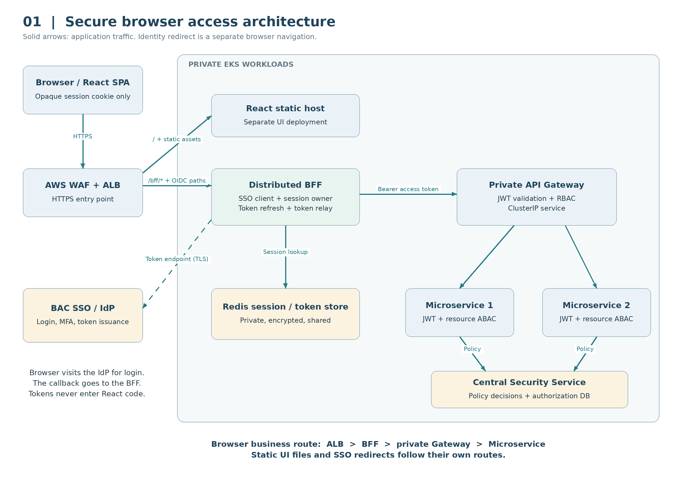
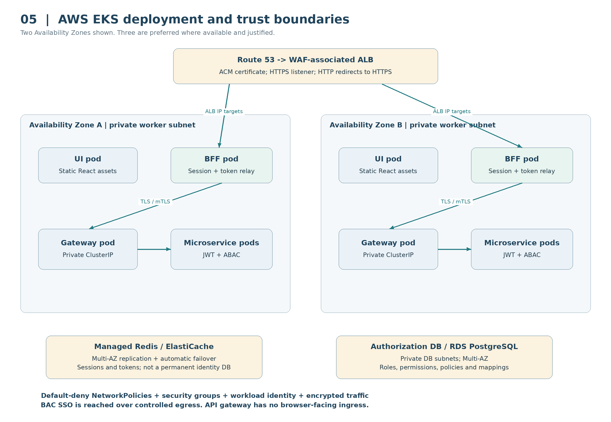
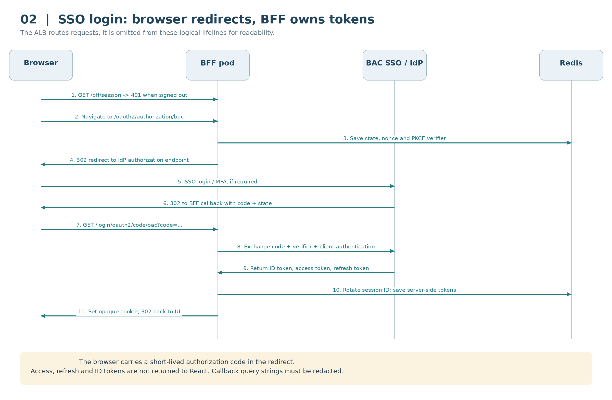
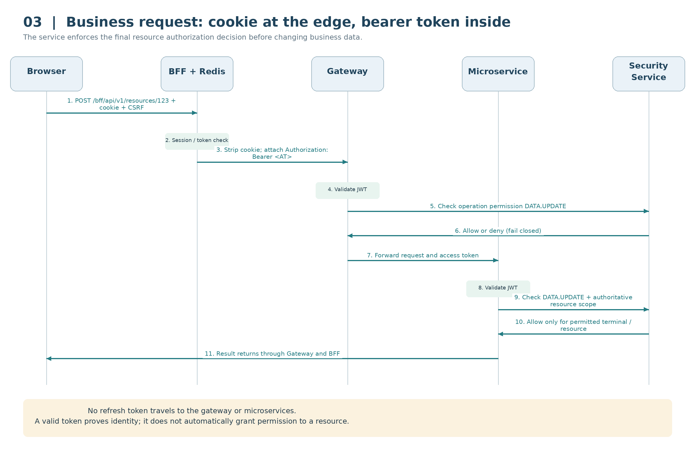
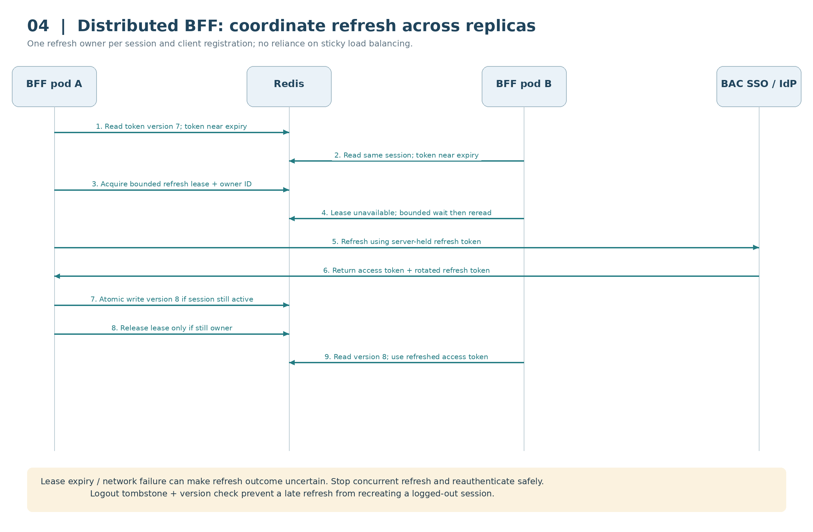
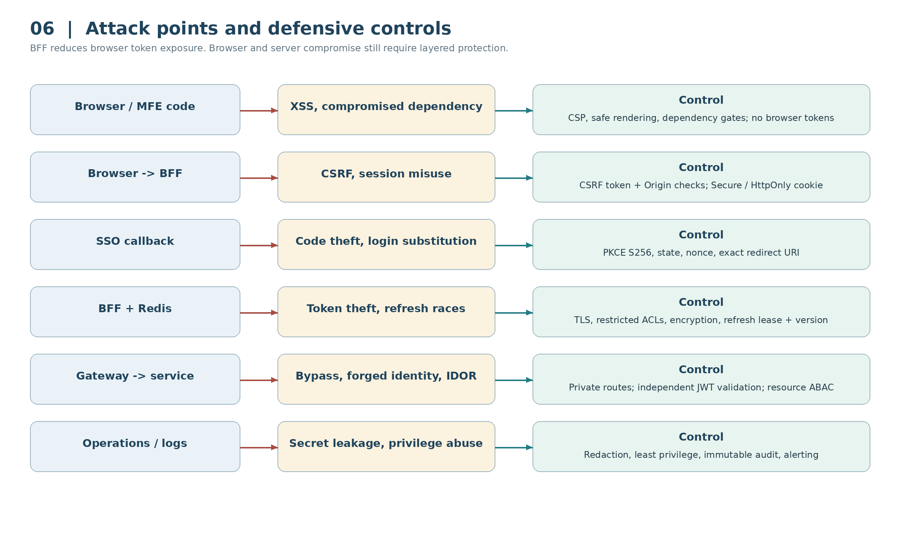

# AOBP - Centralized SSO, Authentication and Authorization

**BFF-based target architecture | AWS EKS | Proposed design | 2 November 2026**

## 1. Objective and introduction

Establish one clear, secure authentication and authorization architecture for AOBP. BAC SSO owns authentication and user lifecycle. AOBP keeps OAuth tokens on the server and applies business permissions consistently across Microservice 1, Microservice 2 and future services.

### The decision in plain language

The React application is the screen the user operates. The Backend for Frontend (BFF) is its trusted server-side companion: it signs the user in through BAC SSO, keeps their tokens safe, and calls backend APIs for them. The browser receives a random session reference, like a claim ticket, rather than an API access token. The private API Gateway directs approved backend requests to the appropriate microservice.

### Scope and source alignment

This rewrite is based on the supplied 10-page AOBP Centralized SSO, Authentication and Authorization PDF. It retains its Objective, High-level architecture, Implementation Approach, Authentication Runtime, Gateway RBAC, Central Security Service, Resource-Level ABAC and Authorization Database topics. The referenced Markdown attachment was unavailable, so its exact contents and formatting have not been verified.

### What changes from the reviewed design

| Reviewed PDF | Revised design |
| --- | --- |
| SPA registered as OAuth client | BFF registered as confidential OIDC client |
| SPA receives and retains access tokens | BFF receives tokens; browser holds opaque cookie |
| Browser sends bearer token to gateway | Browser calls BFF; BFF relays token privately |
| Browser-led token handling | Shared server-side session and controlled refresh |
| Gateway and central authorization | Retained, with independent service enforcement |

No local user accounts: AOBP does not create passwords or become a second identity directory. Minimal session claims and issuer/subject references are permitted for runtime security and audit. Authorization configuration and access-scope grants remain AOBP responsibilities.

## 2. High-level architecture

Decision: place the BFF behind the AWS Application Load Balancer (ALB), and before the private API Gateway on the browser business path. Both run in private EKS worker subnets. The UI remains a separately deployed React microfrontend application, exposed through the same origin as its BFF.



Figure 1. Browser business traffic passes through the BFF before the private gateway. Static assets and IdP redirects use separate routes.

The ALB is the first network entry point. The BFF is the first application component that handles browser authentication and protected API calls. The API Gateway is the internal API entry point after the BFF. These are distinct responsibilities, so the answer depends on which boundary is being discussed.

## 2.1 Components, responsibilities and benefits

| Component | Responsibility |
| --- | --- |
| React SPA / MFE | Render screens; check session; submit same-origin requests and CSRF header. No OAuth library token cache. |
| BAC SSO / IdP | Authenticate users, MFA, identity attributes and group lifecycle. Either direct BAC IdP integration or approved Keycloak federation. |
| AWS WAF + ALB | Filter and balance HTTPS traffic; route static files, BFF routes and OIDC callbacks. No business RBAC. |
| BFF replicas | Confidential OIDC client, session lifecycle, token refresh, allowlisted proxy and token relay. |
| Redis | Shared sessions, login transaction state, authorized-client tokens, refresh coordination and logout state. |
| Private API Gateway | Validate API tokens, apply route/operation RBAC, throttling and internal routing. |
| Central Security Service | Resolve trusted entitlements, map roles, evaluate versioned RBAC/ABAC policy. |
| Microservices | Validate tokens independently; enforce resource access and business rules before reads/writes. |
| Authorization Database | Persist roles, permissions, mappings, policies, scope grants and change audit. |

### Architecture principles

Identity-centric security: BAC authenticates; AOBP authorizes. Least privilege: deny unless a role and resource policy permit the action. Defense in depth: edge, BFF, gateway and services enforce different controls. Separation of concerns: UI, OAuth handling, routing and business logic evolve independently. Secure by default: private services, no browser tokens and no bypass route. Deployment-independent policy: the same decisions apply with or without Istio.

### Benefits and trade-offs

A compromised browser script cannot directly read server-held OAuth tokens. Shared Redis state lets any healthy BFF replica serve a session. A private gateway gives one controlled API boundary for multiple backends. Costs are one additional application hop, Redis dependency, CSRF protection and careful distributed refresh. The BFF reduces token theft exposure; it does not stop malicious JavaScript from performing actions through an active user session.

## 2.2 AWS EKS placement and routing



Figure 5. ALB balances to private pod IP targets. Gateway and business services remain private. Cross-zone service routing is allowed; replicas are not paired by zone.

| Layer | Deployment specification |
| --- | --- |
| Edge | Route 53 DNS, WAF-associated ALB, ACM certificate and HTTPS 443. Use an internal ALB for private-only BAC access; otherwise an internet-facing ALB in public subnets. |
| EKS ingress | AWS Load Balancer Controller reconciles Kubernetes Ingress into ALB listeners and target groups. Use target-type ip. The controller is not a request proxy. |
| Private compute | UI, BFF, gateway, security service and microservices use Deployments and ClusterIP Services. No public NodePorts or service LoadBalancers for internal APIs. |
| Private data | Managed Redis and RDS in private data subnets; security groups permit only necessary callers. |
| Encryption | TLS to ALB and HTTPS ALB targets. Use workload TLS/mTLS with certificate validation for internal calls; ALB HTTPS target encryption alone is not pod identity verification. |

## 2.3 Public URLs and exact request routes

Example origin: https://aobp.example.com. This is an illustrative hostname, to be replaced with BAC DNS. Separate UI and BFF deployments do not require separate browser origins. Same-origin ingress avoids cross-origin cookie and CORS complexity.

| Browser URL / method | ALB target / behavior |
| --- | --- |
| GET / and /assets/* | UI static host. SPA fallback applies only to UI paths. |
| GET /bff/session | BFF. Return display identity/capabilities or 401; never tokens. |
| GET /bff/csrf | BFF. Return session-bound CSRF token; Cache-Control: no-store. |
| GET /oauth2/authorization/bac | BFF. Begin login via top-level navigation. |
| GET /login/oauth2/code/bac | BFF. OIDC query-mode callback with code and state. |
| GET/POST /bff/api/v1/** | BFF. Session and CSRF checks, then allowlisted internal API proxy. |
| POST /bff/logout | BFF. CSRF-protected logout, invalidate session and server tokens. |
| GET /bff/ws | BFF WebSocket upgrade with session and exact Origin check. |

### Route transformation example

```text
Browser: POST https://aobp.example.com/bff/api/v1/resources/123
BFF:     POST https://api-gateway.aobp.svc.cluster.local/api/v1/resources/123
Gateway: POST https://microservice-1.aobp.svc.cluster.local/api/v1/resources/123
```

Ingress sends BFF and OIDC paths to the BFF with higher priority than the UI catch-all. The BFF strips only the /bff prefix and chooses a fixed configured destination. Browser-supplied URLs, arbitrary hosts and arbitrary proxy paths are rejected. Private service DNS is resolvable only on the controlled backend network.

### Why the gateway is after the BFF

This order makes the BFF the sole browser session owner and removes browser tokens from API calls. A gateway in front of a BFF can be valid when an enterprise edge gateway is mandated, but it adds another edge policy layer. It is not required for this recommendation. ALB supplies the edge routing; the Spring Cloud Gateway supplies private API routing and API policy.

## 3. Implementation Approach

### Step 1 - Register the BFF as the OIDC client

Register a confidential web client named aobp-bff with BAC SSO. Use Authorization Code flow with PKCE S256, even though the BFF also authenticates as a client. Keep the client secret or private key in Secrets Manager with controlled workload access. Never embed a secret in React assets.

| Property | Proposed value / rule |
| --- | --- |
| Client ID | aobp-bff |
| Redirect URI | https://aobp.example.com/login/oauth2/code/bac; exact match, no wildcard |
| Post-logout redirect | https://aobp.example.com/; explicitly registered |
| Scopes | openid plus only necessary profile/API scopes; request offline access only if required by provider policy |
| Client authentication | Prefer private_key_jwt where supported; otherwise managed and rotated client secret |
| PKCE / state / nonce | S256 challenge; one-time state and OIDC nonce; verifier stored server-side |
| Login response mode | Authorization code via query-mode GET callback; redact callback query logs |

### Step 2 - Register the protected API

Represent the AOBP protected API as a logical audience, for example aobp-api. The exact issuer, audience and scope syntax are IdP-specific. For Entra ID, use the resource application ID/identifier and exposed delegated scopes; Keycloak requires appropriate client scopes/audience mapping. Do not assume the literal sample value is accepted by every provider.

Microservices sharing this audience form one trust domain. Each still validates issuer, audience, signature, permitted algorithm, expiry and required claims. If service boundaries require distinct audiences, use separate resources and provider-supported token exchange/on-behalf-of flow; forwarding an unchanged token to a different audience is invalid.

### Step 3 - Configure IdP groups and attributes

BAC owns external group membership and user lifecycle. Use stable entitlement IDs scoped by issuer, rather than mutable display names. Where token group claims are incomplete, resolve through an approved server-side IdP API, with least-privilege access and explicit caching. Missing or unresolvable required claims must deny access.

## 3.1 Roles, permissions and scope

### Step 4 - Define AOBP roles

| Role | Meaning |
| --- | --- |
| ADMIN | Manage approved platform configuration, subject to segregation of duties |
| MANAGER | Perform management actions |
| OPERATOR | Perform permitted operational updates |
| VIEWER | Read approved operational information |

### Step 5 - Map external entitlements to roles

| IdP entitlement example | AOBP role |
| --- | --- |
| AOBP_OPERATIONS | OPERATOR |
| AOBP_MANAGERS | MANAGER |
| AOBP_VIEWERS | VIEWER |
| AOBP_ADMINISTRATORS | ADMIN |

Persist issuer, entitlement type and stable external entitlement ID. Display names above are examples only. Multiple matching groups can grant multiple roles; explicit deny policy and separation-of-duty rules take precedence where configured.

### Step 6 - Define business permissions

Use stable permissions such as DATA.READ, DATA.UPDATE, APPROVAL.SUBMIT and APPROVAL.APPROVE. They describe business actions independently of microservice names. The gateway obtains required permission from a trusted method-and-route mapping, never a browser header.

### Step 7 - Assign role permissions (RBAC)

An OPERATOR may receive DATA.READ and DATA.UPDATE. A VIEWER receives DATA.READ. An ADMIN does not automatically bypass terminal restrictions or approval separation. API scopes represent coarse delegated access; they do not replace AOBP business permissions.

### Step 8 - Apply resource scope (ABAC)

| User | Role | Trusted permitted terminals |
| --- | --- | --- |
| User A | OPERATOR | T1 |
| User B | OPERATOR | T2 |
| User C | OPERATOR | T1, T2 |

The role answers what the user may do. Scope answers where or to which records they may do it. Store scope grants as authorization data or obtain them from approved BAC attributes. Every final decision combines the permission and the authoritative resource context.

## 4. Authentication Runtime



Figure 2. SSO activity sequence. Network redirects carry the authorization code; tokens are exchanged directly between the BFF and IdP.

### Step-by-step login

1. React loads from its static host and calls /bff/session. A missing session returns 401 JSON. 2. The UI navigates to the BFF login endpoint. 3. The BFF stores a one-time login transaction in Redis and redirects to BAC SSO. 4. BAC authenticates the user with existing SSO/MFA rules. 5. The browser carries the authorization code to the BFF callback. 6. The BFF checks state, exchanges the code using the PKCE verifier and client authentication, and validates the ID token including issuer, audience and nonce. 7. It rotates the session identifier, stores tokens server-side and sets the session cookie. 8. It redirects to a validated local return path; React reloads session display information.

BAC credentials are entered at BAC SSO, not the BFF. If Keycloak brokers BAC, AOBP trusts Keycloak as the configured issuer; federation and logout behavior must be tested. Do not treat tokens from two issuers as interchangeable.

## 4.1 Cookies, tokens and browser protections

| Credential / data | Where it lives and where it travels |
| --- | --- |
| Session cookie | Browser cookie jar and BFF only. Contains opaque random session reference, never OAuth tokens. |
| Access token | Encrypted server-side authorized-client store; sent in Authorization header from BFF to gateway and services. |
| Refresh token | Server-side store; sent only from BFF to IdP token endpoint. |
| ID token | BFF authentication context. Not used as an API bearer token. |
| CSRF token | Session-bound value available to React and sent as X-CSRF-TOKEN on unsafe requests. Not an OAuth token. |
| Display user / capabilities | Minimal /bff/session response. UI hints only; server authorization remains authoritative. |

```text
Set-Cookie: __Host-AOBPSESSION=<opaque>; Path=/; Secure; HttpOnly; SameSite=Lax
Cache-Control: no-store
```

Do not set Domain on the __Host- cookie. Lax supports a normal top-level GET redirect from the IdP. If a provider requires cross-site POST callbacks, assess the cookie/transaction correlation design separately; do not simply remove SameSite protection. Rotate the session ID after login and sensitive privilege changes.

### CSRF and XSS controls

BFF checks a session-bound CSRF token on POST, PUT, PATCH, DELETE and logout. It also checks the expected Origin/Referer and Fetch Metadata as layered controls. GET requests must not change state. SameSite is an additional control, not the sole CSRF defense. The CSRF token endpoint and authenticated responses are never cached.

Serve a restrictive Content Security Policy, safe output encoding and approved script sources. Limit MFE remote origins and publish immutable versioned assets. Independently deployed MFEs execute with the shell privileges when same-origin, so treat their supply chain as part of the security boundary. HttpOnly prevents script access to the session cookie but does not prevent injected code from sending authenticated requests.

Same-origin requests need no permissive CORS policy. If cross-origin deployment becomes necessary, explicitly allow approved origins with credentials, never wildcard origin plus credentials, and re-evaluate cookie behavior. Keep bearer tokens out of browser storage, URLs, HTML, postMessage and logs.

## 5. Gateway RBAC Authorization



Figure 3. A protected update requires valid identity, operation permission and resource scope. Response arrows are simplified to show the return through the same proxy chain.

### Request processing in order

1. The BFF validates session, CSRF and the allowlisted route. 2. It retrieves the current authorized-client tokens, refreshing if necessary. 3. It removes browser Cookie, Authorization and user/role/permission headers; it creates its own Authorization: Bearer access-token header. 4. The gateway validates the token and maps HTTP method plus normalized route to a required business permission. 5. The Central Security Service evaluates trusted entitlements and role permissions. 6. Deny returns 403 before reaching the business operation. 7. If allowed, the gateway forwards to the fixed internal service. 8. The service validates the JWT again and evaluates resource-level policy before accessing or changing data.

Strip untrusted forwarding headers at the edge and trust proxy metadata only from known hops. Forward a validated or regenerated correlation/trace ID. Do not forward browser cookies, refresh tokens, ID tokens or raw permission claims as trusted identity headers.

## 5.1 Central Security Service evaluates RBAC

### Authoritative decision process

Validate tokens locally at gateway and services using trusted issuer metadata/JWKS, or approved introspection for opaque tokens. Pin the accepted issuer and audiences; restrict algorithms and reject unsigned tokens. Cache signing keys with controlled refresh for unknown key IDs. Do not download discovery/JWKS locations from untrusted token input.

The Central Security Service authenticates its callers and binds each decision to a validated subject: either it validates the relayed access token itself or accepts a protected, authenticated assertion from a trusted enforcement point. A plain subject field or X-User header is insufficient.

| Evaluation | Required result |
| --- | --- |
| Identity | Trusted issuer + subject, token validity and permitted client/token type |
| Entitlements | Trusted groups/roles resolved; unknown mandatory data causes deny |
| Role mapping | External issuer + stable entitlement IDs resolve approved AOBP roles |
| Permission | At least one allowed role grants the required operation, subject to deny rules |
| Policy | Current policy version, contextual restrictions and separation-of-duty checks |
| Decision | ALLOW or DENY with reason code, decision ID and policy version |

### Availability and policy freshness

Run at least two Security Service replicas across zones. Cache decisions only with a documented lifetime and key including issuer, subject, operation, relevant context and policy version. Proposed maximum cache lifetime is 30 seconds for normal operations; use fresh decisions for sensitive administration and approvals. These are design targets, not measured performance.

Publish policy-change invalidations and retain a bounded fallback TTL. A denied decision is 403. If the required policy cannot be evaluated because its dependency is unavailable, fail closed with 503; do not silently allow. If offline evaluation is needed, explicitly approve a signed versioned policy bundle and its maximum permitted staleness.

### Status contract

401 means no valid authentication; the UI may initiate a new login. 403 means authenticated but not permitted; refreshing a token does not solve it. 503 means a required dependency is unavailable. Return structured errors with code, safe message and traceId, without stack traces or credentials.

## 6. Resource-Level ABAC Authorization

### Example: identical role, different terminal

User A is an OPERATOR permitted for Terminal T1. They request an update to resource 123. The gateway permits DATA.UPDATE. Microservice 1 loads resource 123 from its database and discovers that it belongs to Terminal T2. The security policy denies access because T2 is outside the user scope. Final result: 403; no business change occurs.

| Check | Example outcome |
| --- | --- |
| Valid authenticated identity | ALLOW |
| RBAC: OPERATOR grants DATA.UPDATE | ALLOW |
| Authoritative resource terminal | T2, read from business data |
| Trusted user scope | T1 |
| ABAC: T2 in permitted terminals? | DENY |
| Final decision | DENY; no operation executed |

### Where enforcement belongs

The gateway cannot reliably make the final object-level decision because it does not own current resource data. Each service must enforce access before returning records or committing changes. The service constructs resource attributes from trusted business data and requests the shared policy decision. It never trusts a terminal field supplied only by the browser.

For lists and searches, apply scope filters in the query before pagination and aggregation. For exports and bulk changes, authorize the whole selection and every affected resource; enforce volume/rate limits. For creates, validate the target terminal against user scope before insert. For moves between terminals, require access to the source and destination plus the specific transfer permission.

### Prevent time-of-check/time-of-use errors

A resource can change terminal between checking access and updating it. Combine authorization with an optimistic version condition or appropriate transaction/locking strategy. If the version or scope changes, reload and re-evaluate. For approval workflows, enforce maker/checker separation in the same transaction boundary as approval state changes.

### Service-to-service calls

Where a backend acts for the user within the same API audience, relay the access token over a trusted channel and enforce policy again at the receiving service. For independent background work use a workload identity and least-privilege client credentials. Record the initiating user as audit context rather than pretending an expired user token is still valid.

## 7. Distributed BFF, Redis and token refresh



Figure 4. Shared state makes BFF replicas interchangeable; explicit refresh coordination prevents reuse of a rotated refresh token.

### Shared state is an implementation requirement

Store Spring Session security context, authorization-request state and authorized-client data in shared storage. Spring Session Redis alone does not prove that OAuth authorized clients are persisted correctly: configure an explicit shared repository/service or a session-backed repository with its full token state serialized safely. Default in-memory token storage is unsuitable across replicas.

Key token state by a strong server session identifier and client registration. Suggested fields: issuer, subject, registrationId, token expiry, encrypted access/refresh token, tokenVersion, sessionGeneration and status. Protect Redis with TLS, ACLs, private network access and encryption at rest; use application-level token encryption where required by the threat model. Restrict serializer types and never enable unsafe polymorphic deserialization.

Any replica may handle login callback or later requests because transaction and token state are shared. Sticky sessions are unnecessary for correctness. Existing WebSocket connections remain attached to the handling pod until reconnect; reconnect may reach any healthy replica.

## 7.1 Refresh algorithm and expiry while processing

### Before relaying an API request

Use a proposed refresh safety window of 60 seconds, subject to clock skew and measured request latency. If the token remains valid beyond the window, relay it. Otherwise acquire a bounded per-session/per-client refresh lease with a unique owner ID. Reload token state after acquisition: another pod may already have refreshed it. Only the owner calls the IdP with the current refresh token.

After refresh, atomically replace access token, refresh token if rotated, expiry and version only if the session is still active and the expected session generation/tokenVersion matches. Release the lease using compare-owner-and-delete. Other pods wait for a bounded interval and reread, then return a retryable error or require reauthentication. They must not refresh using a stale snapshot.

### Race and failure cases

| Condition | Required behavior |
| --- | --- |
| invalid_grant / detected token reuse | Invalidate authorized client and session; clear cookie; return 401. Do not loop refresh. |
| Temporary IdP failure | Return 503 if no usable token remains. Never bypass expiry or authorization. |
| Refresh timeout after possible rotation | Outcome may be ambiguous. Quarantine refresh state and require login rather than blindly reusing an old refresh token. |
| Lease expires while owner is running | Use renewal within strict limits and guarded writes. If ownership/outcome is uncertain, stop refresh and reauthenticate. |
| Redis unavailable | Fail closed for protected BFF requests. Do not fall back to pod-local tokens. |
| Logout races with refresh | Session tombstone/generation prevents writeback and session recreation. Retain it for the bounded in-flight refresh lifetime. |

### If the token expires during a downstream request

A resource server normally checks token validity when authenticating the request. Passing expiry later does not automatically cancel an already authenticated operation. A later call to another service validates the token again and may reject it. Long-running workflows must use durable jobs and appropriate workload credentials rather than keeping user tokens valid indefinitely.

A clear invalid_token response may trigger one controlled refresh and retry only when replay is safe. Read-only requests can normally be retried. A state-changing request requires a server-enforced idempotency key or proof it was rejected before execution. Never blindly retry a POST after a timeout, never retry 403 as token expiry, and never refresh in the gateway or microservices.

## 8. Logout, revocation and session policy

### Logout sequence

1. React sends POST /bff/logout with CSRF. 2. BFF marks the session inactive and increments its generation/tombstone before clearing token data. 3. Remove shared session and authorized-client state; close tracked WebSocket sessions. 4. Revoke the refresh token at the IdP where supported. 5. Expire the browser cookie with the same name/path. 6. If global SSO logout is required, use the provider-supported RP-initiated logout flow and approved return URI. Record success/failure without tokens.

Deleting the BFF session stops browser access through that BFF immediately. It does not automatically invalidate an already issued self-contained JWT at every service. Provider revocation semantics vary. For strict rapid revocation, enforce a distributed jti/sid/session-generation deny state at every enforcement point or use supported introspection/reference tokens. Set an explicit maximum propagation delay and test it.

### Starting policy values - subject to BAC approval

| Setting | Proposed initial value / rule |
| --- | --- |
| Access-token lifetime | 5 minutes; align with IdP capabilities and operational risk |
| Refresh safety window | 60 seconds plus tested clock-skew policy |
| Browser idle timeout | 15 minutes, tuned for operational usability |
| Absolute session lifetime | 8 hours; force reauthentication at limit |
| Refresh-token lifetime | Bound by approved IdP policy; session may not outlive it |
| Sensitive operations | Step-up / recent authentication where supported; fresh authorization |
| Revocation target | At most 30 seconds where rapid revocation is required; otherwise bound residual access by token expiry |
| Session identifier | Cryptographically random, at least 128 bits entropy |

Idle, absolute and token limits must be enforced server-side, not only by Redis TTL. Prevent sliding TTL from extending the absolute session limit. On account disable or role change, use provider events/back-channel logout where supported plus policy-cache invalidation. Keycloak and Entra group-change, token and logout semantics require provider-specific verification.

## 9. Third-party REST and WebSocket access

### Machine-to-machine REST does not use browser sessions

A third-party system uses its own registered confidential client. It obtains an access token from the approved IdP using client credentials, and calls a dedicated integration hostname through a restricted integration ALB/ingress to the gateway. This path does not go through the browser BFF because no browser session exists.

```text
Partner -> IdP token endpoint (client authentication)
Partner -> HTTPS integration.aobp.example.com/partner-api/v1/resources
Restricted integration ALB -> Gateway integration listener -> Microservice
```

Expose only a narrow route set and distinct machine scopes/roles on the integration listener or a separate gateway deployment. Use IP restrictions/private connectivity, quotas and mTLS where required. Authorize the application identity, not a fictitious user. Browser cookie authentication is rejected on this path. The browser BFF path must not be bypassable through broad partner routes; require appropriate client/application identity and grants.

### Delegated user integration

If an integration truly acts for a user, use an approved delegated/OBO/token-exchange mechanism with the correct audience and consent. Do not use stored usernames/passwords or pass the browser session to a partner. Outbound integrations receive destination-specific credentials, never arbitrary AOBP bearer tokens.

### WebSocket behavior

The browser opens wss://aobp.example.com/bff/ws. BFF authenticates the session cookie and validates the exact Origin before upgrade. It opens a controlled backend connection through the gateway with a server-added Authorization header. The browser WebSocket API cannot set arbitrary Authorization headers, so do not put OAuth tokens in query parameters.

A connection upgrade is authenticated once; every subscription/message still needs authorization. Cap connection lifetime, periodically recheck session/revocation and close connections on logout/expiry. Token refresh does not automatically reauthenticate an existing backend WebSocket. Define a reconnect/re-authentication protocol before token or session expiry. Configure ALB idle timeout, heartbeats, connection draining and gateway upgrade routing, then test reconnect across replicas.

## 10. Security risks and attack-point mitigations



Figure 6. Defense in depth across browser, login, session store and private API boundaries.

| Risk | Specific mitigation and residual exposure |
| --- | --- |
| XSS / MFE compromise | No browser OAuth tokens; CSP, encoding and dependency control. Malicious script can still use the active session. |
| Cookie theft / CSRF | TLS, HttpOnly/Secure cookie, session rotation, CSRF token and Origin validation. Browser/device compromise remains a risk. |
| Login substitution / redirect abuse | State, nonce, PKCE, exact redirect and allowlisted local return paths. |
| SSRF / token exfiltration | Fixed BFF proxy allowlist, blocked arbitrary destinations, restricted egress and sanitized redirects. |
| IDOR / excessive exports | Service resource ABAC, query scope, transactional recheck and bulk limits. |
| Refresh-token race / Redis compromise | Single refresh owner, versioned updates, private TLS Redis and encrypted token state. |
| Gateway bypass / forged headers | Private services, network restrictions and independent JWT validation; reject client identity headers. |

## 10.1 Deployment hardening and operations

### Kubernetes controls

Run UI, BFF, gateway and Security Service with at least two replicas spread over Availability Zones. Use topology spread constraints, readiness/startup/liveness probes, PodDisruptionBudgets and graceful termination. Start BFF at 2 replicas, gateway at 2 and Security Service at 2; these are availability baselines, not capacity sizing. Set CPU/memory requests and limits using measured load, and scale with HPA including latency/connection metrics where useful.

Use default-deny ingress and egress NetworkPolicies with an enforcing CNI configuration. Explicitly allow ALB target traffic, BFF-to-gateway, gateway-to-service, service-to-policy, BFF-to-Redis, service-to-DB, DNS and approved IdP/telemetry egress. Native NetworkPolicy cannot generally express an IdP FQDN; use supported egress controls/proxy and account for changing provider addresses. Security groups constrain ALB targets and data stores.

Apply non-root containers, read-only root filesystems where feasible, dropped Linux capabilities, seccomp and restricted Pod Security admission. Use EKS Pod Identity/IRSA rather than static AWS keys. Restrict control-plane access, Kubernetes RBAC and secret access. Pin supported image versions, scan dependencies and containers, sign artifacts, and promote identical images through environments. If Istio is used, enforce strict mTLS and workload authorization policies; JWT and business authorization remain required.

### Monitoring without leaking credentials

Propagate W3C trace context through BFF, gateway, services and policy calls. Log UTC time, traceId, service, route template, operation, outcome, latency, policyVersion and decisionId. Audit role/policy changes, auth outcomes, denied access, refresh failure, logout, exports and administrative actions. Minimize or pseudonymize issuer/subject according to retention policy.

Never log Authorization, Cookie, Set-Cookie, tokens, PKCE verifier, client secret or OIDC code/state query values. Redact at ALB/edge access-log handling as well as application instrumentation. Restrict access to unavoidable sensitive edge logs and set retention. Alert on 401/403 spikes, reuse detection, refresh contention, Redis latency, policy timeouts and unexpected routes.

### Failure and DR behavior

Redis Multi-AZ failover is not lossless; a recently rotated token/session write may be lost, requiring re-login. Do not promise zero RPO for sessions. RDS backups/PITR protect authorization configuration. For on-prem primary and AWS DR, reproduce the same trust boundaries and issuer configuration, promote policy/business data under the DR plan, and prefer fresh SSO sessions after failover. Never assume active Redis sessions can be transparently moved across sites.

## 11. Authorization Database

Retain the source design principle: authorization storage is independent of application/microservice registration tables. One AOBP application can share business permissions across services. Endpoint/permission mappings remain version-controlled configuration, or governed policy data when dynamic changes are required.

| Entity | Key fields and constraints |
| --- | --- |
| AOBP_ROLE | role_code PK, description, enabled, policy_version |
| PERMISSION | permission_code PK, description, enabled |
| ROLE_PERMISSION | role_code FK + permission_code FK; composite PK |
| IDP_ROLE_MAPPING | mapping_id PK, issuer, entitlement_type, entitlement_id, role_code FK; unique mapping tuple |
| ACCESS_SCOPE_GRANT | issuer + subject_id or entitlement reference, scope_type, scope_value, enabled; explicit uniqueness |
| POLICY | policy_id PK, policy_version, action, resource_type, rule, enabled, approval metadata |
| POLICY_AUDIT | audit_id PK, actor issuer/subject, operation, before/after reference, timestamp, trace_id |
| SESSION_REVOCATION (if required) | issuer + sid/jti or session generation, expires_at, reason; shared enforcement state |

### Boundary between identity and authorization

ACCESS_SCOPE_GRANT is not a local user account. It records who is entitled to which resource scope using an external issuer/subject reference. Prefer BAC-managed attributes/groups when they provide the necessary scope. Do not add passwords, duplicate user lifecycle or treat copied profile attributes as an authoritative directory.

Foreign keys and unique constraints prevent duplicate role assignments. Require controlled administration and audit for permission/mapping changes. Enforce segregation of duties for privileged policy changes. Use safe parameterized SQL, bounded queries and least-privilege database roles. Cache invalidation follows the committed policy version, rather than uncommitted administration events.

### Keep transient credentials separate

OAuth sessions and refresh tokens are transient security state in the protected BFF store. They are not columns in the role/permission schema. Audit records retain safe identity references and outcomes, never token values. Encryption-key access is separated from normal database administration where practical.

## 12. Implementation acceptance and rollout

| Acceptance test | Pass condition |
| --- | --- |
| Browser token inspection | No OAuth token in browser storage, app responses or URLs; OIDC callback contains code only |
| SSO callback / replica switch | Login initiated on pod A and callback on B succeeds using shared state; wrong state/nonce fails |
| Route enforcement | Browser cannot reach gateway/services directly or exploit UI catch-all to bypass BFF |
| CSRF / fixation | Unsafe request without valid CSRF fails; session ID changes after login |
| JWT validation | Wrong issuer/audience/signature, expired token and ID token as bearer are rejected |
| RBAC / ABAC | Missing permission denied; T1 user cannot read/update T2 record or export it |
| Distributed refresh | Concurrent calls across pods cause one refresh; no stale token overwrite or repeated rotation |
| Refresh + logout race | Late refresh cannot recreate logged-out session; revocation reaches all required points |
| Retry safety | POST timeout does not cause duplicate update; idempotency contract verified |
| Dependency failure | Redis/IdP/policy outage follows documented 401/503 behavior with no fail-open |
| WebSocket / third party | Origin/session rejection, revoke/reconnect behavior and isolated machine scopes verified |
| Resilience / tracing | Pod/AZ failover tested; complete trace without credential leakage |

### Delivery sequence

Phase 1: agree BAC IdP, origin, client/audience registration, session limits and revocation target. Phase 2: implement BFF login/session/CSRF and shared authorized-client persistence. Phase 3: enforce private gateway routes and service RBAC/ABAC, then distributed refresh and logout. Phase 4: add integration/WebSocket controls, perform attack-path tests and load/failover tests. Phase 5: pilot, monitor, then retire the SPA token path and its public OAuth registration if no longer used.

This document is a proposed target architecture and implementation specification. It does not claim that the current application or EKS cluster already implements or passes these controls. Final pod resources, throughput targets and DR objectives require measured workload and BAC service requirements.

## 13. Decision record and technical references

| Decision | Reason and consequence |
| --- | --- |
| BFF owns browser OAuth | Avoid browser bearer-token exposure; adds session/CSRF responsibilities |
| ALB -> BFF -> private gateway | Clear browser trust boundary; one extra hop for central API policy |
| Separate UI deployment, same origin | Independent releases with simpler cookies and routing |
| Shared Redis + explicit token repository | Replica independence; state-store outage requires controlled failure |
| RBAC at gateway, resource checks at service | Early deny plus authoritative object-level protection |
| Separate machine API entry | Client credentials and scopes without browser cookies |
| Re-login after uncertain refresh / DR | Prioritize credential consistency over invisible session continuity |

### Verified primary references - 2 November 2026

The architecture choices above are AOBP design decisions informed by the references below; they are not claims of automatic compliance. Product behavior must be verified for the selected supported Spring, EKS and IdP versions.

R1. IETF RFC 10017, OAuth 2.0 for Browser-Based Applications, section 6.1 | https://datatracker.ietf.org/doc/html/rfc10017

R2. IETF RFC 9700, Best Current Practice for OAuth 2.0 Security | https://www.rfc-editor.org/info/rfc9700/

R3. AWS EKS: Route application traffic with Application Load Balancers | https://docs.aws.amazon.com/eks/latest/userguide/alb-ingress.html

R4. AWS EKS: Network security best practices | https://docs.aws.amazon.com/eks/latest/best-practices/network-security.html

R5. Spring Security: Authorized Client Features | https://docs.spring.io/spring-security/reference/servlet/oauth2/client/authorized-clients.html

R6. Spring Cloud Gateway: TokenRelay filter and storage note | https://docs.spring.io/spring-cloud-gateway/reference/spring-cloud-gateway-server-webmvc/filters/tokenrelay.html

R7. Spring Session: Integration with Spring Security | https://docs.spring.io/spring-session/reference/guides/java-security.html

R8. OWASP: Cross-Site Request Forgery Prevention Cheat Sheet | https://cheatsheetseries.owasp.org/cheatsheets/Cross-Site_Request_Forgery_Prevention_Cheat_Sheet.html

Reference mapping: BFF responsibilities and separate static hosting: R1. OAuth protections and refresh policies: R2. ALB placement: R3. Network isolation: R4. Client token refresh/relay implementation: R5-R7. Browser CSRF safeguards: R8. Distributed refresh locking, topology, session limits and gateway ordering are explicit project design decisions requiring implementation and tests.
