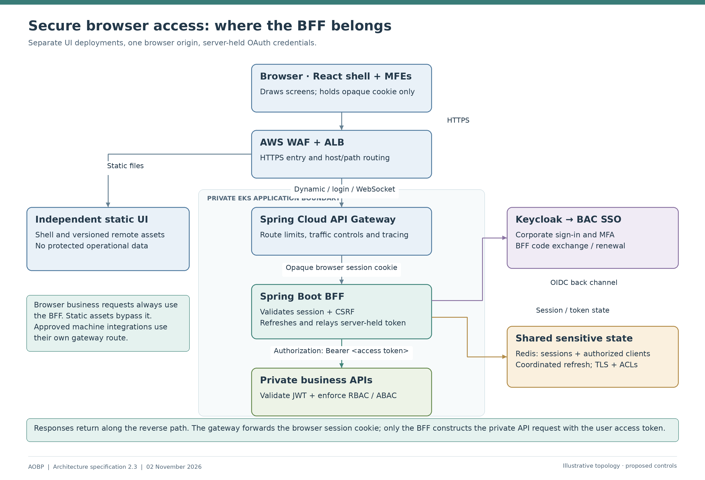
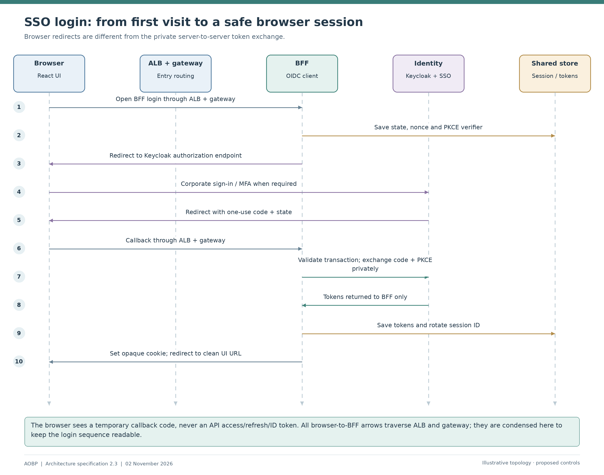
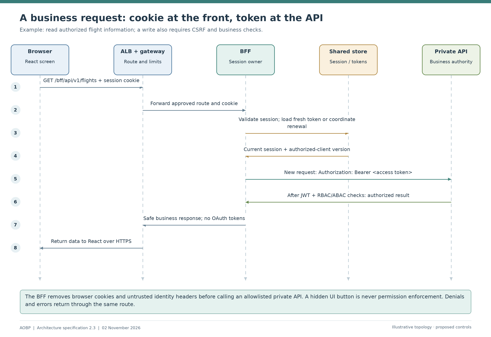
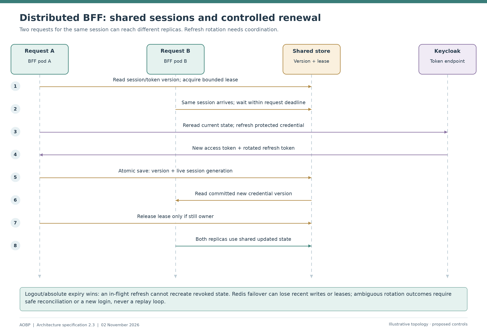
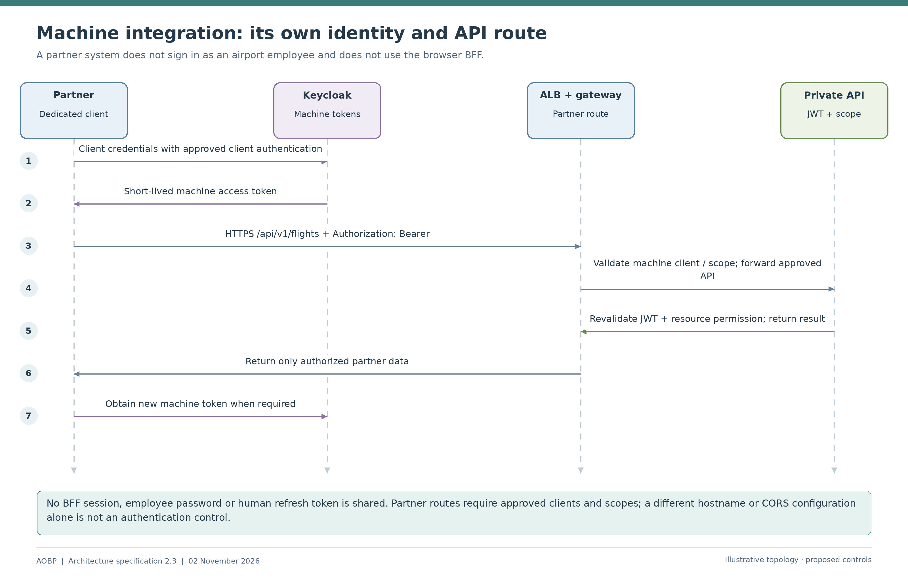
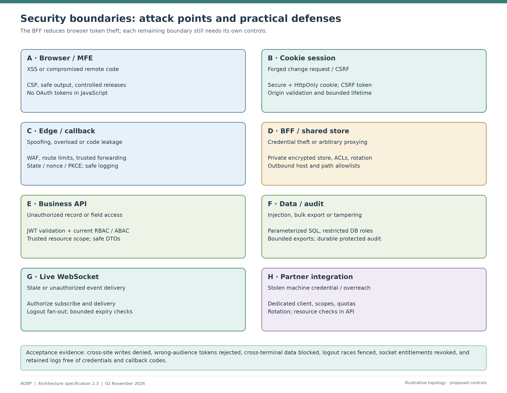
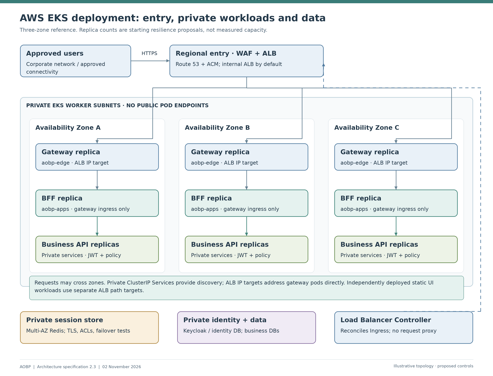

# AOBP Platform

Architecture, API and Engineering Specification

Version: 2.3 - Reviewed BFF placement, SSO request journeys and EKS security specification, 2 November 2026

Status: Architecture specification for implementation and validation

Audience: Business reviewers, architects, developers, platform engineers and security reviewers

**Document guide**

- 1. Design scope and delivery status
- 2. Architecture principles
- 3. Logical architecture
- 4. Microfrontend architecture
- 5. Gateway-neutral contract and Spring reference
- 6. Authentication and token lifecycle
- 7. Business authorization
- 8. WebSocket flow and scaling
- 9. API naming and resource modelling
- 10. Requests, responses and headers
- 11. Exceptions and error responses
- 12. Structured logging and audit
- 13. Reliability, security and event formats
- 14. Code structure, OpenAPI and quality gates
- 15. Standards reference register
- 16. Technology stack
- 17. Complete request tracing and error tracking
- 18. Kubernetes deployment and Helm specification
- 19. Docker and Docker Compose execution design
- 20. Data, audit and resilience
- 21. Acceptance and implementation sequence
- 22. Open decisions and provisional register
- 23. Official implementation references

## 1. Design scope and delivery status

### Introduction

AOBP brings separately deployed React microfrontends together as one browser application. Users sign in through BAC corporate Single Sign-On (SSO), then work with flight information, workflows and other business services. This specification explains who verifies the user, where credentials are kept, and the exact route taken by each type of request.

The selected browser architecture is **AWS Application Load Balancer (ALB) → Spring Cloud API Gateway → Spring Boot Backend for Frontend (BFF) → private microservices**. The BFF runs inside EKS, behind the gateway. It manages the browser session and all user OAuth tokens. Each business service validates its incoming access token and enforces its own business permissions and data restrictions.

Think of the ALB as the building entrance, the gateway as traffic reception, the BFF as the user's secure representative, and a microservice as the department that makes the final business decision. Reception can direct a visitor, but only the department can decide whether that visitor may change a particular record.

### Reading this specification

Start with sections 1-3 for the decision and the overall picture. Section 5 answers which URL goes where. Section 6 explains login, normal use, token renewal and logout in sequence. Section 13 shows attack points and their controls. Section 18 explains the AWS and Kubernetes deployment. The remaining sections preserve the platform engineering contracts from the source document.

**Revision note:** The current source already contains a BFF proposal. This revision retains all 23 main sections, clarifies that proposal, replaces the five referenced illustrations with newly drawn PNGs, and adds a machine-integration view and an attack-point view. It does not claim that the reviewer inspected a live deployment or that any implementation has been security-tested.

### How to read this document

Start with the introduction and Figure 1 for the overall design. Follow Figure 2 for signing in and Figure 3 for a normal business action. Figure 4 explains why several BFF instances can safely serve the same user. Figure 5 shows where the components run in AWS. The later sections give developers and operators the precise contracts needed to implement that simple story.

| Reader | Suggested route | What you will understand |
|---|---|---|
| Business or non-technical reviewer | Sections 1-3, Figures 1-7, decision table in 22 | Why this design is chosen and how a user reaches protected data |
| Application developer | Sections 4-14 | URLs, headers, session handling, API authorization and error contracts |
| Platform or operations engineer | Sections 16-20 | EKS placement, networking, availability, deployment and recovery |
| Security reviewer | Sections 2, 5-8, 13, 21-23 | Credential boundaries, threat controls and evidence needed for acceptance |

### The architecture in one minute

The user opens one AOBP web address. React draws the screens. For a business action, React calls the BFF through the load balancer and gateway. The BFF checks the user's server-side session, obtains a suitable access token and calls the private API. That API checks both the token and the business permission before reading or changing data. The result returns through the same components in reverse order.

**Decision:** place the BFF inside private EKS application subnets, behind the Spring Cloud API Gateway. Place the gateway behind the AWS ALB. Keep both as separate Kubernetes Deployments. This ordering is an AOBP design choice; OAuth standards define security responsibilities rather than requiring this exact gateway position.

| Everyday question | Clear answer | Detailed section |
|---|---|---|
| Who sees the password? | BAC corporate identity provider; AOBP never collects it | 6 |
| Who keeps the API tokens? | BFF, in protected shared server-side storage | 6 |
| What does React keep? | An opaque session cookie managed by the browser; no OAuth tokens | 4, 6 |
| Who is contacted first? | ALB first; gateway first for dynamic application requests | 3, 5 |
| Does every request pass through BFF? | Browser business/session requests do; static assets and machine APIs have distinct routes | 3, 5, 9 |
| Can a service trust the gateway alone? | No. Every API validates its token and business permissions | 7 |
| What if a BFF pod fails? | Another replica reads shared state; live sockets reconnect | 6, 8 |
| What if a token expires? | BFF coordinates refresh; services never accept expired tokens as a fallback | 6 |

### How this resolves the reviewer's access-token concern

An access token is like an API access pass. A signed JWT is normally readable by whoever possesses it; signing does not encrypt its contents. A bearer token can be used by its holder until it expires or an enforced revocation rule rejects it. Giving that pass to browser JavaScript increases the places it can be copied from. Here the browser instead receives a session reference: the BFF keeps the API pass on the server and attaches it only to approved private API calls.

This reduces token theft from JavaScript storage and centralizes refresh/logout handling. It still requires strong browser security, because malicious page code can issue requests using the user's session. HttpOnly cookies, CSRF protection, CSP, controlled microfrontend releases and service authorization work together.

### Security review concerns and design resolution

| Concern to resolve | Resolution in this specification |
|---|---|
| Browser-managed OAuth would expose API credentials to JavaScript | Register the BFF as the confidential client; React receives no access, refresh or ID token |
| The Markdown already describes a BFF but leaves the edge generic | Specify AWS ALB, Kubernetes routing, gateway placement and private service paths |
| Authentication and authorization responsibilities can be confused | Corporate IdP authenticates; BFF manages sessions; microservices enforce business authorization |
| Session sharing does not fully specify token sharing | Persist both session and authorized-client state; coordinate concurrent refresh across BFF replicas |
| Gateway operation checks might be read as sufficient security | Gateway checks are coarse; service RBAC, ABAC and transaction rules remain mandatory |

A token is a digital credential, not an encryption mechanism. TLS protects transport. A BFF reduces exposure of bearer tokens to browser JavaScript; it does not eliminate XSS, stolen-session or backend compromise risks. The reviewed Markdown already moves in the right direction. This revision makes its security boundary and implementation obligations explicit.

### Scope and interpretation

The reviewed 23-section structure, engineering tables and step-by-step explanations are retained. Sections 3, 5, 6 and 18 make the placement and EKS topology concrete. Any earlier SPA-owned token flow is superseded for this web application. Business roles, group mapping and resource-scope concepts remain applicable.

AWS EKS is the reference deployment described here. This does not change the wider AOBP working direction of on-premises primary and AWS secondary/DR. Section 20 explains how the same application boundaries carry across sites. Whether EKS is initially a production or recovery runtime is an environment decision.

This is an implementation specification and architectural decision, not evidence of an installed system. Example domains, resource budgets, timeouts and lifetimes need environment configuration and validation. No load test, running repository or deployed cluster was inspected.

### Plain-language glossary

| Term | Meaning in this document |
|---|---|
| Authentication / SSO | Proving who the user is through the corporate sign-in system |
| Authorization | Deciding what that identified user may do with a particular record |
| BFF | A server acting for the browser; it keeps API tokens and manages the browser session |
| Access token / JWT | A signed API credential; its claims must be validated, not merely decoded |
| Refresh token | A server-side credential used to obtain another access token |
| ALB / gateway | ALB distributes incoming traffic; the application gateway adds route and traffic controls |
| EKS / Kubernetes | AWS-managed Kubernetes; Kubernetes schedules and operates application containers |
| Pod / replica | One running instance of a workload; replicas provide multiple instances |
| Ingress / Service | Ingress declares entry rules; a Service provides a stable Kubernetes endpoint for pods |
| Redis | A fast shared store used here for sensitive, temporary session and token state |
| TLS / mTLS | Encrypted transport; mutual TLS also authenticates both communicating workloads |
| CSRF / XSS | Forged browser requests / malicious code running in a page; they need different defenses |
| RBAC / ABAC | Permissions from business roles / decisions using trusted user and resource attributes |
| PKCE | A login-code protection mechanism binding the exchange to the initiating OAuth client |
| RTO / RPO | Target recovery time / acceptable data-loss window; both require business approval and tests |

## 2. Architecture principles

| Principle | What it means in everyday language | Implementation consequence |
|---|---|---|
| Secure by default | Start with access closed | Explicit routes, permissions and network allowlists; deny everything else |
| Identity-centric access | Trust the approved identity system | Corporate SSO through Keycloak; no application passwords |
| Keep credentials server-side | The browser does not carry API credentials | BFF stores tokens; browser holds an opaque HttpOnly session cookie |
| Defense in depth | One failed check must not open everything | WAF, gateway, BFF, service token checks and resource authorization |
| Least privilege | Give each person and workload only its required access | Scoped permissions, audiences, IAM roles and database grants |
| Backend authority | A hidden button is not security | Service checks action, object, fields and current business state |
| Separation of concerns | Each component has one clear job | ALB load-balances; gateway protects/routes; BFF manages sessions; services own business rules |
| Independent deployment | Change a UI module without rebuilding the security layer | Separate shell, remote, gateway, BFF and service deployments |
| Stable contracts | Deployment changes should not break browser URLs | Same-origin relative BFF URLs and documented OpenAPI contracts |
| Failure containment | A dependency problem must remain bounded | Deadlines, controlled errors, bulkheads and no silent authentication bypass |
| Traceability and privacy | Explain what happened without leaking secrets | Correlated logs, durable audit, redaction and restricted telemetry |
| Build once, promote unchanged | Test the same release that will run | Signed immutable image digests and reviewed GitOps promotion |
| Recoverability | Recovery needs a tested process | Backups, writer fencing, identity recovery and measured DR exercises |

### Why this design was chosen

Keeping tokens in the BFF gives one controlled place to refresh, revoke and protect them. Separating the gateway from the BFF lets traffic controls evolve without making the gateway the owner of browser identity. A common external origin keeps React integration simple even though frontend and backend deployments are separate. Service-side checks protect business data even if a route or UI control is wrong.

The cost is an additional application hop, a sensitive BFF runtime and a highly available session store. These are deliberate trade-offs. Capacity planning, patching and outage tests are required; the pattern alone is not a production-readiness certificate.

## 3. Logical architecture

### Architecture overview



**Read the diagram from top to bottom.** Static UI files take the left path. Every browser business request takes the gateway and BFF path. The identity branch is used during login, refresh and logout; it is not a requirement to call the identity provider for every valid JWT.

| Component | Placement | Responsibility |
|---|---|---|
| React shell and microfrontends | Independent static workloads in EKS | Draw screens; call relative BFF URLs; display safe session/capability information |
| AWS WAF and ALB | Regional entry; access scope matched to audience | WAF request rules, HTTPS termination, host/path rules and healthy-target distribution |
| AWS Load Balancer Controller | EKS infrastructure namespace | Reconciles Kubernetes Ingress into AWS resources; does not proxy application requests |
| Spring Cloud Gateway | Private EKS pods, aobp-edge | Request limits, allowlisted routes, tracing and partner-token checks |
| Spring Boot BFF | Private EKS pods, aobp-apps | OIDC client, login callback, CSRF, session, token refresh and relay |
| Shared session/token store | Private managed Redis-compatible service | Sensitive transient session and authorized-client state for all BFF replicas |
| Keycloak identity broker | Isolated identity runtime and database | Federates BAC SSO and issues AOBP tokens; maintains required federation metadata |
| Central Security Service | Private authorization runtime | Resolves approved group-to-role mappings, permissions and policy decisions |
| Flight / Workflow / other APIs | Private EKS pods | Validate JWTs and enforce business permissions, ABAC and state changes |
| Business data and event services | Private managed data tier | Durable records, audit outbox and governed events |

### Picture key and trust boundaries

Blue means browser and entry routing; teal means the BFF session boundary; green means business services; purple means identity; sand means sensitive shared state. Solid arrows show requests or credential exchanges. Dotted arrows in the EKS view show configuration rather than application traffic. Numbered arrows show the order for that particular journey, not a global ordering across every figure.

The gateway is permitted to forward a browser cookie to the BFF. It does not own that session or receive the BFF's outbound user tokens in this topology. The BFF creates a separate authenticated request to the business service. All components that handle cookies or tokens remain security-sensitive.

### Exactly where the gateway and BFF sit

The **ALB is the first network entry**, and the **gateway is the first application component for dynamic AOBP traffic**. The BFF is behind it. The BFF is a separate Deployment and ClusterIP Service, not a component inside the React container or the gateway process. Start with one logical AOBP web BFF with multiple replicas, not one BFF per microservice. Split by distinct browser product or trust boundary only when there is a demonstrated need.

The reference gateway is Spring Cloud Gateway running in EKS. Amazon API Gateway is not an additional required hop. There is no extra Nginx ingress-controller data-plane hop in this design: the AWS Load Balancer Controller provisions an ALB that targets pods directly using IP targets. Kubernetes Services and EndpointSlices identify eligible pods; they are not always a physical extra hop on ALB IP-target traffic.

BFF-to-service requests use private Kubernetes service DNS over authenticated TLS. They do not leave the cluster and re-enter through the public ALB or gateway. A future internal east-west gateway is a separate decision; it is not needed for this reference flow.

### Placement decision and alternatives

There are two sensible places for an application gateway: before the BFF, to govern incoming traffic, or after it, to govern API traffic. AOBP selects the first because the shared gateway already has an edge role and must protect login, session, WebSocket and partner entry paths. OAuth does not mandate this ordering. The following comparison makes the local decision reviewable.

| Candidate | Benefit | Cost or constraint | AOBP decision |
|---|---|---|---|
| ALB → gateway → BFF → private APIs | One governed dynamic entry before the session handler; fits browser and machine routes | Additional hop; gateway must preserve OIDC, cookies and WS correctly | Selected |
| ALB → BFF → internal gateway → APIs | Central internal API routing and policy for BFF calls | Separate edge protections still needed; couples BFF requests to internal gateway availability | Valid alternative if internal API governance becomes a requirement |
| ALB → edge gateway → BFF → internal gateway → APIs | Additional independent API governance if explicitly required | Additional hop, latency and operational dependencies | Deferred until justified |
| ALB → combined gateway/BFF → APIs | Fewer deployments and hops | Session credentials and edge changes share one failure/release boundary | Not selected for this shared platform |
| ALB → gateway → APIs with browser-held tokens | Simple direct API access | Does not meet the requested server-side OAuth-token boundary | Superseded for the AOBP browser application |

The gateway before the BFF does not validate a bearer token on browser routes because the browser has none. It forwards the session cookie to the BFF, which validates it. On machine routes, the gateway does validate the machine bearer token. These are separate security chains, even when hosted by the same gateway Deployment.

### Three entry classes

1. **Static UI:** ALB → independently deployed shell or remote asset workload. No protected business data is embedded in public assets.
2. **Browser operations:** ALB → gateway → BFF → private business API. The same rule includes session discovery, login initiation, callbacks, logout and WebSocket upgrades.
3. **Approved system integration:** ALB → partner gateway route → private API, using a machine access token. It does not use a human BFF session.

Keycloak uses `identity.example.com` with independently managed authentication ingress. Its administrative and management endpoints remain private. Do not route Keycloak through a BFF that needs Keycloak to establish its own session. Identity cookies stay on the identity hostname; AOBP session cookies stay on the application hostname.

## 4. Microfrontend architecture

Reference composition: React shell plus independently published flight and workflow remotes, using Module Federation or an equivalent runtime loader. Confirm the bundler and federation implementation before selecting packages. Route-based independently deployed applications are an alternative if runtime federation complexity is not justified.

| Item | Ownership and contract |
|---|---|
| Shell | Navigation, layout, authentication state UX, design-system bootstrap, error boundaries, remote loader |
| Flight remote | Flight views and interactions; calls `/bff/api/v1/flights/**` |
| Workflow remote | Workflow/task views; calls its approved BFF contract |
| Shared browser SDK | Typed API client, CSRF handling, trace propagation, sanitized error reporting |
| Shared design system | Versioned UI contracts; defined compatible ranges |
| Session | One BFF session; no tokens stored by individual MFEs |
| Remote manifest | Maps remote name/version to immutable asset URL and compatible shell contract |

Example external paths: `/`, `/mfes/flight/1.4.0/remoteEntry.js`, `/mfes/workflow/2.1.0/remoteEntry.js`, `/bff/**`. The ingress sends MFE prefixes to their own static services; the shell fallback must not swallow `/bff`, `/mfes`, OIDC callbacks or health endpoints.

Release process: publish immutable remote assets, run compatibility tests, update the environment remote manifest, then invalidate only the short-lived manifest cache. Hash-named assets receive long immutable caching; the remote manifest receives short caching/revalidation. Keep previous remote versions during rollback and existing browser sessions. Avoid overwriting one `remoteEntry.js` URL for every release.

Share React through a tested compatible version contract; do not force every remote dependency into a global singleton. Use per-remote error boundaries so a failed workflow remote does not blank the flight UI. Add a remote-loading availability metric and a controlled reload prompt for incompatible sessions.

Same-page MFEs share JavaScript execution privileges. They are not security isolation boundaries. Restrict who may publish remote code, protect asset integrity, review dependencies, and apply CSP. Use a sandboxed separate-origin iframe only when actual isolation is required, with its own integration constraints. Do not promise SRI support without validating the selected remote loader.

## 5. Gateway-neutral contract and Spring reference

### External routing contract

All browser examples use `https://aobp.example.com`. Frontend images are deployed separately, but appear under this one origin through ALB routing. Separate deployment does not require separate browser origins or broad CORS.

| Host and path | ALB destination | Gateway destination | Security owner |
|---|---|---|---|
| aobp.example.com / and shell assets | UI static target | Not traversed | Asset pipeline; no operational secrets |
| aobp.example.com /mfes/** | Independent remote static target | Not traversed | Immutable remote assets and manifest governance |
| aobp.example.com /bff/api/** | Gateway | BFF REST | BFF session/CSRF; downstream resource authorization |
| aobp.example.com /bff/ws/v1 | Gateway | BFF WebSocket endpoint | Session, Origin and authorized messages/subscriptions |
| aobp.example.com /oauth2/authorization/keycloak | Gateway | BFF login initiation | BFF creates state, nonce and PKCE transaction |
| aobp.example.com /login/oauth2/code/keycloak | Gateway | BFF callback | BFF checks correlation and exchanges code |
| aobp.example.com /bff/logout | Gateway | BFF logout | CSRF-protected POST |
| aobp.example.com /bff/oidc/backchannel-logout | Gateway; IdP-restricted where feasible | BFF logout-token receiver | Signed OIDC logout token; no browser session requirement |
| aobp.example.com /api/** | Reject | No browser bypass route | Gateway/edge deny |
| api.example.com /api/v1/flights/** | Partner gateway target | Flight API | Client credentials token; gateway + API validation |
| identity.example.com approved OIDC routes | Identity ingress | Not through AOBP gateway/BFF | Keycloak and corporate IdP |
| Any public /actuator/** or admin route | Reject | No public management route | Private operator network and authorization |

Route priority must put known static/MFE and dynamic paths before the shell fallback. Unknown dynamic paths return an error; they must not turn into an HTML 200. The browser is not allowed to switch to partner APIs when its BFF session fails. Partner routes require machine credentials with explicit audience, scopes and client controls; a hostname or CORS policy alone does not distinguish a trusted caller.

### Request routing in everyday language

| What the person or system does | Request journey | What proves identity |
|---|---|---|
| Opens the home page | Browser → ALB → static UI workload → browser | No business authentication needed to download public application code |
| Clicks Sign in | Browser → ALB → gateway → BFF; browser then follows redirects to Keycloak and corporate SSO | Corporate SSO authenticates the person; BFF validates the returned login transaction |
| Returns from SSO | Browser → ALB → gateway → BFF callback; BFF → Keycloak token endpoint | One-use code, state, PKCE, client authentication and OIDC validation |
| Reads or changes a business record | Browser → ALB → gateway → BFF → API; response reverses this route | Cookie to BFF; access-token Authorization header to API; API business permissions |
| Receives live updates | Browser → ALB → gateway → BFF WebSocket; authorized backend events → BFF → browser | Session at handshake plus ongoing subscription/delivery authorization |
| Logs out | Browser POST → ALB → gateway → BFF; BFF invalidates shared state and coordinates identity logout | Existing session and CSRF token; logout scope is explicit |
| Partner system reads an approved API | Partner → ALB → partner gateway route → API | Dedicated machine token; no BFF cookie or human refresh token |

Only the callback delivers a temporary authorization code through the browser. API access tokens, refresh tokens and ID tokens stay server-side. Each returned API response contains business data, not these credentials.

### Gateway responsibilities

The gateway enforces route/method allowlists, body/header limits, deadlines, request correlation and applicable quotas. It proxies BFF session cookies but does not interpret them as JWTs. Login and callback endpoints are forwarded without requiring an already authenticated session. The BFF still validates those endpoints; 'reachable before login' does not mean unvalidated.

Partner routes validate bearer tokens and coarse scopes before forwarding. BFF routes do not require a browser bearer token. Do not enable OAuth login, token storage or ALB OIDC authentication as a second session owner alongside the BFF. Avoid overlapping redirection or logout rules.

Strip browser-supplied identity headers such as X-User and X-Roles. Do not accept a browser Authorization header as a way to replace the token associated with the session. Sanitize forwarded-host/proto/client-IP information at trusted proxy boundaries. The BFF uses the configured external callback URL, not arbitrary request headers, to construct redirects. Preserve the external path through both proxies and test encoded-path and trailing-slash behavior.

Gateway access logs omit cookies, bearer headers and sensitive query strings, including OIDC code/state. Gateway quotas before session validation may be coarse network/route protections. Per-user quotas belong after trustworthy user identification; do not key them on an unvalidated cookie or client-provided username.

### Explicit BFF destination mapping

The BFF is an allowlisted application adapter, not an open proxy. The caller cannot provide a target URL, host, port or redirect destination. Preserve business query parameters only after validation. Never let a downstream redirect carry an access token to another host; disable automatic cross-host redirect following for credentialed calls.

| External browser contract | Fixed private destination | Credential on the private call |
|---|---|---|
| GET /bff/api/v1/flights | Flight API: /api/v1/flights | Server-held access token in Authorization header |
| PATCH /bff/api/v1/flights/{id}/operational-times | Flight API: same resource under /api/v1 | Server-held access token; validated If-Match |
| GET /bff/api/v1/tasks | Workflow API: /api/v1/tasks | Server-held access token for the approved audience |
| GET /bff/api/v1/session | Handled by BFF | No downstream API token returned |
| POST /bff/logout | Handled by BFF; approved IdP back channel if configured | BFF-held credentials only |

Apply object-ID and path validation before building an outbound URI. Never concatenate an unvalidated suffix into a destination. Rate limits after session validation use a trusted subject/session reference; pre-login limits use bounded network/route controls.

### Spring and replacement contract

Use Gateway Server WebFlux with Actuator, Micrometer and OAuth2 Resource Server for partner routes. Keep blocking database or policy calls out of reactive event-loop threads. BFF uses a separate Spring Boot application with OAuth2 Client and Spring Session. Pin a supported Spring Boot/Spring Cloud BOM combination during implementation; examples are not a request to reuse legacy versions.

Prefer explicit routes with stable IDs. Place WebSocket matching ahead of overlapping REST matching; use the selected release's supported WebSocket URI scheme and preserve upgrade headers. No business-resource policy belongs only in gateway configuration.

A replacement gateway must pass tests for callback paths, cookie attributes, CSRF forwarding, WebSocket upgrades, body limits, error contracts and trace context. Grafana provides monitoring; route changes use reviewed configuration and deployment. Gateway management endpoints stay private and read-only for routine monitoring.

## 6. Authentication and token lifecycle

### What each credential means

| Item | Purpose | Location | May React read it? |
|---|---|---|---|
| Corporate password / MFA evidence | Proves identity to BAC SSO | Corporate IdP interaction | Never collected by AOBP |
| Authorization code | Short-lived, one-use login exchange | Browser redirect to BFF callback | Appears transiently in callback URL; never used as an API token |
| ID token | Tells the BFF about completed authentication | BFF authorized-client/session state | No |
| Access token | Authorizes calls to the protected API audience | BFF store; Authorization header on private calls | No |
| Refresh token | Obtains a new access token | BFF server-side authorized-client store | No |
| Session cookie | Opaque reference to the BFF session | Browser cookie jar; BFF session lookup | No: HttpOnly |
| CSRF token | Proves a state-changing request came through the intended browser session | BFF session and safe CSRF response | Yes; it is not an API credential |

The session cookie is still a sensitive credential. HttpOnly prevents normal JavaScript reads but does not stop malicious JavaScript from making requests through an already logged-in browser. CSP, dependency security, output encoding and controlled MFE publishing remain necessary.

### Step 1 - Register the BFF for corporate SSO

Create one confidential OIDC client, for example `aobp-web-bff`, in Keycloak. Register exactly `https://aobp.example.com/login/oauth2/code/keycloak`, with exact approved logout redirects. Use Authorization Code with PKCE S256 plus confidential-client authentication. Prefer managed asymmetric client credentials where supported; otherwise keep a rotated client secret in AWS Secrets Manager with narrowly scoped access. Never place it in React, Helm values or Git.

Keycloak brokers the BAC identity provider using the agreed OIDC or SAML connection. The corporate provider owns credentials, MFA and user lifecycle. React is not registered as the OAuth client for this BFF-based web flow. Machine callers use separate clients. One logical protected API audience, `aobp-api`, is selected initially for the governed AOBP API trust boundary; every participating service explicitly validates it. Separate sensitive domains may require separate audiences and deliberate token exchange. Merely registering audiences does not make services secure.

### Step 2 - Load the separately deployed UI

The browser downloads the shell and MFE assets through ALB static routes. React calls `GET /bff/api/v1/session`. ALB sends it to gateway; gateway forwards it unchanged to BFF. With no valid session, the BFF returns a JSON 401. React displays a sign-in action. It does not receive an HTML identity login page inside a fetch response.

### Step 3 - Start login with top-level navigation

The sign-in action navigates to `/oauth2/authorization/keycloak`. BFF creates a login transaction containing state, nonce, PKCE verifier, expiry and an allowlisted relative return path. Store that transaction in the shared server-side session repository before redirecting. Another BFF replica must be able to complete it. BFF redirects the browser to Keycloak, which redirects to BAC SSO if necessary. Corporate credentials are entered only at the approved identity page.



### Step 4 - Complete SSO and exchange the code

After successful login, Keycloak sends the browser to the registered BFF callback with a code and state. The request again follows ALB → gateway → BFF. BFF checks the stored transaction, state and expiry, then exchanges the one-use code server-to-server using PKCE and client authentication. Validate returned ID-token signature, issuer, audience, nonce and timestamps using the OIDC library. Do not hand-roll the protocol.

The BFF receives tokens over its secured back channel, rotates the session identifier after authentication, and saves the session and authorized client. The browser receives only the session cookie and a redirect to a clean relative application URL. Disable raw access logging on the browser ALB as specified in section 17; redact callback query strings at gateway, BFF, analytics and error-reporting sources; set an appropriate Referrer-Policy and avoid third-party content on the callback response.

### Login sequence: who does what

| Step | Actor and action | What the reader should understand |
|---|---|---|
| 1 | Browser loads React and asks BFF for session status | Downloading the screen does not grant access to data |
| 2 | BFF returns 401 when no session exists | The screen offers Sign in; an API fetch does not become an invisible login page |
| 3 | Browser navigates to BFF login through ALB and gateway | BFF records a short-lived login transaction in shared storage |
| 4 | BFF redirects through Keycloak to BAC SSO | The password and MFA are handled by the corporate identity system |
| 5 | Keycloak returns a code to the exact BFF callback | The callback can land on a different healthy BFF replica |
| 6 | BFF validates the transaction and exchanges the code privately | Tokens are returned to the BFF over the back channel |
| 7 | BFF saves tokens and rotates the session identifier | Browser receives an opaque cookie and a clean application redirect |
| 8 | React obtains session/capabilities and a fresh CSRF token | The screen can now request authorized data; APIs still check every action |

### Step 5 - Protect the session and CSRF boundary

Use a host-only session cookie such as `__Host-AOBPSESSION`, `Secure; HttpOnly; Path=/`, with no Domain attribute. **SameSite=Lax is the selected compatibility choice for the shared pre-login/session cookie and top-level GET OIDC callback.** This is a documented relaxation from the stricter SameSite preference: an external IdP must return the correlation cookie to the callback. Do not use cross-site form_post with this assumption. If Strict is required, implement a separately bounded login-correlation mechanism and test the complete redirect chain. Never relax to None merely to make a broken route work.

Use the stronger `__Host-Http-` cookie prefix where the supported browser matrix enforces it; the examples retain `__Host-AOBPSESSION` for compatibility. Both require explicit Secure and HttpOnly configuration, host-only scope and Path=/. Because Path=/ also sends the cookie on same-host static requests, static workloads must ignore it, never log it and never treat it as permission to embed operational data in assets.

Set initial idle timeout to 30 minutes and absolute session lifetime to 8 hours, bounded by the IdP/refresh-token lifetime. These are AOBP proposals, not industry constants. A cookie can outlive its server record; the server always decides validity. Refresh, WebSocket heartbeats and background polling must not reset the absolute lifetime; define which genuine user activity extends idle time.

Expose `GET /bff/api/v1/csrf` as a no-store, same-origin CSRF bootstrap bound to the session. React sends the returned token in `X-CSRF-TOKEN` for POST/PATCH/PUT/DELETE, including logout. Keep CSRF protection enabled, validate exact Origin where applicable, and refresh the CSRF token after login/logout rotation. Use the supported Spring Security SPA integration for the selected version, including its deferred/masked-token behavior. No wildcard credentialed CORS; normal same-origin requests need none.

### Step 6 - Process an authenticated business request



1. React sends `GET /bff/api/v1/flights?terminalId=T1`. The browser automatically includes the AOBP session cookie over HTTPS.
2. ALB selects a healthy gateway pod. Gateway validates the route and request limits and forwards to a healthy BFF pod.
3. BFF resolves the session in the shared store, checks lifetime and session revocation, and checks CSRF for unsafe methods.
4. BFF obtains this session's authorized client, checks token freshness and performs a coordinated refresh if needed.
5. BFF maps the approved browser contract to the private Flight API. It removes browser cookies and untrusted identity/authorization headers, then sets `Authorization: Bearer <access-token>` and approved tracing headers.
6. Flight API independently validates signature, algorithm, issuer, `aud=aobp-api`, expiry/not-before and required client/scope constraints. An ID token is never accepted as an API access token.
7. The service resolves current business permissions and checks the requested action plus trusted resource attributes. For a list, authorized terminal scope is applied before pagination, counts and exports.
8. Service returns only authorized data. BFF shapes the browser response, strips unsafe downstream headers and returns via gateway and ALB. The access token never appears in the JSON response.

An access token goes downstream in an **Authorization header**, not a cookie, URL or JSON field. A refresh token never goes to a business service. No service calls the browser or BFF to refresh a token.

### Browser and server request example

These two requests represent the same user action at two different trust boundaries. Values below are placeholders, never real credentials.

```http
GET /bff/api/v1/flights?terminalId=T1 HTTP/1.1
Host: aobp.example.com
Cookie: __Host-AOBPSESSION=<opaque-session-reference>
```

After session validation, the BFF constructs a new private request. It does not copy the browser Cookie header downstream.

```http
GET /api/v1/flights?terminalId=T1 HTTP/1.1
Host: flight-api.aobp-apps.svc.cluster.local
Authorization: Bearer <server-held-access-token>
traceparent: <validated-trace-context>
```

For PATCH/POST/PUT/DELETE, React also sends its session-bound `X-CSRF-TOKEN` to the BFF. The BFF forwards only an allowlist of application headers and constructs authorization itself. All application hops use the transport controls in section 18. Redaction must apply to both HTTP examples in diagnostics.

### A simple example: one click, two different credentials

An operator clicks a flight in the React screen. The browser sends its session reference to the BFF through ALB and gateway. The BFF looks up the operator's session and privately retrieves the API token. It sends that token to Flight API, which checks identity, permission and terminal scope. The response contains the permitted flight information. The browser never receives the API token, and Flight API never receives the browser's session cookie.

| Event the user notices | What happens behind the screen | User-visible result |
|---|---|---|
| First visit | No BFF session; UI starts approved SSO navigation | Corporate sign-in, or immediate return if SSO is already active |
| Normal click | Session valid; access token fresh; service permits action | Requested authorized data appears |
| Access token near expiry | BFF refreshes under coordinated control before the API call | Usually no interruption |
| Session expired or refresh definitively rejected | BFF removes unusable state and returns a safe 401 | UI offers sign-in again; never loops silently |
| Authenticated user lacks permission | API returns 403 after its own checks | Clear access-denied message; no refresh attempt |
| Identity or session dependency unavailable | Bounded failure path; no credential bypass | Clear temporary-unavailable message with support reference |

### Step 7 - Run distributed BFF replicas correctly



Use Spring Session Data Redis for clustered HTTP sessions, including pre-login correlation. Configure an explicit OAuth2AuthorizedClientRepository/Service that persists access/refresh/ID-token state in a protected shared store associated with the session and client registration. Session storage alone does not prove authorized-client persistence. Avoid an in-memory repository and avoid sharing one user's tokens solely by username across unrelated sessions.

Session metadata includes session ID/reference, issuer+subject, createdAt, idle/absolute expiry, revocation/session generation and the authorized-client reference. Authorized-client data includes registration, token expiry, current encrypted credential values and a version. Redis-compatible storage uses TLS, private endpoints, encrypted storage, least-privilege ACLs and controlled administration. Protect credentials with application-level envelope encryption where required by the platform threat model; store wrapping keys in KMS. Verify backups, diagnostics and support tooling cannot expose raw tokens.

Any healthy BFF can serve the next REST request; no sticky session is needed. A live WebSocket still belongs to one pod. Keep long-lived socket state separate from shared HTTP session records.

### Step 8 - Refresh before expiry and coordinate concurrent requests

Use OAuth2AuthorizedClientManager with authorization_code and refresh_token providers and configured success/failure persistence handlers. Before an outbound API call, treat a token inside a proposed 60-second expiry safety window as needing refresh. Use a window suitable for request duration and clock skew; a fixed minute is not a guarantee for all workloads.

1. Acquire a bounded per-session/per-client refresh lease, then reread the authorized-client record.
2. If another pod already refreshed it, use the newer version.
3. Otherwise call Keycloak's token endpoint using the refresh token and BFF client authentication. Persist rotated refresh and access tokens together with a version-checked update.
4. Use an ownership-checked lease release and prevent stale holders overwriting a newer record. Lease expiry, pod death and rotating-token races require explicit tests; a basic SETNX lock alone is insufficient.
5. Bound waiting callers. A definitive invalid_grant/revocation invalidates the session. A temporary IdP outage produces controlled 503 when no usable token remains, rather than falsely treating the user as revoked.
6. A timeout after a refresh may leave its result unknown. Do not repeatedly replay an old rotating refresh token. Follow the selected IdP's documented reuse behavior; if safe reconciliation is impossible, require a fresh login.

### Refresh sequence: a plain-language example

Assume the person is still within the permitted session lifetime, but their short-lived API access pass is about to expire. The person does not need to type their password for every renewal. The BFF renews the pass privately, while keeping the browser cookie unchanged unless session policy requires rotation.

| Step | BFF and shared-store action | Failure behavior |
|---|---|---|
| 1 | Load this session's current token version and expiry | Missing or expired session returns 401; store outage returns controlled 503 |
| 2 | If refresh is needed, coordinate one owner and reread the record | Waiting requests have a bounded deadline |
| 3 | Owner asks Keycloak for new tokens using the protected refresh token | Definitive revocation requires login; transient outage does not imply revocation |
| 4 | Atomically save new access and rotated refresh tokens with a version check | A stale worker cannot overwrite newer state |
| 5 | All waiting callers use the committed new version | No refresh token is sent to a microservice or React |

Redis replication failover can lose a recent lease or token update. Version checks protect local writes but cannot cancel a token request already accepted by Keycloak. Therefore a Redis lease is not a promise of exactly-once refresh under every failure. Bound retries, test failover with refresh rotation, and require a new login when the credential outcome cannot be reconciled safely. A stricter exactly-once requirement needs an identity-compatible durable coordination design, not a longer lock timeout.

### Step 9 - Handle expiry during processing

JWT validation normally happens when each request arrives. If the token expires after a service has accepted a request, it does not automatically interrupt the running transaction. Long-running workflows use explicitly authorized durable jobs rather than keeping the user's token alive indefinitely. High-risk operations may recheck current permission/revocation immediately before commit.

If Flight API then calls Workflow API, Workflow API performs its own entry validation. A token accepted by the first service might now be expired at the second. Keep synchronous chains short and refresh with an adequate margin at BFF. Define client-credential identities for background jobs, or explicit token exchange for narrower delegated audiences; do not silently elevate a failed user request into a machine request.

A downstream 401 does not always mean expiry: issuer, audience or signature may be wrong. Never refresh on 403. For a confirmed authentication expiry, allow at most one refresh/retry for a safe read, or for a mutation protected by a durable idempotency contract. Do not blindly replay a command or distributed chain whose outcome may already be committed. Return an intelligible error and let the client reconcile operation state where the outcome is unknown.

### Step 10 - Logout, disablement and revocation

React submits CSRF-protected `POST /bff/logout`. BFF deletes the session and authorized-client state, clears the cookie, publishes a cross-replica socket-close/revocation notification and invokes supported IdP revocation/logout. Navigate the browser through approved end-session redirects if corporate SSO logout is intended. Define 'log out of AOBP' separately from 'log out of all BAC applications'.

Expose a dedicated POST receiver at `/bff/oidc/backchannel-logout`, registered exactly with the IdP. Gateway permits only that method and bounded form size; restrict network sources where feasible. This protocol endpoint is exempt only from browser CSRF/session requirements because it authenticates the signed logout token. It is not a general CSRF exclusion for `/bff/**`. Validate signature, issuer, audience, issued-at, required logout event, and sid or subject; reject a nonce claim and deduplicate replay using the logout token jti for its validity window. Persist the invalidation before acknowledging successful processing, and test IdP retry behavior.

Implement Keycloak back-channel logout with logout-token validation and a mapping from IdP session identifier to all affected BFF sessions. Subject-wide invalidation needs issuer+subject indexing. Avoid logging the index's raw identity data. Already issued self-contained JWTs may remain valid until expiry unless services perform current revocation/entitlement checks. A BFF logout is not instantaneous global JWT invalidation.

Propose five-minute access tokens and a maximum 60-second account-disable decision propagation target for protected actions, subject to security/business approval and test evidence. The shorter propagation target requires service-side current entitlement/revocation checks with bounded caches; JWT expiry alone cannot meet it. Privileged mutations fail closed when required fresh authorization data is unavailable. Rotating refresh tokens, socket closure and session TTL form part of the same tested lifecycle.

### Logout and refresh must not resurrect a session

The token save operation must check that the session still exists, has the same generation, is not revoked and has not exceeded its absolute expiry. A refresh started before logout must not recreate a deleted authorized-client record afterward. Use an atomic compare-and-save against the session generation; retain a bounded revocation marker where necessary for in-flight operations. Invalidate shared state before reporting local logout success, clear the cookie, then coordinate socket closure and IdP operations. A failed remote logout must not recreate a locally invalidated session.

### Step 11 - Preserve the no-local-user-accounts principle

AOBP stores roles, permissions, issuer-qualified external-group mappings, scope policies and audit references. It does not store corporate passwords or maintain a parallel editable employee directory. A BFF session is transient security state, not an application user account. Keycloak may retain federation metadata; this must be recognized explicitly in BAC's identity policy.

Use immutable issuer+subject and stable group identifiers. Resolve group overage, missing claims and lifecycle events through approved IdP mechanisms; absence of group data must not grant broader access. The Central Security Service maps trusted claims to AOBP permissions and terminal scopes. UI capability information is for display and never substitutes for backend checks.

## 7. Business authorization

| Layer | Checks |
|---|---|
| Edge | Network/request protections and coarse bearer scope for partner routes |
| BFF | Authenticated session, CSRF, approved routes and subscription controls |
| Flight API | Permission, object scope, field access and business invariant |
| Query layer | Authorized predicate before pagination/count/export |
| Workflow API | Current task eligibility, resource scope, claim/complete/reassign permissions |

Example permissions: `flight.read`, `flight.operational-time.update`, `flight.export`, `task.claim`, `task.complete`. Designer/publisher permissions are independent from operational privileges. A studio manifest declares required permissions but cannot grant them to users.

ABAC input: validated subject, current entitlements, resource airport/terminal/airline from the database, requested action, session assurance where needed, and current flight/task state. Flight terminal and identity headers from the browser are never authoritative. Effective list scope is authorized scope intersected with requested filters. Deny by default.

Reference interface: `FlightAuthorization.checkCanRead(subject, flight)` and `checkCanUpdate(subject, flight, requestedChanges)`. Implement initially with tested Spring policy classes or an OPA adapter. For polyglot reuse, distribute versioned policies to local evaluators. Supply dynamic resource data from the owning service. Define freshness bounds; deny protected actions if necessary policy/entitlement data is unavailable or stale.

Recheck update invariants under transaction/optimistic locking. A permission allow does not override an invalid business state. Use idempotency for retried commands. Do not automatically retry non-idempotent mutations at the gateway.


### Central Security Service and a simple worked example

The Central Security Service is the shared policy decision capability; services remain enforcement points. It owns authorization configuration, not corporate authentication. Gateway may use cached coarse operation mappings for partner routes. Browser BFF routes rely on BFF session checks; the private API always performs the authoritative business check. An authenticated private service call must not be treated as authorized just because it originated in the cluster.

Example: User A belongs to BAC Operations, maps to OPERATOR, and may work on Terminal T1. Updating a T1 flight requires both flight.operational-time.update and a matching terminal scope. Updating a T2 flight returns 403 even when the request passed ALB, gateway and BFF. Changing terminalId in the browser request cannot change the trusted terminal read from the flight database.

Permission mapping uses business capabilities rather than one permissions table per microservice. A logical API audience is still registered with the IdP. Absence of an application-owned microservice registration table does not exempt APIs from client registration, audience checks or workload identity.

Central policy availability is an operational concern. Use versioned policy/config caches or local evaluators where appropriate; define freshness explicitly. Do not silently allow writes when the security service is unavailable. Record deny decisions and policy version without copying tokens or full identity profiles into logs.

## 8. WebSocket flow and scaling

Browser connects to `wss://aobp.example.com/bff/ws/v1` after login. The gateway proxies the upgrade; BFF authenticates the HTTP principal, validates Origin, and associates the connection with the session. With Spring STOMP security, send CSRF in CONNECT and authorize destinations/messages. Native WebSocket requires equivalent application controls.

On `SUBSCRIBE`, authorize the topic/resource against current scope. On event delivery, ensure recipients remain entitled, including role changes and changes to a flight's terminal/airline. Never broadcast all airport events and rely on React to hide them. Client-supplied destinations are not authorization evidence.

Flight API commits update + outbox record. Relay publishes a versioned event with event_id/business key. BFF receives it, finds authorized local subscriptions, and sends a minimal permitted payload. Use event ID and resource version to deduplicate and detect out-of-order changes. For complex payload security, send a scoped invalidation and let the browser re-fetch an authorized snapshot.

Multiple BFF replicas require fan-out to every replica holding relevant connections, or a broker relay/subscription architecture that accomplishes it. One Kafka consumer group delivers an event to one consumer, not every BFF. Do not use a single shared group as a broadcast design. Shared Redis sessions do not share live sockets or subscriptions.

Connections remain attached to their accepting instance. Native WebSocket generally needs no stickiness after upgrade; fallback transports may. Use graceful draining, connection/message limits, heartbeats, bounded buffers and slow-consumer disconnects. Reconnect with exponential backoff/jitter and obtain a fresh snapshot or replay cursor. Sockets are not a durable record of business state.

Map session expiry/logout to local socket closure across replicas; define bounded periodic checks because session notifications can be delayed. Server push/heartbeats must not keep a user logged in indefinitely. Define idle and absolute lifetime independently.

## 9. API naming and resource modelling

The rules in this chapter are AOBP platform conventions. They adopt HTTP, JSON, OpenAPI and Problem Details standards, but conventions such as URL versioning, camelCase fields and success envelopes are local choices, not universal industry mandates. MUST indicates an acceptance requirement; SHOULD allows a documented exception approved by the API owner and security/platform reviewer.

### URI standard

| Boundary | Canonical format | Example |
|---|---|---|
| Browser BFF API | `/bff/api/v{major}/{resources}` | `/bff/api/v1/flights` |
| Domain API, private or partner | `/api/v{major}/{resources}` | `/api/v1/flights` |
| Browser native WebSocket endpoint | `/bff/ws/v{major}` | `/bff/ws/v1` |
| BFF framework login endpoints | Framework-defined stable routes | `/oauth2/authorization/keycloak` |
| BFF framework callback | Exact registered redirect URI | `/login/oauth2/code/keycloak` |
| Health and telemetry | Private management endpoints | `/actuator/health/readiness`, `/actuator/prometheus` |
| Versioned MFE assets | `/mfes/{name}/{release}/...` | `/mfes/flight/1.4.0/remoteEntry.js` |

Hostnames differ by environment; path contracts do not. Use `https://aobp.example.com` as the illustrative browser origin and `https://identity.example.com` as the issuer host. Partner APIs may use `https://api.example.com` while preserving `/api/v1/...`. Internal DNS names and ports never appear in browser contracts.

Paths MUST use lowercase plural resource nouns and kebab-case for compound segments. JSON/query/property names MUST use lowerCamelCase. OpenAPI path parameters use `{flightId}`; runtime requests contain an actual identifier, not braces. Avoid trailing slashes and ambiguous alternate spellings. IDs are opaque, immutable, non-PII references: a flight number plus date is not a reliable unique flight identifier. UUID is the reference representation; choose the UUID generation variant during implementation.

Do not include a service framework, deployment location, user identity, password, bearer token or action verb such as `getFlights` in the URI. Scope is enforced from trusted identity and resource data; a path airportId is not evidence of access. Keep nesting shallow and use nested paths only where ownership is real. URI versions identify breaking API contracts, not application releases. Additive compatible changes stay in v1; breaking changes need a new major contract and coexistence/migration plan.

### Resource catalogue

| Method and path | Meaning | Success |
|---|---|---|
| `GET /api/v1/flights` | Authorized filtered flight collection | 200 |
| `GET /api/v1/flights/{flightId}` | One authorized flight representation | 200 + ETag |
| `GET /api/v1/flights/{flightId}/operational-times` | Read the operational-time subresource and concurrency token | 200 + ETag |
| `PATCH /api/v1/flights/{flightId}/operational-times` | Partial update of defined operational-time fields | 200 + new ETag |
| `POST /api/v1/flight-change-requests` | Create a governed operational change request | 201 + Location |
| `POST /api/v1/flight-change-requests/{requestId}/approvals` | Record an authorized approval | 201 + Location |
| `POST /api/v1/flight-exports` | Request an asynchronous export | 202 + Location |
| `GET /api/v1/operations/{operationId}` | Read asynchronous operation status | 200 |
| `GET /api/v1/flights/{flightId}/events` | Authorized durable business history, if exposed | 200 |

These examples define the reference Flight API surface; each operation is implemented only if the business capability exists. POST does not imply blanket approval to create flight records. GET/HEAD MUST be safe; never use GET to update state or log out. PUT replaces the documented representation; PATCH updates explicitly permitted fields; DELETE means the documented deletion semantics, not a hidden arbitrary command. Use subordinate command resources for approvals/exports with lifecycle and audit needs.

BFF routes mirror or compose domain operations. One example mapping is `/bff/api/v1/flights/{flightId}` to `/api/v1/flights/{flightId}`. Do not blindly forward all HTTP paths/headers. Composition endpoints such as `/bff/api/v1/flight-dashboard` may combine responses while retaining explicit schemas and partial-failure semantics.

### Filtering, pagination and sorting

Example: `GET /api/v1/flights?airportId=BRU&terminalId=T1&airlineCode=SN&scheduledFrom=2026-10-30T00%3A00%3A00Z&scheduledTo=2026-10-31T00%3A00%3A00Z&limit=50&sort=scheduledTime,flightId`.

Use RFC 3339 timestamps and a half-open time interval `[scheduledFrom, scheduledTo)`. `airportId=BRU` is an illustrative configured airport key; distinguish it from `airportIataCode` or `airportIcaoCode` if those attributes are exposed. Validate named filters; never accept raw SQL, column names or arbitrary expressions. Sort keys are allowlisted; prefix descending keys with `-`. Always append a unique tie-breaker.

Cursor pagination is the reference for potentially large flight collections. `limit` defaults to 50 and is bounded at 200 as an initial platform convention; confirm against payload sizes and load. Cursor is opaque, integrity-protected, expires under a documented policy, and binds filters, sort and applicable authorization context. Reauthorize every page. Do not silently upgrade requested scope. Reject incompatible/tampered cursors with 400. Avoid mandatory total counts on large queries; use an optional separately budgeted count when needed.

Changing flight schedules can move records between pages. A normal cursor over live data is not a snapshot guarantee. For consistent exports, use a server-side snapshot/as-of strategy and a job. Restrict query ranges, export volume and execution cost.


### Third-party REST integration: step by step



The partner is another computer system. It identifies itself with its own approved credential; it does not borrow an airport employee's browser session.


1. Register a dedicated machine client for the partner in the IdP; grant only required API scopes. Use asymmetric client authentication where supported and rotate credentials. Do not distribute a human refresh token or BFF cookie.
2. The partner authenticates to the token endpoint using client_credentials and requests the agreed API resource/scope. The resulting principal is the system, not an impersonated airport operator.
3. It calls `https://api.example.com/api/v1/flights` with Authorization: Bearer. ALB forwards to the partner gateway route; gateway validates the token and coarse scope.
4. Flight API validates the token again, identifies the approved client and enforces its airport/terminal/data scope and permitted operations. Machine identities must not inherit ADMIN merely because there is no human group claim.
5. The response returns through the gateway and ALB. The partner obtains a new machine token when needed; the BFF is not involved.

For outbound AOBP-to-partner REST, the owning integration service uses its own approved machine credential from the secret manager. Do not forward AOBP user tokens to arbitrary partner endpoints. Delegated user integration requires explicit federation/token exchange and a separate contract. Webhooks use a dedicated authenticated receiver and replay controls, not a cookie-session CSRF exception across all browser routes.

## 10. Requests, responses and headers

### Representation conventions

Use UTF-8 JSON with `application/json` for success responses; JSON Merge Patch uses `application/merge-patch+json`. Use a documented data envelope for business JSON responses. Errors MUST use the top-level Problem Details object and MUST NOT be wrapped in `data` or a second error envelope. Health probes, OIDC protocol responses, metrics, files, streams and 204/304 responses retain their protocol-defined representations.

Use lowerCamelCase fields, JSON booleans, numbers with documented bounds/precision, ISO dates and UTC RFC 3339 timestamps ending Z. Represent exact decimal monetary/measurement values as documented decimal strings when binary floating point would be unsafe; include units/currency. Enum values use UPPER_SNAKE_CASE and are explicitly documented. Define nullability per field: null means explicitly unknown/not available where allowed; absent means not included or not applicable according to that schema. Empty collections are `[]`, not null. Do not serialize ORM entities or expose internal columns.

Reference single-flight response:

```json
{
  "data": {
    "flightId": "f47ac10b-58cc-4372-a567-0e02b2c3d479",
    "flightNumber": "SN1234",
    "airportId": "BRU",
    "terminalId": "T1",
    "movementType": "DEPARTURE",
    "operationalStatus": "SCHEDULED",
    "scheduledTime": "2026-10-30T16:30:00Z",
    "estimatedTime": "2026-10-30T16:40:00Z",
    "actualTime": null,
    "version": 17
  }
}
```

Reference collection response:

```json
{
  "data": [
    {
      "flightId": "f47ac10b-58cc-4372-a567-0e02b2c3d479",
      "flightNumber": "SN1234",
      "scheduledTime": "2026-10-30T16:30:00Z"
    }
  ],
  "meta": {
    "limit": 50,
    "hasMore": true,
    "nextCursor": "opaque-integrity-protected-cursor"
  },
  "links": {
    "next": "/api/v1/flights?limit=50&cursor=opaque-integrity-protected-cursor"
  }
}
```

Collection items use an explicit summary schema, not an accidentally truncated detail schema. BFF emits BFF-facing links and its own documented DTOs; do not leak internal URLs. At the last page use hasMore=false, nextCursor=null and omit links.next. Do not repeat HTTP status, success=true or generic messages in every successful body. Use headers for request correlation; do not add timestamps and trace metadata to all business payloads unnecessarily.

### Headers

| Header | Rule |
|---|---|
| `Content-Type`, `Accept` | Validate supported media types; 415/406 where appropriate |
| `Authorization: Bearer ...` | BFF-to-API and partner API only; redact everywhere |
| `Cookie` / `Set-Cookie` | BFF browser session only; redact everywhere |
| `traceparent`, `tracestate` | W3C trace propagation on allowlisted boundaries |
| `X-Request-ID` | Sanitized opaque HTTP interaction identifier returned to caller |
| `Idempotency-Key` | AOBP application contract for specified POST operations, not a guarantee supplied by HTTP itself |
| `ETag` / `If-Match` | Optimistic concurrency for versioned resources |
| `Location` | Newly created resource or asynchronous status URL |
| `Retry-After` | Applicable rate-limit/unavailable responses; honour before retry |
| `Cache-Control` | Sensitive/session responses default no-store; caching must be explicitly designed |
| `WWW-Authenticate` | Preserve appropriate bearer challenges on API 401 |

Generate/validate X-Request-ID at the trusted edge; internal spans may carry that value for a synchronous chain. A trace identifies distributed execution and may include retries; request ID identifies the interaction. Do not use either as user identity or an idempotency key. Do not expose arbitrary baggage fields. The BFF may return a correlation header but MUST NOT forward Set-Cookie/Authorization from unrelated downstream services.

### Concurrency and PATCH

For the reference operational-times subresource, GET the subresource and receive a strong opaque ETag. PATCH requires If-Match and the documented merge-patch schema. Missing required precondition returns 428; stale If-Match returns 412. Return the new representation and new ETag on success. Never synthesize an ETag solely from a guessed client version. Authorize before exposing resource/version information.

The patch DTO allowlists fields such as estimatedTime. Explicitly reject forbidden and unknown input fields to prevent mass assignment. Define whether null clears a nullable field; reject null for fields that cannot be cleared. Use a transaction and version check so the conditional write and state invariants are atomic. Return 409 for genuine business-state conflicts, distinct from a failed HTTP precondition. GET flight detail may use its own representation ETag; do not assume it is interchangeable with a subresource ETag.

### Asynchronous operations and idempotency

POST export returns 202 and Location `/api/v1/operations/{operationId}`. Status resource uses QUEUED/RUNNING/SUCCEEDED/FAILED/CANCELLED with createdAt/updatedAt and an authorized result reference when ready. A failed job's status GET can still return 200 because retrieving status succeeded; its documented error field describes the job failure. Result download rechecks authorization, expiry and data scope; private signed URLs are short-lived and never logged.

For selected POSTs, require an Idempotency-Key. Scope persistence by caller identity/organization, operation and key; store a canonical request hash and result in durable storage with a uniqueness constraint. Concurrent duplicate execution must be fenced. Same key/same request replays the documented original outcome; same key/different request returns 409. In-progress duplicates return the existing operation reference or a documented conflict. Start with a 24-hour retention proposal and agree it against client retry horizons. Do not claim idempotency after expiry. Never use pod memory as the only store. Reauthorize a replay and avoid storing secrets or unrestricted response bodies in the idempotency record.

## 11. Exceptions and error responses

Adopt RFC 9457 Problem Details for HTTP APIs, with Content-Type `application/problem+json`. Standard members are type, title, status, detail and instance. AOBP extensions are code, requestId, traceId and optional errors. Problem type URLs identify stable documentation, not internal stack traces. They should resolve to controlled API documentation. The public hostname below is illustrative.

```json
{
  "type": "https://api.example.com/problems/validation-failed",
  "title": "Request validation failed",
  "status": 400,
  "detail": "One or more request fields are invalid.",
  "instance": "urn:uuid:8e6699b3-5c73-4c72-9f56-1c68568b0918",
  "code": "AOBP.VALIDATION_FAILED",
  "requestId": "req_01J_EXAMPLE",
  "traceId": "4bf92f3577b34da6a3ce929d0e0e4736",
  "errors": [
    {
      "location": "body",
      "pointer": "/estimatedTime",
      "code": "INVALID_TIMESTAMP",
      "message": "Use a valid RFC 3339 timestamp."
    }
  ]
}
```

For query/path/header errors, use location plus parameter name instead of pretending there is a JSON Pointer. Do not include rejected secret/PII values. instance is a unique error occurrence identifier; it need not be a fetchable URL. traceId is present only when known and safe to disclose. Clients branch on code/type, never localized title/detail. Keep titles stable for a problem type.

| HTTP | Code example | Trigger / handling |
|---|---|---|
| 400 | AOBP.VALIDATION_FAILED | Malformed JSON, invalid fields, filters or cursor |
| 401 | AOBP.AUTHENTICATION_REQUIRED | Missing/expired session or invalid bearer token |
| 403 | AOBP.ACCESS_DENIED | Authenticated but lacks action/scope |
| 404 | AOBP.RESOURCE_NOT_FOUND | Absent resource; also concealed inaccessible resource by agreed policy |
| 405 | AOBP.METHOD_NOT_ALLOWED | Include Allow header |
| 409 | FLIGHT.STATE_CONFLICT | Current business state disallows action |
| 412 | AOBP.PRECONDITION_FAILED | Stale If-Match |
| 413 | AOBP.PAYLOAD_TOO_LARGE | Request exceeds documented size |
| 415 | AOBP.UNSUPPORTED_MEDIA_TYPE | Unsupported request representation |
| 428 | AOBP.PRECONDITION_REQUIRED | Required If-Match absent |
| 429 | AOBP.RATE_LIMIT_EXCEEDED | Include Retry-After where known |
| 500 | AOBP.INTERNAL_ERROR | Unexpected application defect; safe generic detail |
| 502 | AOBP.UPSTREAM_RESPONSE_INVALID | Gateway/BFF receives invalid upstream response |
| 503 | AOBP.SERVICE_UNAVAILABLE | Necessary dependency unavailable/circuit open |
| 504 | AOBP.UPSTREAM_TIMEOUT | Proxy deadline exceeded waiting for upstream |

These are platform mappings, not proof all failures have one universal status. A domain invariant outside the current state may use a separately defined 422 contract; do not use 400/409/422 inconsistently for the same condition. Preserve actual HTTP status; never return 200 with success=false for an HTTP operation failure.

### Spring implementation pattern

| Component | Implementation responsibility |
|---|---|
| Controller | Validated request DTOs, ResponseEntity, documented headers and status |
| Application service | Use-case orchestration and transaction boundary |
| Domain | Typed business exceptions with stable codes, not raw HTTP coupling |
| Policy adapter | Typed authorization decision; trusted attributes |
| REST exception handler | `@RestControllerAdvice`, ResponseEntityExceptionHandler, Spring ProblemDetail |
| Security entry/deny handlers | Same JSON contract for filter-chain 401/403 |
| Gateway handler | Reactive error handler for routing/timeouts; separate security handlers |
| BFF downstream mapper | Preserve approved domain errors; transform unsafe/unknown payloads |
| WebSocket layer | Message-level error contract after upgrade |

MVC advice alone does not handle gateway reactive errors, security-filter failures or post-upgrade WebSocket errors. Implement those boundaries explicitly. Unexpected exceptions are logged once at the owning error boundary with the stack trace and returned as sanitized 500. Upstream layers record the dependency failure without repeating the full stack trace. Expected validation/business denials do not require ERROR stack traces. Do not catch Exception and return null or success.

ProblemDetail example for a business conflict (illustrative Spring code):

```java
@ExceptionHandler(FlightStateConflictException.class)
ResponseEntity<ProblemDetail> handleConflict(
        FlightStateConflictException ex) {
    ProblemDetail p = ProblemDetail.forStatusAndDetail(
        HttpStatus.CONFLICT,
        "The flight cannot be changed in its current state.");
    p.setType(URI.create(
        "https://api.example.com/problems/flight-state-conflict"));
    p.setTitle("Flight state conflict");
    p.setProperty("code", "FLIGHT.STATE_CONFLICT");
    // Common factory adds instance, requestId and current traceId.
    return ResponseEntity.status(HttpStatus.CONFLICT).body(p);
}
```

Use a shared ProblemFactory and catalogue, with independent implementations for MVC and reactive stacks. Do not pass ex.getMessage() through to the caller without an explicit safe-message contract. Make framework-generated body parse, validation, unknown route, 401/403 and method errors conform too. A proxy/load balancer may still emit a generic transport error; frontend clients must tolerate non-JSON failures safely rather than crashing during JSON parsing.

## 12. Structured logging and audit

### Canonical JSON log schema

Emit one JSON object per line to stdout/stderr, not multi-line text. Stack traces are escaped strings inside the JSON object. The following schema is an AOBP JSON export representation; OTel collectors map it to the OTel LogRecord's Timestamp, SeverityText, Body, TraceId, SpanId, Resource and Attributes. Dotted keys below are literal flat JSON keys. Do not mix a flat field and nested object with the same name in the backend index.

```json
{
  "timestamp": "2026-10-30T16:30:12.345Z",
  "severity": "INFO",
  "message": "Flight operational times updated",
  "event.name": "flight.operational_times.updated",
  "service.name": "flight-api",
  "service.version": "1.4.0",
  "deployment.environment.name": "production",
  "site.id": "onprem-primary",
  "trace_id": "4bf92f3577b34da6a3ce929d0e0e4736",
  "span_id": "00f067aa0ba902b7",
  "request.id": "req_01J_EXAMPLE",
  "http.request.method": "PATCH",
  "http.route": "/api/v1/flights/{flightId}/operational-times",
  "http.response.status_code": 200,
  "duration_ms": 43,
  "business.action": "flight.operational-time.update",
  "business.outcome": "SUCCESS",
  "resource.type": "flight",
  "resource.id": "f47ac10b-58cc-4372-a567-0e02b2c3d479",
  "airport.id": "BRU",
  "terminal.id": "T1",
  "policy.version": "flight-policy-7"
}
```

Always include timestamp, severity, message, event.name, service.name/version and environment. Include trace_id/span_id only when an active trace exists; never invent placeholder IDs. Include workflow.instance.id, task.id, event.id and causation.id when relevant. Actor reference is pseudonymous and restricted to justified events; never log email/name routinely. Business identifiers and terminal details also need access/retention review.

Use an allowlist for logged HTTP headers; exclude Authorization, Cookie, Set-Cookie, CSRF tokens, credentials and signed URLs. Do not log complete query strings, SQL parameters, raw request bodies, process variables or upstream payloads by default. Normalize untrusted strings, enforce length limits and prevent log injection. Schema validation should detect accidental field-type changes. Redact at source, then enforce collector/index controls.

| Severity | Use |
|---|---|
| DEBUG | Controlled diagnostics, off by default in production |
| INFO | Meaningful lifecycle/completion events; normal request summaries at selected boundaries |
| WARN | Recoverable degradation, exhausted client quota or notable expected failure by policy |
| ERROR | Unexpected defect or failed required operation needing investigation |

Avoid logging every method entry/exit and every normal authorization permit at INFO. Expected 4xx events are tracked through structured access/security metrics without treating them as application defects. A denied privileged action is always security-audited; it need not contain a stack trace. Add error.code, error.type and exception.stacktrace for unexpected faults only at the owner. Sampling diagnostics does not authorize sampling required audit events.

### Audit versus technical logs

Audit event fields: auditEventId, occurredAt, actor subject+issuer reference, executing service, action, resource reference, authorized airport/terminal scope, outcome/reason, policy version, application release, requestId/traceId and redacted change summary. Keep a named schema and version. Separate business effective time from audit recording time. Capture failed attempts separately from transactionally committed outbox records.

Audit writer privileges are append-oriented; readers are separately authorized. Protect retention, archival, integrity and privileged administration. Define legal/data-owner retention periods rather than inventing one retention duration for all datasets. Diagnostic log backend availability must not decide whether a transaction's required audit record is durable.

### Logging implementation

Provide language-specific adapters to the common schema: Logback JSON encoder/structured logging for supported Spring versions; standard JSON log adapters for Node/Python/Quarkus. Common standards do not require every service to depend on a Java library. Propagate correlation through instrumentation, MDC/context and asynchronous/reactive context; clear context after request completion to prevent cross-user contamination. Test Reactor and executor propagation explicitly; a thread-local-only approach is insufficient.

## 13. Reliability, security and event formats

### Timeout and retry budget

Reference starting budget for a normal interactive read: API response objective below 2 seconds under agreed load; API dependency budget below 2 seconds; BFF overall deadline 3 seconds; gateway deadline 4 seconds; browser deadline 6 seconds. These are initial proposals to validate, not established SLOs. Set specific connect/read/pool-acquisition deadlines inside that budget, reserve overhead and use separate budgets for exports/long-running actions. Never use a retry that exceeds the caller's remaining deadline.

Retry only documented transient failures for safe/idempotent operations, with bounded attempts, exponential backoff and jitter. Respect Retry-After. Do not retry validation, authorization, state conflict or stale preconditions automatically. Choose one retry owner to prevent gateway x BFF x API multiplicative attempts. No transparent replay of partial WebSocket messages. Use bulkheads and bounded pools/queues; a circuit breaker is for dependency failures, not ordinary business rejection.

### Request security controls

Validate body/header sizes, JSON nesting, collection limits, date ranges and upload/download limits. Use parameterized database queries; allowlist sort and patch fields. Never deserialize arbitrary polymorphic types from untrusted JSON. Restrict outbound hosts to prevent SSRF. Use exact CORS/origin policies only where necessary; common browser origin simplifies but does not replace CSRF. Return no-store on session/operational responses by default, and avoid user-specific shared-cache leakage. Reauthorize exports and event subscriptions. Threat-model XSS in shared-privilege MFEs, CSRF, object-level authorization, replay and injection.

### Attack points, risks and mitigation responsibilities



| Attack point / threat | Possible consequence | Required control | Owner and acceptance evidence |
|---|---|---|---|
| A. Browser or compromised MFE / XSS | Malicious code acts through the logged-in session | No OAuth tokens in JavaScript; CSP, safe output handling, controlled remote releases and dependency checks | UI/security: inject test payloads; inspect browser storage and network responses |
| B. Forged browser request / CSRF | Unwanted change or logout | Session-bound CSRF token, exact Origin checks, safe GET semantics and secure cookie attributes | BFF: cross-site mutation fails before API execution |
| C. Edge or callback / spoofing, code leakage | Stolen login transaction, poisoned redirect or entry overload | Fixed callback, state/nonce/PKCE, trusted forwarding, WAF/limits, query redaction and controlled logging | Edge/IAM: forged callback/Host denied; retained records contain no codes or credentials |
| D. BFF or token store / theft, SSRF, replay | Attacker obtains server-held credentials or calls arbitrary destinations | Private store, encryption/ACLs, workload identity, outbound host/path allowlists, rotation and bounded token lifetime | Platform/BFF: no arbitrary URL proxy; restricted Redis access and restore/failover tests |
| E. API / object or field authorization failure | Cross-terminal access or unauthorized change | JWT validation, current RBAC/ABAC, trusted resource attributes and DTO field allowlists | API owner: wrong audience, altered ID, terminal and forbidden field tests fail |
| F. Data / injection or audit tampering | Bulk disclosure, corruption or concealed changes | Parameterized SQL, query/export bounds, least-privilege DB roles and durable protected audit | Data/API: injection tests, export scope tests and audit integrity evidence |
| G. Live socket / stale entitlement | Events continue after logout or permission removal | Origin/handshake checks, per-subscription and delivery authorization, revocation fan-out and bounded rechecks | BFF/events: open sockets close and no unauthorized event is delivered within agreed bounds |
| H. Partner route / stolen machine credential | Automated access exceeds intended scope | Dedicated client/audience/scope, rotation, quotas and service resource authorization; mTLS if agreed | Integration/security: human web token and unauthorized partner scope are rejected |

The BFF addresses browser exposure of OAuth tokens. It does not cure compromised browser code, weak business authorization or a compromised server. The table assigns the remaining defenses to the component that can enforce them. Apply STRIDE during implementation review: spoofing, tampering, repudiation, information disclosure, denial of service and elevation of privilege; retain testable threats and decisions rather than treating a product list as a threat model.

### Event and WebSocket contracts

Use CloudEvents-style metadata when adopting CloudEvents, with specversion, id, source, type, subject, time, datacontenttype and data; do not call a custom envelope CloudEvents-compliant without validating the chosen transport binding. Reference event type `com.aobp.flight.operational-times.updated.v1`. Include resourceVersion and approved airport scope in data, plus correlation/causation metadata as defined extensions. Schemas are versioned and registered; consumers tolerate compatible additions and unknown optional attributes.

WebSocket message envelopes define protocolVersion, messageId, type, occurredAt and data. A message-level rejection contains code, safe message, relatedMessageId and request/trace reference where available; it is not an HTTP 400 after the connection has upgraded. STOMP ERROR framing/connection semantics must be followed rather than assuming every error can retain the connection. For application-level recoverable errors, use an authorized private error destination. Use standard close codes such as 1008 for policy violation, 1009 for oversized messages and 1011 for server failure as applicable; do not leak exception details. Define resynchronization after disconnect.

## 14. Code structure, OpenAPI and quality gates

Reference Java package boundaries:

```text
com.aobp.flight
  api              # controllers, request/response DTOs, exception advice
  application      # use cases and transaction orchestration
  domain           # flight rules, domain types and typed exceptions
  infrastructure   # repositories, outbox, external adapters
  security         # authorization facade and policy adapter
  observability    # schema adapter and business metrics
```

Keep the gateway reactive and independent; BFF can use the Spring web stack selected for session/WebSocket needs; Flight API can use Spring MVC/JPA. Do not add both servlet and reactive web starters casually. Shared dependencies supply contracts, error factories and telemetry conventions; they must not contain flight domain logic or centralize all services in one release cycle.

Maintain an OpenAPI document per BFF/domain API and AsyncAPI or equivalent schemas for event/WebSocket contracts. Pin a supported OpenAPI version in tooling (3.1 is the reference if all generators/validators support it). Document security, operationId, permissions, query bounds, DTOs, nullability, headers, all status codes, Problem Details and examples. Gate breaking changes in CI and generate TypeScript clients after contract approval. JWT bearer security applies to domain APIs; BFF declares cookie-session security and documents CSRF, with custom UI handling where tooling lacks support. Publishing OpenAPI does not authorize operations.

Example operationId names: listFlights, getFlight, updateFlightOperationalTimes, createFlightExport. Specify read-only fields and additionalProperties rules in schemas. Unknown input fields are rejected for security-sensitive commands; clients tolerate additive response properties. Enum additions may break exhaustive clients, so classify them explicitly in compatibility rules. Do not change units, timestamp meaning, default sort or authorization semantics silently.

| Gate | Evidence |
|---|---|
| URI/schema lint | Naming, version, operationId and examples conform |
| Contract compatibility | No unapproved breaking change; generated client integration passes |
| Negative API tests | Cross-terminal/object/field access denied; no mass assignment |
| Error consistency | Parse/security/gateway/domain failures follow correct contract |
| Concurrency | Two updates with one ETag cannot silently overwrite |
| Idempotency | Duplicate concurrent POST does not execute twice |
| Telemetry | Trace continuity, requestId and sanitized logs verified |
| WebSocket | Unauthorized subscribe/delivery, expiry, reconnect and fan-out tested |
| Capacity/reliability | Representative throughput, tail latency, timeout and outage behaviour measured |
| Deployment | Helm schema/security checks, migration compatibility and rollback verified |

Definition of done: OpenAPI updated, contract and negative tests passed, policies approved, bounded dependencies configured, dashboards/alerts/runbook provisioned, audit delivery verified, image scanned/signed with SBOM, and deployment/recovery evidence retained. No claim of enterprise readiness is based solely on using a named product or pattern.

## 15. Standards reference register

| Reference | Applied purpose |
|---|---|
| RFC 9700 OAuth Security BCP | OAuth threat model and protocol hardening |
| RFC 10017 Browser-Based Applications | BFF pattern and browser threat analysis |
| RFC 9110 HTTP Semantics | Methods, status, conditional requests and headers |
| RFC 9457 Problem Details | Standard HTTP API error representation |
| RFC 3339 timestamps | Interoperable date/time strings |
| RFC 7396 JSON Merge Patch | Documented partial-update representation |
| RFC 6585 | Additional statuses including 428 and 429 |
| W3C Trace Context | Cross-service trace propagation |
| OpenTelemetry Logs Data Model | Trace-correlated structured telemetry |
| OpenAPI | Machine-readable synchronous API contract |
| CloudEvents / AsyncAPI | Optional governed event/async contracts |

Official sources: https://www.rfc-editor.org/rfc/rfc9110 ; https://www.rfc-editor.org/rfc/rfc9457 ; https://www.rfc-editor.org/rfc/rfc3339 ; https://www.rfc-editor.org/rfc/rfc7396 ; https://www.rfc-editor.org/rfc/rfc6585 ; https://www.w3.org/TR/trace-context/ ; https://opentelemetry.io/docs/specs/otel/logs/data-model/ ; https://spec.openapis.org/oas/ ; https://cloudevents.io/ . These standards guide the design; AOBP-specific choices are explicitly identified above.

## 16. Technology stack

| Capability | Reference stack | Selection note |
|---|---|---|
| UI | React + TypeScript, independently built shell/remotes | Federation implementation depends on bundler |
| Static hosting | Nginx or equivalent static service | Separate image per frontend |
| Gateway | Spring Cloud Gateway Server WebFlux | Replaceable through standard contracts |
| BFF/API | Supported Spring Boot + Spring Security | Separate services and dependency sets |
| Identity | Keycloak + dedicated PostgreSQL | Corporate OIDC/SAML federation |
| Sessions | Redis-compatible store | Verify client compatibility, support and exact selected distribution's licence |
| Flight state/audit outbox | PostgreSQL | Independent roles and schemas; audit archive separate |
| Business events | Kafka or RabbitMQ | Choose one based on replay/fan-out needs; not both by default |
| Policy | Spring classes; OPA adapter where shared governance needed | Version and test policies |
| Metrics | Micrometer, Prometheus, Alertmanager | Private scrape endpoints |
| Traces | OpenTelemetry Collector + Tempo | Alternative Jaeger possible |
| Logs | Structured JSON, collector + Loki | OpenSearch alternative for richer search |
| Dashboard | Grafana | OIDC login, scoped operational access |
| Packaging | Docker, Compose for development; Helm for Kubernetes | Immutable images |
| Delivery | CI plus Argo CD or equivalent GitOps | Build once, digest promotion |

Open source is not the same as permissive licensing for every component. Review pinned component/image/plugin licences, including Grafana/Loki/Tempo distribution choices and the selected session store. Community software does not include a contractual support SLA. Produce an SBOM and licence inventory during delivery.

## 17. Complete request tracing and error tracking

**Telemetry path:** browser diagnostics pass through an authenticated, rate-limited BFF ingestion endpoint to the collector. Gateway/BFF/API traces go to OpenTelemetry Collector → Tempo; structured logs go to Loki; private service metrics are scraped by Prometheus. Grafana joins these views and Alertmanager routes operational alerts.

Use one documented instrumentation strategy per service. Avoid simultaneously enabling overlapping agents and Spring instrumentation that create duplicate server spans. Trace ingress/gateway, BFF and API separately and propagate `traceparent`/`tracestate` over approved boundaries. Enable sampling, exporters and log correlation explicitly; propagation alone does not export spans.

Browser SDK creates spans for navigation, remote load and approved API calls, tags MFE name/version, and reports sanitized JS errors/unhandled rejections and performance measurements. It is an implementation task, not an automatic capability of React. Initial navigation can precede SDK initialization; use navigation/resource timing rather than promising one browser trace covers every bootstrap request.

Browser telemetry credentials must not be secrets embedded in JS. Expose a restricted ingestion proxy with origin checks, rate/body limits, schema filtering and abuse controls. Do not expose a generic Collector receiver publicly. Propagate traces only to allowlisted destinations. Scrub query strings, user input and source-map payloads; protect private source maps used for symbolication. Treat browser-provided trace identifiers as untrusted correlation data, never authorization.

Structured fields: timestamp UTC, severity, service.name, service.version, deployment.environment, site, namespace, pod, route_id, MFE version where known, trace_id, span_id, request_id, event_id, workflow_instance_id, flight resource reference where permitted, error.code, outcome and duration. Avoid personal details and secrets. Gateway owns a sanitized request ID; client correlation values are length/format checked. No tokens/cookies/bodies by default.

HTTP spans capture transport status; domain events capture business outcomes. A 200 response can contain a business rejection and a 403 is not necessarily a software defect. Standard error response: stable error code, safe message, request/trace reference; detailed stack traces remain private. Track error fingerprints to group repeated defects.

Async events carry trace metadata plus event ID, causation ID and correlation/business-process ID. For fan-out or long delays, use trace links/new consumer traces rather than one unbounded trace. Metrics use bounded labels: service, route, operation, outcome. Never label by user/flight/trace/request ID or raw URL.

Telemetry has a defined loss policy. Sample traces; never present sampled traces as complete audit evidence. Tail/error sampling requires collector capacity and correct trace routing. Maintain durable audit independently. Bounded collector queues and retry storage prevent observability outages from exhausting application memory; monitor dropped telemetry.

### Browser-entry logging policy

The BFF telemetry endpoint validates schema/size and strips secrets before forwarding. Do not expose unrestricted public OTLP ingestion. The browser ALB carries OIDC callback codes in query parameters; this design disables access logging on that ALB until an approved capture/redaction design exists. Classic ALB access records contain the request URL; gateway redaction cannot sanitize a record already captured by ALB. Enforce `access_logs.s3.enabled=false` on the browser ALB in the reference configuration, and test any separately enabled enhanced logging destination before use. Use sanitized gateway/BFF access and security events for request audit. This is a deliberate visibility trade-off, not a claim that application redaction sanitizes ALB logs.

WAF logging and request sampling need separate controls: redact Authorization, cookies and sensitive query arguments, and disable sensitive request sampling or configure validated data protection. Partner ALB logs use a separately approved policy. Verify actual retained records during security acceptance; restrict access and retention on every logging destination.

### Dashboard provisioning specification

Version-control data sources, dashboard JSON, alert rules and permissions. Use stable data-source UIDs (`prometheus`, `loki`, `tempo`). Configure trace-to-log links using trace_id; log-to-trace derived fields; metric exemplars where instrumentation and backend support them. Use dashboard variables environment/site/service/route/release. Do not expose broad data-source query access merely because a dashboard has filters.

| Dashboard | Panels and drill-down |
|---|---|
| Platform overview | Service health, traffic, errors, p95/p99, deployment versions, saturation |
| Gateway | Per-route rate/latency/status, throttles, upstream failures, connections, event-loop pressure |
| BFF and identity | Session/login/refresh failures, session-store latency, revocation processing |
| Flight API | Endpoint latency, error codes, DB pool/waits, policy decisions, update conflicts |
| WebSocket | Active sessions, handshake failures, connection lifetime, messages/sec, delivery lag, disconnect reason, queue pressure |
| Browser/MFEs | Remote-load failures, JS errors, navigation/Web Vitals, API failures by release |
| Business operations | Flight-event freshness, overdue tasks, rejected updates, integration backlog |
| Audit/security | Denied actions, privilege/config changes and audit outbox age |

WebSocket connection duration is not message latency. Add application metrics/spans for message processing and delivery. In a microfrontend page, Web Vitals are page-level; attribute remote actions/errors separately rather than claiming every page metric belongs exclusively to one remote.

Starter PromQL templates (verify actual exported metric/label names):

```promql
sum by (routeId) (rate(spring_cloud_gateway_requests_seconds_count[5m]))

histogram_quantile(0.95,
  sum by (le, routeId) (rate(spring_cloud_gateway_requests_seconds_bucket[5m])))

sum(rate(http_server_requests_seconds_count{service="flight-api",status=~"5.."}[5m]))
/
clamp_min(sum(rate(http_server_requests_seconds_count{service="flight-api"}[5m])), 0.001)
```

Histogram buckets must be enabled. Prometheus scrape labels such as service must be configured consistently. Set low-traffic conditions for ratio alerts. Example triggers: sustained elevated 5xx with minimum traffic; p95 above agreed SLO; zero ready replicas; oldest outbox event over agreed threshold; rising event lag; dropped telemetry; certificate expiry; authorization service unavailable. Numerical thresholds are open decisions based on the workload. Route alerts to the correct support owner, with dashboard/log/trace links and runbooks.


## 18. Kubernetes deployment and Helm specification

### EKS deployment overview



The reference AWS footprint spans three Availability Zones where available. Figure 5 shows logical tiers across zones; it does not require a gateway, BFF and API request to stay within one zone. ALB uses at least two eligible subnets in different zones. Run worker pods in private subnets without public IPs. A private/internal ALB is the default for BAC staff access over approved corporate connectivity; use an internet-facing ALB only for an approved public audience. In either case, pod and database endpoints remain private. Internet-facing entry is not a prerequisite for SSO.

Route 53 supplies application and identity names; ACM supplies the external TLS certificate. AWS WAF is associated with approved ALBs. The Load Balancer Controller uses a least-privilege IAM role through an approved EKS workload-identity mechanism. EKS control-plane endpoint access is private/restricted. ECR, Secrets Manager, CloudWatch and other required services use VPC endpoints where practical; approved NAT/egress paths serve required external IdP endpoints.

### Data plane versus control plane

The platform team creates Ingress and ClusterIP Services. The controller reads those objects and manages ALB listeners, target groups and pod registration. For target-type ip, the ALB forwards directly to selected pod IPs, rather than first traversing a worker NodePort. The Ingress object and the controller are configuration/control components, not two application proxies in the request path. This distinction avoids drawing or operating duplicate ingress layers.

### Service and exposure specification

| Workload | Kubernetes object / exposure | Starting availability policy |
|---|---|---|
| Gateway | Deployment + ClusterIP; ALB IP targets | Minimum 3 pods across zones; HPA; PDB minAvailable 2 |
| BFF | Deployment + ClusterIP; gateway-only application ingress | Minimum 3 pods across zones; HPA; PDB minAvailable 2 |
| Shell and each remote | Independent Deployment + ClusterIP; ALB targets | Minimum 2 pods; immutable static asset versions |
| Flight / Workflow APIs | Independent Deployments + ClusterIP | Minimum 2 pods per service; scale from tested workload |
| Central Security Service | Deployment + ClusterIP | Minimum 2 pods; tested cache/freshness and fail-closed behavior |
| Keycloak | Supported HA deployment; isolated identity ingress | Follow selected release HA/database/cache guidance |
| Session store | Managed private Redis-compatible replication group | Multi-AZ failover; TLS/ACL/encryption; capacity and loss behavior tested |
| Business / authorization / identity databases | Private PostgreSQL services, distinct ownership/grants | Multi-AZ managed DB where selected; backup/PITR and restore tests |

Replica counts are initial resilience proposals, not capacity estimates or guaranteed SLOs. Three pods do not guarantee three-zone placement without topology rules and available nodes. A PDB constrains voluntary disruptions; it does not prevent failures or replace surge capacity. Test node/AZ loss and managed-store failover. Session loss may require reauthentication rather than loss of business data.

### What actually distributes a request

ALB distributes each new HTTP request among healthy registered gateway targets. The gateway resolves the BFF ClusterIP Service, which provides access to eligible BFF endpoints using the cluster's supported networking implementation. BFF resolves the fixed private API Service. Kubernetes handles pod replacement and endpoint updates; it does not authenticate the airport operator.

The three BFF replicas are interchangeable for HTTP because session, login-correlation and authorized-client state are shared. They do not each hold an independent login for the same browser. A WebSocket stays on the accepting pod until it closes; a reconnect is a new authorized handshake and can land on another pod.

### Namespace and network boundaries

Use aobp-edge, aobp-apps, aobp-identity and aobp-observability. Namespace names do not enforce isolation. Use a NetworkPolicy-capable CNI, default-deny policies, security groups and approved egress. Evaluate security groups for pods where useful; document their interaction with CNI network-policy mode and ALB source traffic.

| Allowed source | Allowed destination | Purpose |
|---|---|---|
| Approved client network | ALB 443 | Browser/approved partner entry |
| ALB security group | Static or gateway TLS application port | Only registered application targets and health checks |
| Gateway pods | BFF application TLS port | Browser dynamic routes; no BFF management API |
| Gateway pods | Approved business API TLS ports | Partner paths only |
| BFF pods | Flight/Workflow APIs, session store, Keycloak | Token relay, clustered session and OAuth back channel |
| APIs | Required policy service, own DB, broker | Authorized business execution |
| Telemetry agents | Private metrics/OTLP endpoints | Controlled collection |
| Each workload | Approved DNS and explicit infrastructure endpoints | Resolution, secrets and required service APIs |

Health-check rules are explicit exceptions. Give ALB a minimal 200-only readiness endpoint on the application listener, without build details or management controls. Management endpoints on a separate port remain available only to authorized probes/collectors/operators. A compromised frontend pod must not be able to reach Redis, databases or private APIs.

### TLS and trusted forwarding

Terminate external HTTPS at ALB and use HTTPS target groups for gateway and static workloads. Use certificate-verifying TLS for gateway-to-BFF and BFF-to-services; mTLS may be implemented with Istio or another supported workload-identity system. A mesh is optional, and never replaces JWT/business authorization.

ALB HTTPS target connections encrypt traffic but ALB does not validate target certificates. Do not describe this hop as certificate-verified mutual authentication. Security groups and target registration constrain it. If policy requires end-to-end authenticated transport from the external boundary, assess a validated proxy/mTLS termination design or NLB TLS passthrough with the required WAF/routing trade-offs. This is a specific security decision, not an undocumented switch in a Helm chart.

Configure trusted proxies so spoofed client Forwarded/X-Forwarded headers cannot affect redirect URLs, secure-cookie decisions or audit IPs. Validate public issuer and callback consistency; do not change Keycloak's issuer to an internal service DNS name. Back-channel connectivity may use split-horizon DNS provided certificate identity and issuer remain consistent.

### Ingress implementation template

This fragment illustrates only the BFF-related ALB rules and references an already defined gateway Service in the same namespace. Supply real certificate/WAF identifiers, subnets, health checks, static-host rules and security groups through controlled environment configuration. It is not a complete deployment package.

```yaml
apiVersion: networking.k8s.io/v1
kind: Ingress
metadata:
  name: aobp-browser-dynamic
  namespace: aobp-edge
  annotations:
    alb.ingress.kubernetes.io/scheme: internal
    alb.ingress.kubernetes.io/target-type: ip
    alb.ingress.kubernetes.io/listen-ports: '[{"HTTPS":443}]'
    alb.ingress.kubernetes.io/backend-protocol: HTTPS
    alb.ingress.kubernetes.io/healthcheck-protocol: HTTPS
    alb.ingress.kubernetes.io/healthcheck-path: /health/ready
    alb.ingress.kubernetes.io/success-codes: '200'
    alb.ingress.kubernetes.io/load-balancer-attributes: >-
      idle_timeout.timeout_seconds=120,access_logs.s3.enabled=false,
      routing.http.drop_invalid_header_fields.enabled=true
spec:
  ingressClassName: alb
  rules:
    - host: aobp.example.com
      http:
        paths:
          - path: /bff
            pathType: Prefix
            backend:
              service:
                name: aobp-gateway
                port:
                  name: https
          - path: /oauth2/authorization
            pathType: Prefix
            backend:
              service:
                name: aobp-gateway
                port:
                  name: https
          - path: /login/oauth2/code
            pathType: Prefix
            backend:
              service:
                name: aobp-gateway
                port:
                  name: https
```

Use explicit TLS policies and ACM certificate configuration in the full Ingress. With a separate Ingress per remote/namespace, centrally govern any shared IngressGroup: it is a trust boundary because members can affect listener rules. Limit RBAC/admission permissions, assign rule priorities and test the shell catch-all. Do not let an unrelated team join a shared group and override authentication routes. A shared ALB may have separate gateway target groups by host/route; partner and browser gateway Deployments may be split for stronger isolation.

### Pod lifecycle and resource specification

Chart defaults include non-root UID, read-only root filesystem with explicit writable tmp volume, dropped capabilities, RuntimeDefault seccomp, resource requests, startup/readiness/liveness probes and graceful shutdown. Disable service-account token automount when the application does not need the Kubernetes API; use a dedicated least-privilege AWS identity only for required AWS APIs.

Start BFF/gateway sizing experiments around 500m CPU and 1 GiB memory requests per pod with a tested memory ceiling, then measure representative load. Include JVM/native/TLS/connection overhead. HPA uses CPU plus measured concurrent requests or connection pressure as appropriate. WebSocket load and Redis latency can saturate before CPU. Pod count is not a substitute for queue and connection limits.

Configure topologySpreadConstraints, pod anti-affinity where appropriate, HPA minimums, node capacity and controlled disruption. Omit Deployment replicas when HPA owns it. Coordinate readiness removal, target deregistration, preStop and termination grace; test interruption with ongoing HTTP/WS traffic. A proposed ALB idle timeout of 120 seconds requires protocol heartbeats below that interval. Keep authentication/session expiry independent of transport heartbeats. Bound socket drain and use reconnect plus authorized snapshot recovery.

Liveness checks process health; it must not restart all pods because Redis or Keycloak is down. Readiness reflects safe serving capacity and required dependencies without turning optional telemetry outages into platform-wide failure. Expose separate management ports only through private policies.

### Helm and delivery structure

```text
charts/
  aobp-edge/                 # gateway and managed entry configuration
  aobp-shell/                # independent shell assets
  aobp-flight-mfe/           # independent flight remote
  aobp-workflow-mfe/         # independent workflow remote
  aobp-bff/                  # session, OAuth, REST and WebSocket
  aobp-flight-api/           # business API and policy adapter
  aobp-security/             # policy runtime/configuration
  aobp-observability-config/ # dashboards, collectors and alerts
environments/
  dev/ staging/ prod-onprem/ dr-aws/
```

Use values.schema.json and validated image digests; pin charts and platform versions. Secrets use approved Secrets Manager integration with workload-scoped IAM; never Git/ConfigMap/plain Helm values. Rotate BFF client credentials, encryption keys and database passwords through tested procedures. Use backward-compatible database migrations, controlled migration jobs and expand/contract rollout. Helm rollback does not undo a schema migration. Set total connection pools against maximum replicas and database limits.

CI checks include contracts, negative security tests, secret/dependency/image/IaC scans, SBOM/signing, helm lint/template, Kubernetes schema validation, admission policy and realistic login/refresh/WS tests. Argo CD or equivalent applies reviewed environment changes. Promote the same digests and retain restore/rollback evidence. No second load balancer is created for each private BFF/API Service.

## 19. Docker and Docker Compose execution design

Each backend produces one non-root image. Build Java artifacts in a builder stage with pinned toolchain; copy only the artifact into a supported pinned JRE runtime. Frontends use a Node builder and a static web runtime; no frontend dev server in production. Supply frontend environment/remote manifest at runtime using an external configuration endpoint/file, not baked secrets.

Dockerfile outline (replace placeholders with selected pinned images/artifact):

```dockerfile
FROM company-approved-jre@sha256:REPLACE AS runtime
WORKDIR /app
COPY --chown=10001:10001 app.jar /app/app.jar
USER 10001:10001
EXPOSE 8080 9090
ENTRYPOINT ["java", "-jar", "/app/app.jar"]
```

Compose is for local integration and single-host demonstration, not production HA. Use the same images and external route contracts as Kubernetes. A local edge proxy routes static hosts/paths, gateway and identity without coupling UI images to gateway. Set local DNS/hosts entries, trusted development TLS and reachable OIDC issuer names first. Browser and containers must resolve the same configured issuer correctly; `localhost` inside a container is not the host or Keycloak.

Service inventory:

| Compose service | Dependencies |
|---|---|
| edge | shell, remotes, gateway, keycloak |
| shell, flight-mfe, workflow-mfe | Their independent static images |
| gateway | BFF; private management metrics |
| bff | keycloak, sessions/authorized-client store, flight-api, event broker |
| flight-api | flight-db, policy if external, event broker |
| keycloak | identity-db |
| outbox-relay | flight-db and event broker |
| prometheus, grafana, collector, tempo, loki | Provisioned monitoring configuration |

Compose skeleton illustrating contracts (not a runnable complete file):

```yaml
services:
  gateway:
    image: ${GATEWAY_IMAGE:?Set an immutable image reference}
    env_file: ./config/gateway.env
    networks: [app]
    restart: unless-stopped
  bff:
    image: ${BFF_IMAGE:?Set an immutable image reference}
    env_file: ./config/bff.env
    secrets: [bff_oidc_secret]
    networks: [app, data]
    restart: unless-stopped
  flight-api:
    image: ${FLIGHT_API_IMAGE:?Set an immutable image reference}
    env_file: ./config/flight-api.env
    secrets: [flight_db_password]
    networks: [app, data]
    restart: unless-stopped
  flight-mfe:
    image: ${FLIGHT_MFE_IMAGE:?Set an immutable image reference}
    networks: [app]
  grafana:
    image: ${GRAFANA_IMAGE:?Set a pinned approved image}
    volumes:
      - ./observability/grafana/provisioning:/etc/grafana/provisioning:ro
      - grafana-data:/var/lib/grafana
    networks: [app]
networks:
  app: {}
  data:
    internal: true
volumes:
  grafana-data: {}
secrets:
  bff_oidc_secret:
    file: ./local-secrets/bff_oidc_secret
  flight_db_password:
    file: ./local-secrets/flight_db_password
```

Applications must explicitly consume mounted secrets, e.g. via supported Spring configtree import and correctly named files. Compose secrets are file delivery, not a production secret manager. Keep local-secrets excluded from source control. Define healthchecks with tooling actually present in images; add health-based depends_on for startup convenience, but retain application retries because dependency failure occurs after startup too. Publish only local edge/required operator ports; keep DB/Redis/broker/admin interfaces private. Supply persistent volumes and backup/reset commands. Never use `down -v` when data must be retained.

Execution contract after implementing the complete package:

```bash
docker compose --env-file .env.local config --quiet
docker compose --env-file .env.local up -d
docker compose --env-file .env.local ps
docker compose --env-file .env.local logs -f gateway bff flight-api
docker compose --env-file .env.local down
```

Kubernetes execution contract after charts, dependencies and secret provisioning are complete:

```bash
helm lint charts/aobp-flight-api
helm template flight-api charts/aobp-flight-api -f environments/dev/flight-api.yaml
helm upgrade --install flight-api charts/aobp-flight-api --namespace aobp-apps --create-namespace -f environments/dev/flight-api.yaml --wait
```

## 20. Data, audit and resilience

Flight API owns flight state and trusted object attributes. Keycloak owns identity state in an independently protected database. Sessions are transient but contain sensitive material. Business history, security audit and diagnostic telemetry have separate retention/access policies.

Transactionally persist flight changes plus outbox records. Consumers deduplicate, observe event ordering/resource versions and reconcile after downtime. Capture denied requests and failed authentication through a separate security-event path. Protected immutable archive provides stronger audit assurance than an append-only SQL table alone.

On observability outage, bounded buffers and a documented loss policy protect business operations. On audit persistence failure, critical audited mutations fail according to approved business policy. On policy outage, fail closed for protected actions. On session-store outage, return controlled unavailable responses rather than creating anonymous/partial sessions. On IdP outage, new login fails; existing sessions follow expiry/refresh rules with no hidden local-password fallback.

On-prem/AWS DR: independent entry and gateway capability, same approved application/configuration digests, replicated/backed-up business/identity data, recoverable signing keys/secrets, explicit fencing of primary writers, DNS/routing cutover and partner routing. Do not stretch a session/quota/database quorum across sites casually. Prefer an explicitly tested active/passive design until latency and consistency requirements justify more. Reauthentication after failover is an acceptable proposed simplification, subject to business agreement. Recovery targets remain to be approved per service.

## 21. Acceptance and implementation sequence

1. Establish external routes, DNS/TLS, issuer, permission catalogue and OpenAPI contracts.
2. Deliver shell plus one independent flight remote; demonstrate remote-only deployment and rollback.
3. Implement login/BFF session/Flight API authorization with negative cross-terminal tests.
4. Add authorized WebSocket updates and multi-replica event delivery, logout/expiry and reconnect recovery.
5. Provision observability, dashboards and alerts; demonstrate browser error to API trace/log drill-down and metric exemplar where supported.
6. Implement Docker Compose integration environment and independent Helm releases.
7. Run capacity, dependency outage, security and DR exercises before approving production sizing.

| Acceptance scenario | Required evidence |
|---|---|
| Independent remote deployment | Shell/gateway/BFF unchanged; old/new browser compatibility shown |
| Gateway replacement | Login callbacks, cookies, REST, WS and tracing contracts pass |
| Cross-terminal request/subscription/export | Denial at backend and no event/data leakage |
| Account disabled with open socket | Access removed within agreed revocation bound |
| BFF replica terminated | Client reconnects and recovers correct authorized snapshot |
| Multi-replica event delivery | Authorized users on different BFFs receive updates |
| Token/session inspection | No OAuth credentials in browser storage/responses; opaque cookie flags verified; no secrets in logs/telemetry |
| Tracing drill-down | Request connects gateway/BFF/API spans and relevant logs |
| Slow DB/event broker | Bounded resources, useful error and operator alert |
| Telemetry backend outage | Business service remains bounded; loss/backlog visible |
| Outbox replay | No duplicate business mutation; history reconciles |
| DR exercise | Fenced writes, identity recovery and audited cutover/failback |


### Security-review acceptance evidence

| Scenario | Pass condition |
|---|---|
| Inspect browser traffic/storage | No API access/refresh/ID token in React storage, JS responses or URLs; session cookie is opaque/HttpOnly |
| Complete login on a different BFF pod | Shared pre-login correlation validates successfully without stickiness |
| Refresh concurrently on multiple pods | One safe refresh outcome; no stale overwrite or rotating-token replay loop |
| Forge callback state or return URL | Rejected; no open redirect or session fixation |
| Cross-site mutation / logout attempt | CSRF rejected and no downstream action occurs |
| Spoof X-User, X-Roles, Host or bearer header | No identity substitution or redirect poisoning |
| Call business API directly from browser route | No bypass of BFF; private services inaccessible |
| Present wrong-audience/expired/ID token | API rejects before business execution |
| Terminate BFF or fail over Redis | Controlled recovery/error; no anonymous fallback or credential leakage |
| Expire token across multi-service call | No blind duplicate mutation; safe reconciliation and tested error handling |
| Disable user with open WS | REST and event delivery revoked within the approved bound |
| Logout races with refresh | In-flight refresh cannot recreate session/token state after revocation or absolute expiry |
| Back-channel logout callback | Valid IdP logout closes mapped sessions; replayed or forged logout tokens fail |
| Probe logs and edge logging configuration | Browser ALB raw access logging is disabled; retained application/WAF records contain no credentials, callback code/state or session identifiers |
| Deploy policy/store outage | Protected operations fail closed with controlled 503, not restart storms |

Production sign-off requires results, not only the presence of these controls in configuration.

## 22. Open decisions and provisional register

### Selected architecture decisions

| ID | Decision | Advantage and trade-off |
|---|---|---|
| ADR-01 | BFF owns web OAuth; React receives session cookie only | Reduces browser token exposure; adds a sensitive server component |
| ADR-02 | ALB → gateway → BFF for dynamic browser traffic | Uniform traffic protection before session logic; adds one application hop |
| ADR-03 | Gateway and BFF are separate Deployments | Independent ownership/scaling; requires compatible route and timeout contracts |
| ADR-04 | BFF calls private services directly | Avoids public hairpin and duplicate edge checks; services must enforce their own security |
| ADR-05 | ALB IP targets; no additional ingress-controller proxy | Clear EKS path; depends on supported networking/controller configuration |
| ADR-06 | Same external origin, independent frontend releases | Simple cookie/CSRF integration; MFEs still share JavaScript privileges |
| ADR-07 | Shared session and authorized-client store with coordinated refresh | Requests survive pod changes; creates a critical sensitive shared dependency |
| ADR-08 | Partner bearer routes bypass human BFF | Correct machine identity model; strict route/client isolation is required |
| ADR-09 | Authoritative RBAC/ABAC in business services | Protects object/field scope; policy freshness and availability need ownership |
| ADR-10 | Single aobp-api audience initially | Simple common API boundary; split audiences for materially separate trust domains |

These are the recommended design decisions for this revision. Environment sizing, operational policy and formal implementation approvals remain separate.

### Values and choices to finalize before production

| Item | Proposed baseline | Owner and required evidence |
|---|---|---|
| EKS deployment role | AWS runtime for production or secondary/DR | Platform/continuity leads confirm environment role |
| Entry audience | Internal ALB for staff; public only where approved | Network/security approve client connectivity and SSO reachability |
| Identity integration | Keycloak broker to BAC IdP | IAM validates federation, group overage, logout and metadata policy |
| Session lifetime | 30-minute idle; 8-hour absolute | Security/business approve and test UX/lifecycle |
| Access-token lifetime | 5 minutes; 60-second refresh margin | IAM validates actual issuance, rotation and concurrency behavior |
| Disablement propagation | Target 60 seconds for protected actions | Service/policy owners prove fresh revocation/entitlement enforcement |
| Runtime sizing | 3 gateway/BFF replicas; measured per-pod budgets | Platform team completes representative load and AZ-loss tests |
| Session store | Managed private Redis-compatible service | Platform team validates client compatibility, failover, licensing and encryption |
| Broker fan-out | Kafka or RabbitMQ, one selected deliberately | Integration team proves delivery to all relevant BFF replicas |
| Transport trust | HTTPS plus network restrictions; verified service TLS | Security approves ALB target certificate limitation and mesh choice |
| Recovery | On-prem primary / AWS active-passive direction | Continuity team approves RTO/RPO, fencing and tested failback |

### Implementation responsibility matrix

| Owner | Concrete deliverable | Acceptance evidence |
|---|---|---|
| IAM team | BFF OIDC client, corporate federation, machine clients, token/logout configuration | Login, audience, MFA, rotation and back-channel logout tests |
| Platform team | ALB/WAF rules, private EKS services, Redis, secrets and network policies | Allowed/denied network tests, TLS review, pod/AZ/store-failure evidence |
| BFF team | Session/correlation storage, CSRF, allowlisted relay, coordinated refresh and session invalidation | Multi-pod callbacks, concurrent refresh and browser credential inspection |
| API teams | JWT validation, object/field authorization, idempotency and durable audit | Wrong-token rejection, cross-terminal denial and safe retry tests |
| UI team | Relative BFF calls, safe login/logout UX, CSRF headers and governed MFEs | No OAuth token in browser storage/responses; safe 401/403/503 handling |
| Operations/security | Dashboards, credential-safe logging, revocation/DR runbooks | Trace drill-down, retained-log inspection and timed recovery exercise |

### Alternatives considered

Direct SPA OAuth remains a legitimate pattern for some applications but does not satisfy this review's server-side token boundary. Combining BFF and gateway can reduce deployable count, but couples session security and edge traffic management; separate services fit AOBP's shared platform and independent deployment model. Placing a single internal gateway after BFF does not by itself protect incoming BFF traffic and would require another entry design. Adding gateways on both sides of BFF is unnecessary until a clear internal governance requirement exists. A token-mediating backend that gives access tokens back to React is not the selected BFF architecture.

## 23. Official implementation references

These are implementation references, not evidence of deployed AOBP capabilities. Verify documentation against the pinned release.

- Spring Cloud Gateway: https://docs.spring.io/spring-cloud-gateway/reference/
- Gateway Actuator API: https://docs.spring.io/spring-cloud-gateway/reference/spring-cloud-gateway-server-webflux/actuator-api.html
- Spring Security OAuth2 client: https://docs.spring.io/spring-security/reference/servlet/oauth2/client/index.html
- Spring Security Resource Server JWT: https://docs.spring.io/spring-security/reference/servlet/oauth2/resource-server/jwt.html
- Spring Security WebSocket: https://docs.spring.io/spring-security/reference/servlet/integrations/websocket.html
- Spring Session WebSocket: https://docs.spring.io/spring-session/reference/guides/boot-websocket.html
- Keycloak production: https://www.keycloak.org/server/configuration-production
- Keycloak HA: https://www.keycloak.org/high-availability/introduction
- OpenTelemetry sensitive data: https://opentelemetry.io/docs/security/handling-sensitive-data/
- OPA external data: https://www.openpolicyagent.org/docs/external-data
- Kubernetes documentation: https://kubernetes.io/docs/
- Helm chart best practices: https://helm.sh/docs/chart_best_practices/
- Docker Compose: https://docs.docker.com/compose/
- Grafana documentation: https://grafana.com/docs/grafana/latest/

### Reference application and review notes

The selected BFF boundary follows RFC 10017 section 6.1; Authorization Code protection follows RFC 9700. AWS documentation explains the ALB IP-target/controller distinction and target TLS limitation. Spring documentation explains the authorized-client, JWT and CSRF mechanisms. None of these sources mandates the precise ALB → gateway → BFF ordering, the proposed replica counts or AOBP's session lifetimes. Those choices are recorded as local decisions and must be tested with the selected product versions.

### Additional sources for this revision

Reviewed 2 November 2026. The references define mechanisms and guidance; the chosen ordering, replica counts and policy values are AOBP design decisions.

- [R1] RFC 10017, OAuth 2.0 for Browser-Based Applications, August 2026, section 6.1: https://www.rfc-editor.org/rfc/rfc10017.html
- [R2] RFC 9700, OAuth 2.0 Security Best Current Practice: https://www.rfc-editor.org/rfc/rfc9700.html
- [R3] AWS EKS, ALB ingress: https://docs.aws.amazon.com/eks/latest/userguide/alb-ingress.html
- [R4] AWS EKS best practices, load balancing and IP targets: https://docs.aws.amazon.com/eks/latest/best-practices/load-balancing.html
- [R5] AWS Load Balancer Controller, ingress annotations: https://kubernetes-sigs.github.io/aws-load-balancer-controller/latest/guide/ingress/annotations/
- [R6] ALB target-group TLS behavior: https://docs.aws.amazon.com/elasticloadbalancing/latest/application/load-balancer-target-groups.html
- [R7] Spring Security, OAuth2 authorized-client management: https://docs.spring.io/spring-security/reference/servlet/oauth2/client/authorized-clients.html
- [R8] Spring Security, JWT resource-server configuration: https://docs.spring.io/spring-security/reference/servlet/oauth2/resource-server/jwt.html
- [R9] Spring Security, CSRF and SPA integration: https://docs.spring.io/spring-security/reference/servlet/exploits/csrf.html
- [R10] Keycloak reverse-proxy and hostname considerations: https://www.keycloak.org/server/reverseproxy

R1 supports the server-side OAuth boundary and browser threat discussion. R3-R5 support the EKS ALB/controller/IP-target mechanics. R6 qualifies the ALB target TLS trust statement. R7-R9 describe the framework mechanisms to implement and test. Existing engineering conventions remain AOBP contracts rather than claims of universal industry standards.

- [R11] AWS ALB access-log fields and logging behavior: https://docs.aws.amazon.com/elasticloadbalancing/latest/application/load-balancer-access-logs.html


- [R12] OpenID Connect Back-Channel Logout 1.0: https://openid.net/specs/openid-connect-backchannel-1_0.html

### Revision 2.3 review record

This revision retains all 23 original section headings and existing API, logging, observability, packaging and resilience contracts. It adds a reader guide, an explicit gateway-placement comparison, fixed BFF-to-API mapping, a plain-language click-through example, a failure/UX table, the back-channel logout route and receiver contract, an EKS distribution explanation and named implementation owners. Seven diagrams use consistent typography and restrained blue, teal, green, purple and sand colors. Figures 1-5 replace the earlier illustrations; Figures 6-7 add partner integration and attack-point views. Their numbers match the relevant section references.

The supplied attachment could not be mounted; the saved document was recovered. A later version 4 was then reloaded, and its additional destination mappings, examples, logout receiver details and implementation responsibilities were retained while the new security and diagram work was reapplied. Official OAuth, AWS and Spring sources were checked on 2 November 2026. Design values remain proposals until the acceptance evidence in section 21 is supplied. This document does not claim that code or infrastructure has been deployed or tested.
