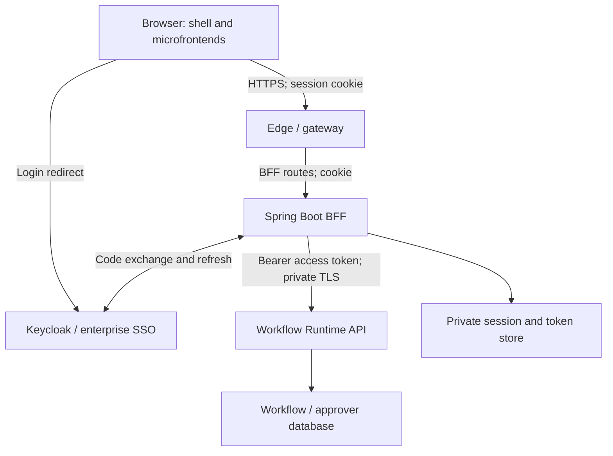

# AODB Flight Delay Routing and Approval — Step-by-Step Guide

This guide creates one small AODB workflow and demonstrates its two useful
operational cases:

1. A delay below 30 minutes finishes automatically as a normal delay.
2. A delay of 30 minutes or more waits for an authorized Operations user to
   approve or reject it.

The browser signs in through a **Backend for Frontend (BFF)**. The BFF keeps
OAuth tokens on the server and relays an access token to the Workflow Runtime
API. The runtime checks the token and the user's business permissions before
starting a workflow, reading an instance, or completing a task.

There is no outbound business API action, Kafka connector, database action,
rule, SLA, notification, or Prompt Poll insertion in this workflow. Authentication
adds BFF-to-runtime and BFF-to-Keycloak calls, plus security configuration.
The existing PostgreSQL approver lookup is still used in Step 7.

**Implementation status:** The workflow designer steps are retained from the
supplied guide. The BFF routes, identity mapping, policies, and security checks
below specify the integration to implement. This document does not establish
that these additions already exist in the AODB application or have passed
runtime tests. Complete Step 0 and the implementation checks in Step 15 before
running the revised examples. This is an AODB integration design; it does not
assume the separate Auth2-BFF sample implements these workflow endpoints.

The completed workflow is:

```text
Start: Flight Delay Reported
  → Gateway: Major Delay?
      ├─ delayMinutes >= 30
      │    → Approval: Approve Major Flight Delay
      │    → Gateway: Delay Approved?
      │         ├─ flightDelayApproved == true → End: Delay Approved
      │         └─ default                         → End: Delay Rejected
      └─ default → End: Normal Delay
```

Authentication controls access to this workflow. It does not change these BPMN
conditions or allow the browser to decide an approval outcome directly.

## 0. Prepare BFF Authentication Before Using the Designer

### 0.1. Confirm the Application Components

Use the following deployment boundaries:

| Component | Responsibility |
| --- | --- |
| React shell and microfrontends | Show the designer, runtime screens, and approval actions; call same-origin BFF routes |
| Edge proxy / API gateway | Route requests, terminate public TLS, apply limits, and forward trusted proxy metadata |
| Spring Boot BFF | Run OIDC login, manage the browser session and CSRF, obtain/refresh tokens, and relay user access tokens |
| Keycloak | Authenticate users, federate enterprise identity providers, and issue signed tokens |
| Workflow Runtime API | Validate bearer tokens; enforce designer, instance, task, and data-scope permissions |
| Session store | Hold shared BFF sessions and encrypted authorized-client token records |
| Workflow and identity database | Persist process/task/history state and the mapping to existing approver identities |

The UI and gateway remain separately deployed applications. The edge exposes
one browser origin so the shell and all microfrontends use relative URLs.
Spring Cloud Gateway can be replaced by another gateway without moving login
or business authorization out of their owning services.



The browser-to-edge, edge-to-BFF, and BFF-to-runtime connections are separate
trust boundaries. Network placement does not replace authentication checks.

### 0.2. Configure the Addresses and Routes

For a local demonstration, use these example addresses:

| Setting | Example value |
| --- | --- |
| Browser application origin | `http://localhost:8088` |
| BFF private address | `http://localhost:8081` |
| Workflow Runtime private address | `http://localhost:8080` |
| Keycloak realm issuer | `http://localhost:8085/realms/aodb` |
| OIDC client registration ID | `aodb` |
| Keycloak client ID | `aodb-bff` |
| Runtime audience | `aodb-workflow-api` |

Ports are deployment examples, not a claim about an existing installation.
Production uses HTTPS and environment-specific DNS. Local HTTP is permitted
only for an isolated loopback demonstration.

Configure the edge routes in this order:

| Browser path | Destination | Behaviour |
| --- | --- | --- |
| `/oauth2/authorization/aodb` | BFF | Start interactive login |
| `/login/oauth2/code/aodb` | BFF | Handle the OIDC callback |
| `/bff/session`, `/bff/csrf`, `/bff/logout` | BFF | Manage the browser security session |
| `/bff/api/runtime/**` | BFF | Apply session/CSRF checks and relay to the runtime |
| UI and approved MFE asset paths | UI applications | Serve the shell and independently deployed assets |

Do not expose the runtime `/api/runtime/**` routes directly to browsers.
Allow BFF egress only to configured internal API hosts and Keycloak endpoints.
Disable gateway-owned login/logout handlers on these BFF routes so the gateway
does not intercept the callback or logout request.

For example, the BFF translates:

```text
POST /bff/api/runtime/workflows/aodbFlightDelayApprovalWorkflow/start
  → POST {configured-runtime-base}/api/runtime/workflows/aodbFlightDelayApprovalWorkflow/start
```

The BFF uses a fixed method/path allowlist; it is not a general URL proxy.
These paths retain the original runtime API naming to limit integration
changes. If versioning is introduced later, version and migrate the published
contract explicitly rather than mixing `/v1` and unversioned examples.

### 0.3. Create the Keycloak Client

Ask the identity administrator to complete the following steps:

1. Create or select the `aodb` realm.
2. Create an OpenID Connect client with client ID `aodb-bff`.
3. Enable client authentication and the Standard Authorization Code flow.
4. Require PKCE with challenge method `S256` and configure the BFF to send it.
5. Disable Implicit Flow and Direct Access Grants for this browser application.
6. Register exactly `http://localhost:8088/login/oauth2/code/aodb` as the
   local redirect URI. Register each production HTTPS callback separately.
7. Register `http://localhost:8088/` as the local post-logout redirect URI.
8. Store the BFF client credential in a secret manager or protected deployment
   Secret. Never place it in React configuration, source control, or examples.
9. Configure audience mapping so the user access token presented to the
   runtime includes `aodb-workflow-api` in `aud`.
10. Configure roles and airport/terminal claims as described below. Ensure
    these claims are included in the **access token**, not only the ID token.
11. For enterprise SSO, configure the approved upstream identity provider in
    Keycloak and test the identity mapping before enabling operational access.

`openid`, `profile`, and `email` are login scopes. They do not grant permission
to publish workflows or approve flight delays. Do not enable offline access
for this example.

Why: the BFF authenticates as a confidential client, while PKCE binds the
code exchange to the login attempt. Exact redirect URIs reduce redirect abuse.
The identity provider remains responsible for credential checks and MFA.

### 0.4. Map the Operations User and Business Permissions

Retain `ANCHICHRTA` as the existing Approval user in Step 7. Link that approver
record to the authenticated Keycloak identity with an administrator-managed,
unique `(issuer, subject)` mapping. `subject` is the token's immutable `sub`.

Do not match solely on a browser-supplied username, email address, department,
or `actedBy`. Display names may change and are not authoritative identity keys.
Resolve `SYSADMIN` and approver membership from trusted server-side records.

Use these example roles and scopes for the demonstration:

| Principal | Roles | Airport / terminal | Purpose |
| --- | --- | --- | --- |
| Authorized designer | `WORKFLOW_DESIGN`, `WORKFLOW_PUBLISH` | `DEL` / `T3` | Configure, validate, publish, and activate this definition |
| `ANCHICHRTA` mapped identity | `WORKFLOW_START`, `WORKFLOW_READ`, `DELAY_APPROVE` | `DEL` / `T3` | Run the examples and complete the assigned Approval |
| Negative-test user | `WORKFLOW_START`, `WORKFLOW_READ` | `DEL` / `T3` | Verify approval is denied |
| Scope-test user | `WORKFLOW_START`, `WORKFLOW_READ`, `DELAY_APPROVE` | `DEL` / `T1` | Verify a T3 instance is inaccessible |

For a small local demo, one test account can hold the designer and Operations
roles. Production should separate publishing and operational responsibilities.
The negative-test user must also be unassigned to the Approval task.

An illustrative, decoded **user access token** is:

```json
{
  "iss": "http://localhost:8085/realms/aodb",
  "sub": "immutable-keycloak-user-id",
  "aud": ["aodb-workflow-api"],
  "azp": "aodb-bff",
  "realm_access": {
    "roles": ["WORKFLOW_START", "WORKFLOW_READ", "DELAY_APPROVE"]
  },
  "airport_codes": ["DEL"],
  "terminals": ["T3"],
  "exp": 1793628300
}
```

This is a claim-shape example, not a usable token. Configure a strict JWT role
converter for `realm_access.roles`; missing or malformed claims grant no access.
If terminals are not globally unique, represent scope as airport/terminal pairs
or validate both against the same authorized airport record.

The runtime applies all applicable checks:

| Operation | Required role | Additional runtime check |
| --- | --- | --- |
| Edit or validate a definition | `WORKFLOW_DESIGN` | Definition ownership / design scope |
| Publish or activate a definition | `WORKFLOW_PUBLISH` | Deployment scope and approved version |
| Start a workflow | `WORKFLOW_START` | Active allowed definition; submitted DEL/T3 belongs to the user's scope |
| Read tasks, variables, or history | `WORKFLOW_READ` | Persisted instance belongs to the user's scope and is visible under the instance policy |
| Complete this Approval | `DELAY_APPROVE` | Persisted task is pending, in scope, and assigned to the mapped approver |

Why: a valid token establishes identity and grants potential capabilities.
The runtime still decides whether this user can act on this particular
workflow instance and task. A hidden UI button is not an authorization check.

### 0.5. Configure the Browser Session and CSRF Contract

Configure the BFF as an OIDC client with a server-side authorized-client store.
Use an opaque session cookie named `AODBSESSION` with these attributes:

| Attribute | Production setting |
| --- | --- |
| `HttpOnly` | `true` |
| `Secure` | `true` |
| `SameSite` | `Lax` for this top-level GET callback design |
| `Path` | `/` |
| `Domain` | Omit; use a host-only cookie |
| Session inactivity timeout | 30 minutes as the initial policy |
| Absolute session lifetime | 8 hours as the initial policy; enforce on the server |

Set `Secure=false` only for the loopback HTTP demonstration. Rotate the session
ID after login. Preserve the link to the authorized-client record across that
rotation. Encrypt persisted access/refresh tokens using managed encryption keys;
protect the entire session store with authentication, network isolation, and
TLS. Never serialize a second plaintext token copy into the general session.

Implement these explicit BFF endpoints:

| Endpoint | Expected contract |
| --- | --- |
| `GET /bff/session` | `200` with display identity and UI capabilities; `401` without an authenticated session; never return OAuth tokens |
| `GET /bff/csrf` | `200` with `{ "headerName": "X-CSRF-TOKEN", "token": "..." }` tied to the current session |
| `POST /bff/logout` | Validate CSRF, invalidate local session and authorized-client records, and return `{ "redirectUrl": "..." }` for a server-generated, allowlisted OIDC logout URL |

Apply `Cache-Control: no-store` to these responses and authenticated workflow
responses. CSRF tokens are allowed in frontend memory; access and refresh tokens
are not. Keep CSRF validation enabled on BFF POST, PUT, PATCH, and DELETE requests.
Keep credentialed cross-origin access disabled for this same-origin design;
validate allowed Origin/Referer metadata on state-changing browser requests as
defence in depth. SameSite and CORS settings do not replace CSRF validation.
Use Spring Security's supported CSRF handler/repository pairing; do not compare
arbitrary strings in a controller. Obtain a new CSRF token after login or logout.

For BFF API requests, return a JSON `401` when a session expires. Do not redirect
an AJAX call to a Keycloak HTML page. The UI starts a new top-level login when
appropriate. Do not automatically replay a start or approval POST after login.

### 0.6. Sign In and Prepare the Test Browser

1. Start the UI/edge, BFF, session store, Keycloak, runtime, and its existing
   databases with the configuration above.
2. Open `http://localhost:8088/` in a browser.
3. Click the application's **Sign in** action. It must navigate to
   `/oauth2/authorization/aodb` on the same origin.
4. Sign in through Keycloak with the authorized designer account.
5. Confirm that the browser returns to `http://localhost:8088/`.
6. Complete Steps 1–9 using this authenticated designer session.
7. Before Step 10, sign out and sign in as the Operations account mapped to
   `ANCHICHRTA`, unless the local demonstration uses one combined account.
8. Open the browser developer tools **Console** on the application page.
9. Define the following demonstration helper once. All JavaScript test blocks
   below run in this same browser tab and console, in order.

```javascript
var aodbApi = async function (path, options = {}) {
  if (!path.startsWith('/bff/api/runtime/')) {
    throw new Error('Only the documented same-origin runtime routes are allowed');
  }
  var method = (options.method || 'GET').toUpperCase();
  var headers = new Headers({ Accept: 'application/json' });
  if (options.body !== undefined) headers.set('Content-Type', 'application/json');

  if (!['GET', 'HEAD', 'OPTIONS'].includes(method)) {
    var csrfResponse = await fetch('/bff/csrf', {
      credentials: 'same-origin', cache: 'no-store', redirect: 'error'
    });
    if (!csrfResponse.ok) throw new Error('CSRF/session initialization failed');
    var csrf = await csrfResponse.json();
    headers.set(csrf.headerName, csrf.token);
  }

  var response = await fetch(path, {
    method, headers, credentials: 'same-origin', cache: 'no-store',
    redirect: 'error',
    body: options.body === undefined ? undefined : JSON.stringify(options.body)
  });
  var text = await response.text();
  var body = text ? JSON.parse(text) : null;
  if (!response.ok) {
    var error = new Error('HTTP ' + response.status + ': ' +
      (body?.title || 'Request failed'));
    error.status = response.status;
    error.problem = body;
    throw error;
  }
  return body;
};

var sessionResponse = await fetch('/bff/session', {
  credentials: 'same-origin', cache: 'no-store', redirect: 'error'
});
if (!sessionResponse.ok) throw new Error('Sign in before continuing');
console.log(await sessionResponse.json());
var runId = crypto.randomUUID();
```

Expected checks:

- `/bff/session` returns the signed-in display identity without tokens;
- the session cookie is HttpOnly;
- no OAuth token appears in localStorage, sessionStorage, an API response,
  or the MFE configuration; and
- all runtime calls use the `/bff/api/runtime/` prefix on the application origin.

The console is only a reproducible demonstration client. Production buttons
call the same BFF contract through a shared frontend API module. The examples
replace the original unauthenticated `curl` calls so they exercise the actual
browser session without copying cookies or bearer tokens into a terminal.

### 0.7. Verify the Login and Token Relay Flow

Follow one successful request in this order:

1. The browser navigates to the BFF login endpoint.
2. The BFF creates an OIDC authorization request with `state`, `nonce`, and
   PKCE `S256`, and redirects the browser to Keycloak.
3. Keycloak authenticates the user, including configured corporate SSO and MFA.
4. Keycloak redirects an authorization code to the BFF callback through the edge.
5. The BFF validates the login response and exchanges the code server-to-server
   using its client credential and PKCE verifier. It validates the ID token
   using the OIDC client library, including issuer, audience, and nonce.
6. The BFF stores the authorized client securely and establishes the rotated
   browser session. The browser receives only the opaque session cookie.
7. The browser calls a BFF workflow endpoint with its cookie and, for a state
   change, a CSRF header.
8. The BFF validates session, method, route, and CSRF. It obtains a usable access
   token for this authorized client, refreshing server-side if necessary.
9. The BFF creates a separate internal request containing
   `Authorization: Bearer <user-access-token>`. It does not forward the browser
   cookie, a refresh token, an ID token, or browser-supplied identity headers.
10. The runtime validates the access token's signature, permitted algorithm,
    issuer, audience, expiry, and other required time claims, then applies
    role and persisted-object policies.
11. The runtime executes the authorized action and returns its business JSON.
    The BFF returns that result without exposing credentials.

Token relay carries identity to the runtime; it does not itself authorize a
business action. Refresh tokens are used only at Keycloak's token endpoint.
Only relay to APIs explicitly included in the token's intended audience.
For an unrelated external API, use separately configured service credentials
or an approved token-exchange design instead of forwarding this token.

## 1. Create the Workflow

1. Open **Workflow Designer**.
2. Click **Create workflow**.
3. Enter the following values in order:

| Field | Value |
| --- | --- |
| Name | `AODB Flight Delay Approval` |
| Workflow key | `aodbFlightDelayApprovalWorkflow` |
| Template | `Blank Workflow` |

4. Click **Create**.
5. Click **Save** once.

Use the workflow key exactly as shown. The REST examples later in this guide
use the same key.

## 2. Add the BPMN Elements

Blank Workflow initially contains one Start event, one End event, and a flow
between them.

1. Select the existing arrow between Start and End.
2. Delete only the arrow. Keep both events.
3. From the toolbox, drag the following elements to the canvas in this order:
   1. **Decision**
   2. **Approval**
   3. A second **Decision**
   4. Two additional **End** events
4. Arrange the elements from left to right.

The canvas now contains:

- one Start event;
- two Decision gateways;
- one Approval task; and
- three End events.

## 3. Rename Every Element

Rename the elements exactly as follows:

| Element | Name |
| --- | --- |
| Existing Start | `Flight Delay Reported` |
| First Decision | `Major Delay?` |
| Approval | `Approve Major Flight Delay` |
| Second Decision | `Delay Approved?` |
| Existing End | `Normal Delay` |
| Second End | `Delay Approved` |
| Third End | `Delay Rejected` |

The designer generates element IDs. Keep those generated IDs; only change the
display names.

## 4. Connect the Elements

Create the sequence flows in this exact order:

1. `Flight Delay Reported` → `Major Delay?`
2. `Major Delay?` → `Approve Major Flight Delay`
3. `Major Delay?` → `Normal Delay`
4. `Approve Major Flight Delay` → `Delay Approved?`
5. `Delay Approved?` → `Delay Approved`
6. `Delay Approved?` → `Delay Rejected`

Each gateway must have exactly two outgoing flows. Do not add any service task
or action between these elements.

## 5. Verify the Start Event

Select **Flight Delay Reported** and verify:

| Property | Expected value |
| --- | --- |
| BPMN type | `bpmn:StartEvent` |
| Start type | normal/none start |
| Kafka Start | not configured |
| REST Start | not configured |

No other Start properties are required. The input variables are supplied by
the runtime start request in the test sections.

## 6. Configure the Major Delay Gateway

Select **Major Delay?**. Complete the routing fields from top to bottom:

| Gateway field | Value |
| --- | --- |
| Condition variable | `delayMinutes` |
| Operator | `Greater than or equal` |
| Expected value type | `Number` |
| Expected value | `30` |
| True outgoing flow | flow to `Approve Major Flight Delay` |
| Default outgoing flow | flow to `Normal Delay` |

The **Generated Flowable condition** must show:

```text
${delayMinutes >= 30}
```

Click **Apply Gateway Routing**.

This routing means:

- `delayMinutes` from 0 through 29 follows the default flow to **Normal
  Delay**;
- `delayMinutes` of 30 or more follows the condition flow to the Approval
  task.

## 7. Configure the Approval Task

Select **Approve Major Flight Delay**. Enter the properties from top to bottom:

| Property | Value |
| --- | --- |
| Department | `SYSADMIN` |
| User | `ANCHICHRTA` |
| Required approvals | `1` |
| Notify on create | `False` |
| Message expression | `Approve the reported major flight delay` |
| Result variable | `flightDelayApproved` |
| Status variable | `flightDelayApprovalStatus` |
| Approved count variable | `flightDelayApprovedCount` |
| Rejected count variable | `flightDelayRejectedCount` |
| Response count variable | `flightDelayResponseCount` |
| Pending count variable | `flightDelayPendingCount` |
| Required approvals variable | `flightDelayRequiredCount` |
| Responded users variable | `flightDelayRespondedUsers` |
| Rejection reason variable | `flightDelayRejectionReason` |
| Task ID variable | `flightDelayApprovalTaskId` |
| Notification status variable | `flightDelayNotificationStatus` |
| Notification rows variable | `flightDelayNotificationRows` |

Select only one user. If the User list does not yet show `ANCHICHRTA`, select
`SYSADMIN`, click **Refresh PostgreSQL approvers**, and then select
`ANCHICHRTA`.

Keep **Task Form** and **SLA monitoring** folded. They are not needed for this
example.

Click **Apply Approval**.

`Notify on create = False` ensures the Approval task does not send a
notification or insert a Prompt Poll row. The plain-text message remains
non-empty because it is a required Approval configuration value.

## 8. Configure the Approval Result Gateway

Select **Delay Approved?**. Enter these values from top to bottom:

| Gateway field | Value |
| --- | --- |
| Condition variable | `flightDelayApproved` |
| Operator | `Equals` |
| Expected value type | `Boolean` |
| Expected value | `true` |
| True outgoing flow | flow to `Delay Approved` |
| Default outgoing flow | flow to `Delay Rejected` |

The **Generated Flowable condition** must show:

```text
${flightDelayApproved == true}
```

Click **Apply Gateway Routing**.

The rejected branch is deliberately the default. An approval reaches **Delay
Approved** only when the Approval task writes the Boolean value `true` to
`flightDelayApproved`.

## 9. Save, Validate, Publish and Activate

Use this exact sequence:

1. Click **Save**.
2. Click **Validate**.
3. Correct every red validation error, if any.
4. Click **Publish**.
5. Click **Activate** for the published version.

Activation makes the published definition available to the runtime start API.
There is no separate Deploy step.

Before testing, confirm:

- the Start event is a normal Start;
- **Major Delay?** has one condition flow and one default flow;
- the Approval has exactly one selected user;
- **Notify on create** is `False`;
- **Delay Approved?** has one condition flow and one default flow; and
- every branch ends at an End event.

## 10. Use Case 1 — Verify a Normal Delay

This request reports a 15-minute delay. Because 15 is below 30, the workflow
must finish without creating an Approval task.

Run in the authenticated browser console from Step 0.6:

```javascript
var normalResponse = await aodbApi(
  '/bff/api/runtime/workflows/aodbFlightDelayApprovalWorkflow/start', {
    method: 'POST',
    body: {
      businessKey: 'AI302-20261029-NORMAL-' + runId,
      variables: {
        flightNumber: 'AI302', flightDate: '2026-10-29',
        airportCode: 'DEL', terminal: 'T3', delayMinutes: 15,
        delayReason: 'AIR_TRAFFIC_CONGESTION'
      }
    }
  }
);
console.log(normalResponse);
var normalProcessId = normalResponse.processInstanceId;
if (!normalProcessId) throw new Error('Missing processInstanceId');
```

The response must contain:

```json
{
  "processInstanceId": "a generated ID",
  "processDefinitionId": "the active workflow definition ID",
  "businessKey": "AI302-20261029-NORMAL-<runId>"
}
```

The flight date is fixed demonstration data. `runId` makes each business key
unique; use a new `runId` when repeating a complete test run.

Verify that no task was created:

```javascript
var normalTasks = await aodbApi(
  '/bff/api/runtime/instances/' + encodeURIComponent(normalProcessId) + '/tasks'
);
console.log(normalTasks);
```

Expected result:

```json
[]
```

Verify the completed route:

```javascript
var normalHistory = await aodbApi(
  '/bff/api/runtime/instances/' + encodeURIComponent(normalProcessId) + '/history'
);
console.log(normalHistory);
console.assert(normalHistory.businessKey === normalResponse.businessKey);
console.assert(normalHistory.variables.delayMinutes === 15);
console.assert(normalHistory.endTime != null);
console.assert(normalHistory.tasks.length === 0);
```

Expected checks:

- `businessKey` equals the generated normal-delay business key;
- `delayMinutes` is `15`;
- `endTime` is not null; and
- `tasks` is empty.

The route taken is:

```text
Flight Delay Reported
  → Major Delay? default flow
  → Normal Delay
```

Why this is safe: the BFF authenticates the browser session and validates CSRF
before relaying the POST. The runtime checks `WORKFLOW_START` and the user's
DEL/T3 scope before persisting the input and starting the workflow. An input
field such as `terminal: "T3"` is a requested business value, not proof of access.

## 11. Use Case 2 — Verify a Major Delay Waiting for Approval

This request reports a 45-minute delay. Because 45 is at least 30, the
workflow must wait at **Approve Major Flight Delay**.

Run:

```javascript
var majorResponse = await aodbApi(
  '/bff/api/runtime/workflows/aodbFlightDelayApprovalWorkflow/start', {
    method: 'POST',
    body: {
      businessKey: 'AI302-20261029-MAJOR-' + runId,
      variables: {
        flightNumber: 'AI302', flightDate: '2026-10-29',
        airportCode: 'DEL', terminal: 'T3', delayMinutes: 45,
        delayReason: 'LATE_INBOUND_AIRCRAFT'
      }
    }
  }
);
console.log(majorResponse);
var majorProcessId = majorResponse.processInstanceId;
if (!majorProcessId) throw new Error('Missing processInstanceId');
```

Find the waiting task:

```javascript
var majorTasks = await aodbApi(
  '/bff/api/runtime/instances/' + encodeURIComponent(majorProcessId) + '/tasks'
);
console.log(majorTasks);
var majorTask = majorTasks.find(t => t.name === 'Approve Major Flight Delay');
if (majorTasks.length !== 1 || !majorTask?.taskId) {
  throw new Error('Expected exactly one waiting major-delay Approval task');
}
var majorTaskId = majorTask.taskId;
console.log('Major-delay task ID:', majorTaskId);
```

Expected checks:

- exactly one task is returned;
- its name is `Approve Major Flight Delay`;
- its process instance ID equals `majorProcessId`; and
- its approval status is `PENDING`.

Inspect the process variables while the task is waiting:

```javascript
var majorVariables = await aodbApi(
  '/bff/api/runtime/instances/' + encodeURIComponent(majorProcessId) + '/variables'
);
console.log(majorVariables);
```

Expected values include:

```json
{
  "flightNumber": "AI302",
  "delayMinutes": 45,
  "flightDelayApprovalStatus": "PENDING",
  "flightDelayApprovalTaskId": "the current task ID",
  "flightDelayNotificationStatus": "DISABLED",
  "flightDelayNotificationRows": 0
}
```

Why this is safe: every tasks, variables, and history endpoint authorizes the
persisted instance. Knowing or guessing an instance ID does not grant read
access. Lists must also filter inaccessible instances; checking only detail
endpoints is insufficient.

## 12. Approve the Major Delay

Confirm that the current browser session belongs to the identity mapped to
`ANCHICHRTA`. Complete the waiting task with `approved: true`:

```javascript
var approvalResponse = await aodbApi(
  '/bff/api/runtime/tasks/' + encodeURIComponent(majorTaskId) + '/complete', {
    method: 'POST',
    body: {
      approved: true,
      comment: 'Operations accepts the revised departure plan',
      variables: {}
    }
  }
);
console.log(approvalResponse);
```

Do not send `actedBy`. The runtime derives the actor from the validated token's
`iss` and `sub`, resolves the trusted approver mapping, and checks that this
pending task is assigned to `ANCHICHRTA`. If an older engine interface requires
`actedBy`, a trusted internal adapter supplies the resolved value after these
checks. It must never forward a value chosen by the browser.

Expected response checks:

- `taskCompleted` is `true`;
- `processStillRunning` is `false`; and
- the approval state reports an approved result.

Verify the final history:

```javascript
var majorHistory = await aodbApi(
  '/bff/api/runtime/instances/' + encodeURIComponent(majorProcessId) + '/history'
);
console.log({
  businessKey: majorHistory.businessKey,
  endTime: majorHistory.endTime,
  approved: majorHistory.variables.flightDelayApproved,
  status: majorHistory.variables.flightDelayApprovalStatus,
  approvedCount: majorHistory.variables.flightDelayApprovedCount,
  rejectedCount: majorHistory.variables.flightDelayRejectedCount,
  tasks: majorHistory.tasks
});
```

Expected values:

```text
approved      = true
status        = APPROVED
approvedCount = 1
rejectedCount = 0
endTime       = not null
```

The route taken is:

```text
Flight Delay Reported
  → Major Delay? condition flow
  → Approve Major Flight Delay
  → Delay Approved? condition flow
  → Delay Approved
```

Why this is safe: `DELAY_APPROVE` is required, and the runtime separately checks
scope, task assignment, and pending state. The task state transition and audit
record are committed transactionally. Two simultaneous decisions cannot both
complete the same task. Browser input cannot override approval counters or
write `flightDelayApproved` directly.

## 13. Verify the Major-Delay Rejection Variant

The approved task from Step 12 cannot be reused. Start a new process instance
with a new business key:

```javascript
var rejectResponse = await aodbApi(
  '/bff/api/runtime/workflows/aodbFlightDelayApprovalWorkflow/start', {
    method: 'POST',
    body: {
      businessKey: 'AI302-20261029-MAJOR-REJECT-' + runId,
      variables: {
        flightNumber: 'AI302', flightDate: '2026-10-29',
        airportCode: 'DEL', terminal: 'T3', delayMinutes: 60,
        delayReason: 'TECHNICAL_INSPECTION'
      }
    }
  }
);
var rejectProcessId = rejectResponse.processInstanceId;
if (!rejectProcessId) throw new Error('Missing processInstanceId');
var rejectTasks = await aodbApi(
  '/bff/api/runtime/instances/' + encodeURIComponent(rejectProcessId) + '/tasks'
);
var rejectTask = rejectTasks.find(t => t.name === 'Approve Major Flight Delay');
if (rejectTasks.length !== 1 || !rejectTask?.taskId) {
  throw new Error('Expected exactly one waiting rejection-test Approval task');
}
var rejectTaskId = rejectTask.taskId;
```

Reject the new task:

```javascript
console.log(await aodbApi(
  '/bff/api/runtime/tasks/' + encodeURIComponent(rejectTaskId) + '/complete', {
    method: 'POST',
    body: {
      approved: false,
      comment: 'Delay plan must be revised before acceptance',
      variables: {}
    }
  }
));
```

Verify the final history:

```javascript
var rejectHistory = await aodbApi(
  '/bff/api/runtime/instances/' + encodeURIComponent(rejectProcessId) + '/history'
);
console.log({
  businessKey: rejectHistory.businessKey,
  endTime: rejectHistory.endTime,
  approved: rejectHistory.variables.flightDelayApproved,
  status: rejectHistory.variables.flightDelayApprovalStatus,
  rejectionReason: rejectHistory.variables.flightDelayRejectionReason,
  approvedCount: rejectHistory.variables.flightDelayApprovedCount,
  rejectedCount: rejectHistory.variables.flightDelayRejectedCount,
  tasks: rejectHistory.tasks
});
```

Expected values:

```text
approved        = false
status          = REJECTED
rejectionReason = Delay plan must be revised before acceptance
approvedCount   = 0
rejectedCount   = 1
endTime         = not null
```

The route taken is:

```text
Flight Delay Reported
  → Major Delay? condition flow
  → Approve Major Flight Delay
  → Delay Approved? default flow
  → Delay Rejected
```

Why this is safe: reject requires the same authentication, assignment, and
scope checks as approve. Validate the comment length, store it as plain text,
and encode it when displayed so comments cannot inject HTML or script.

## 14. Final Verification Matrix

| Test | Input | Expected task | Expected end |
| --- | --- | --- | --- |
| Normal delay | `delayMinutes: 15` | None | `Normal Delay` |
| Major delay approved | `delayMinutes: 45`, approve | `Approve Major Flight Delay` | `Delay Approved` |
| Major delay rejected | `delayMinutes: 60`, reject | `Approve Major Flight Delay` | `Delay Rejected` |

Use a new `businessKey` for every test run. Use the task ID created by that
same process instance when approving or rejecting. The `runId` suffix in this
guide provides unique business keys across runs.

The completed business tests are necessary but do not establish security
readiness. Continue with the implementation and negative checks below.

## 15. Implement and Verify the BFF and Runtime Boundaries

Complete these steps before treating the revised examples as runnable:

1. Add the Spring Security OAuth2 Client dependency to the BFF and configure
   Authorization Code login with PKCE and the `aodb` registration.
2. Configure Spring Session with a shared Redis-compatible store. Use a
   server-side authorized-client repository with encrypted token persistence.
3. Configure framework-managed session fixation protection, CSRF handling,
   session/CSRF endpoints, and JSON API authentication/denial responses.
4. Implement a typed, fixed-destination runtime client. Select the current
   user's authorized client explicitly. Attach only its access token to the
   allowlisted runtime request; do not enable token attachment to all WebClient
   destinations by default.
5. Allow only the browser operations in this guide and the separately defined
   designer API operations. Inventory designer routes before enabling Steps
   1–9; this guide does not invent their unavailable existing URI contracts.
6. Remove inbound `Authorization`, `Cookie`, `X-User`, `X-Roles`, `actedBy`, and
   equivalent identity metadata from the internal request-building path. Reject
   the forbidden `actedBy` body field with `400`; derive identity at the runtime.
   Do not forward browser cookies or client-selected forwarding headers.
7. Configure the runtime as an OAuth2 Resource Server. Validate issuer,
   audience, signature, permitted algorithms, and token time claims. Use
   framework-supported JWKS caching and bounded key-rotation refresh.
   Keep runtime API security stateless and bearer-only. CSRF can be disabled
   on that dedicated filter chain only because it does not accept browser
   cookies or other automatically submitted browser credentials. Keep CSRF
   enabled on the BFF browser chain.
8. Map token roles strictly and implement instance/task policies at the service
   layer so controllers, jobs, and alternative adapters cannot bypass them.
9. In the start request, allow only the input variables shown in Steps 10–13.
   Require a positive, bounded integer `delayMinutes`, valid flight/date and
   airport/terminal values, and length-limited strings. Define the operational
   maximum delay as a business configuration; reject out-of-range input.
10. For completion, accept only Boolean `approved`, bounded `comment`, and an
    empty `variables` object in this example. Reject attempts to write result,
    counter, assignment, identity, or scope variables. For rejection, require a
    nonblank comment. Reject unknown fields rather than silently accepting them.
11. Persist immutable instance security context outside browser-writable
    workflow variables. Use it when authorizing tasks, variables, and history.
12. Commit the decision, workflow transition, and durable audit event atomically
    in the workflow database, or use a transactional outbox when the audit
    sink is external. Use optimistic locking or equivalent database constraints
    so repeated completion returns `409` without changing the original decision.
13. Enforce unique business keys within the defined workflow/tenant boundary.
    Duplicate start requests return `409` under this guide's contract. For clients
    requiring transparent retries, add a documented idempotency-key contract
    and persist the key, payload digest, and result transactionally.
14. Apply bounded connection/response timeouts and response sizes. Do not
    automatically retry start or complete POSTs after network failures. If the
    outcome is uncertain, query instance/task history before any manual retry.
15. Verify that the runtime is not publicly reachable, and that spoofed forwarding
    headers cannot alter redirects or identity. The edge must overwrite them;
    the BFF trusts only configured proxy hops.

Why: the BFF owns browser security and token handling. The runtime owns business
authorization and process integrity. Keeping those checks separate prevents a
routing error or new client from bypassing approval rules.

The session store does not replace the workflow database. Redis-compatible
storage holds ephemeral security state; the existing workflow/approver database
holds durable process, identity mapping, and audit state. This guide adds no
BPMN database action and does not prescribe a database migration.

## 16. Verify Denied and Invalid Requests

### 16.1. Verify an Anonymous Request Is Rejected

1. Open a separate private browser window without signing in.
2. Open the application page on `http://localhost:8088/`.
3. Run:

```javascript
var anonymous = await fetch('/bff/api/runtime/instances/example/tasks', {
  credentials: 'same-origin', redirect: 'error'
});
console.log(anonymous.status, await anonymous.json());
```

Expected result: `401`, a JSON problem response, and no runtime business action.
An API request must not return a Keycloak HTML login page with status `200`.

### 16.2. Verify a Missing CSRF Token Is Rejected

In the signed-in Operations browser, run:

```javascript
var missingCsrf = await fetch(
  '/bff/api/runtime/workflows/aodbFlightDelayApprovalWorkflow/start', {
    method: 'POST', credentials: 'same-origin', redirect: 'error',
    headers: { 'Content-Type': 'application/json' },
    body: JSON.stringify({
      businessKey: 'CSRF-NEGATIVE-' + crypto.randomUUID(),
      variables: {
        flightNumber: 'AI302', flightDate: '2026-10-29',
        airportCode: 'DEL', terminal: 'T3', delayMinutes: 45,
        delayReason: 'TEST'
      }
    })
  }
);
console.log(missingCsrf.status, await missingCsrf.json());
```

Expected result: `403`. Verify in the runtime/audit store that no corresponding
process instance was created. The BFF must reject this request before relay.

### 16.3. Verify Role, Assignment, and Scope Checks

1. Start a fresh 45-minute delay as `ANCHICHRTA` using Step 11 and a new
   `runId`. Keep its instance and task IDs for the test.
2. In a separate browser profile, sign in as the negative-test user from Step
   0.4. Define the helper from Step 0.6 in that profile.
3. Call the same completion endpoint with that pending task ID and a valid
   CSRF token. Expected result: `403`; the task remains `PENDING`.
4. Repeat with an unassigned DEL/T3 user that **has** `DELAY_APPROVE`.
   Expected result: `403`. A broad role must not override task assignment.
5. Sign in as the scope-test user for DEL/T1. Request the T3 instance's tasks,
   variables, history, and task completion. Expected result: `404` under this
   guide's concealment policy, with no data returned or task state changed.
6. As the real approver, include `actedBy: "ANOTHER_USER"` in a completion
   request. Expected result: `400`, and the task remains pending.
7. Try `variables: { flightDelayApproved: true }`. Expected result: `400`.
8. Complete the task correctly once, then repeat the completion. Expected
   result: `409`; only one successful decision is recorded.

The same concealment policy must apply consistently to related endpoints;
otherwise an error difference may reveal a protected instance's existence.

### 16.4. Verify JWT Validation Independently of the BFF

From an authorized integration-test environment on the private runtime network:

1. Send a runtime request with no bearer token. Expect `401`.
2. Send a correctly signed test token with the wrong issuer. Expect `401`.
3. Send a correctly signed token with the wrong audience. Expect `401`.
4. Send an expired or tampered token. Expect `401`.
5. Send a valid scoped token without the operation's role. Expect `403` for
   an otherwise visible object.
6. Verify that untrusted `X-User` and `X-Roles` headers do not change outcomes.

Use an isolated test realm or controlled test keys. Do not copy production
access tokens into terminals or generate forged tokens against production.

## 17. Verify Refresh, Expiry, and Logout

### 17.1. Verify Access Token Refresh

1. Use a short access-token lifetime in the isolated test realm, for example
   five minutes, and keep the browser session active with normal API activity.
2. Read a permitted instance before the access token expires.
3. After it expires, read that instance again.
4. Verify that the BFF refreshes the authorized client server-to-server and
   that the runtime accepts the new access token.
5. Verify that the browser still receives no access or refresh token.

Coordinate refresh per authorized-client/session record across BFF replicas.
When refresh-token rotation is enabled, concurrent refreshes can invalidate
one another. Use an owner-checked lease and fenced writes or an equivalent
proven coordination mechanism; a lock without stale-writer protection is
insufficient. Do not automatically retry an uncertain refresh exchange.

If a BFF fails after Keycloak rotates a refresh token but before the new token
is persisted, require login again when recovery is unsafe. This operation is
not an atomic transaction across Keycloak and the session store.

### 17.2. Verify Session Expiry and Dependency Failure

1. Expire the browser session in the test store or reduce the inactivity
   timeout in the test environment.
2. Call an authenticated BFF API. Expect `401` and no business action.
3. Sign in again and obtain a fresh CSRF token.
4. In an isolated test environment, make the session store unavailable.
5. Call a protected BFF API. Expect `503`; do not fall back to an anonymous
   session, a shared service token, or in-memory permissions.
6. Test Keycloak unavailability during refresh. Expect a controlled failure
   with no business mutation. Distinguish transient provider failure (`503`)
   from an invalid/revoked authorization requiring login (`401`).

Existing unexpired JWTs can remain valid at the runtime during an identity
provider outage if validation keys are cached. Document this availability
choice; do not claim every JWT validation makes a live Keycloak call.

### 17.3. Sign Out Safely

Use the UI **Sign out** action. Its implementation must perform this sequence:

1. Obtain the current CSRF token.
2. POST to `/bff/logout` with the session cookie and CSRF header.
3. Invalidate the local session and remove its authorized-client/token records.
4. Return a server-generated, allowlisted OIDC logout URL, with
   `Cache-Control: no-store`, rather than accepting a browser-provided URL.
5. Navigate the top-level browser to that URL to end the Keycloak SSO session.
6. Return to the registered post-logout page.
7. Call `/bff/session` again. Expect `401`.
8. Verify that the old BFF session cannot read or complete tasks.

Local logout takes effect even if Keycloak logout fails. Display an appropriate
message if the upstream SSO session could not be ended. In that case a later
login might immediately authenticate through the remaining SSO session.

Deleting a BFF session does **not** invalidate an already-issued JWT at every
resource server. Use short token lifetimes and, where immediate revocation is
required, implement a validated denylist/introspection/event mechanism at all
relevant services. Validate OIDC back-channel logout tokens and map their `sid`
and/or subject to local sessions before invalidation. A role change also may
not appear until tokens refresh; sensitive operations may require a live
entitlement check with a defined revocation SLA.

## 18. Use Consistent Responses, Errors, and Audit Records

### 18.1. Keep Successful Business Responses Predictable

Retain the original guide's successful JSON structures: start returns an
object with `processInstanceId`; task lookup returns an array; variables and
history return objects. The BFF must not introduce an unexpected `data` wrapper
that breaks those contracts.

Use `Content-Type: application/json`, `Cache-Control: no-store`, and a request
correlation header on authenticated responses. Do not return OAuth tokens,
client credentials, session IDs, or upstream authorization headers.

### 18.2. Return a Safe Problem Response on Failure

Use RFC 9457 `application/problem+json` for BFF and runtime errors:

```json
{
  "type": "urn:aodb:problem:task-not-actionable",
  "title": "Task is no longer actionable",
  "status": 409,
  "detail": "Refresh the task list before submitting another decision.",
  "instance": "/bff/api/runtime/tasks/example-task-id/complete",
  "code": "TASK_NOT_ACTIONABLE",
  "requestId": "generated-request-id"
}
```

`type` and `code` above are application-defined identifiers. Return an externally
meaningful `instance` path; do not leak private upstream URLs or stack traces.

| Status | Meaning in this guide | Client action |
| --- | --- | --- |
| `400` | Invalid fields, forbidden actor override, or disallowed variables | Correct the input |
| `401` | Missing/expired session or rejected access token | Reauthenticate when appropriate; do not replay a POST automatically |
| `403` | CSRF failure, missing role, or unassigned task in a visible scope | Stop; correct access or CSRF state |
| `404` | Missing or concealed instance/task | Show unavailable; do not reveal protected object details |
| `409` | Duplicate business key or task already decided | Refresh/query the existing result |
| `429` | Request rate limit exceeded | Respect `Retry-After`; do not blindly replay mutations |
| `502` / `504` | Upstream protocol failure / timeout | Treat mutation outcome as uncertain; reconcile history |
| `503` | Required security/runtime dependency unavailable | Stop the action; retry only under the documented retry contract |

### 18.3. Record Technical Logs and Business Audit Separately

Propagate W3C `traceparent` across edge, BFF, and runtime with OpenTelemetry or
the platform's supported tracing integration. Validate inbound correlation
values, generate safe request IDs when absent, and do not put identity or tokens
in trace baggage. Treat trace context as telemetry, never authorization.

An example technical log is:

```json
{
  "timestamp": "2026-11-02T10:15:00Z",
  "level": "INFO",
  "service": "aodb-bff",
  "event": "runtime.request.completed",
  "requestId": "generated-request-id",
  "traceId": "4bf92f3577b34da6a3ce929d0e0e4736",
  "spanId": "00f067aa0ba902b7",
  "method": "POST",
  "route": "/bff/api/runtime/tasks/{taskId}/complete",
  "status": 200,
  "durationMs": 84
}
```

A business audit record must additionally include the authenticated issuer and
subject, resolved approver ID, operation, business key, process/task identifiers,
previous/new decision state, outcome, policy reason code, UTC timestamp, and
request/trace IDs. Protect those records with access controls and a defined
retention policy. Store sensitive comments only in the authorized business
record; use a reference in audit where full duplication is unnecessary.

Do not log access/refresh/ID tokens, session cookies, client secrets, CSRF values,
full authorization headers, or unrestricted request bodies. Keep successful
decision audit durable even when technical traces are sampled or unavailable.
Record denied attempts safely without exposing object details to the caller.

### 18.4. Verify the Monitoring View

Create a dashboard that shows:

- request rate, p50/p95/p99 latency, and `4xx`/`5xx` by service and route template;
- login/refresh failures, CSRF denials, policy denials, and session-store errors;
- runtime start failures and pending Approval count / oldest pending age;
- approval/rejection counts and decision latency from durable business events;
- trace links between BFF relay and runtime operations.

Use bounded metric labels such as route templates, outcome, and service. Do not
use user IDs, task IDs, business keys, or raw URLs as metric labels. Locate
individual requests in access-controlled logs/traces and business audit instead.
Define alert thresholds against measured traffic and operational objectives;
a dashboard alone is not evidence that the controls work.

## 19. Review the Risks and Required Controls

| Area | Remaining risk | Control and verification | Owner |
| --- | --- | --- | --- |
| Browser / MFE code | XSS can issue authorized requests even when tokens are HttpOnly-protected | Enforce CSP, encode output, limit third-party scripts, scan dependencies, and test injected comments | Frontend / security |
| Independently deployed MFEs | A compromised trusted remote can act through the shell's session | Approve deployment origins/manifests, protect release integrity, and apply a shared API/security contract; browser code is not an isolation boundary | Frontend platform |
| Session cookie | Theft or cross-site request abuse | TLS, host-only HttpOnly/Secure cookies, CSRF checks, session rotation, inactivity/absolute limits, and invalidation tests | BFF team |
| BFF / session store | Compromise can expose user tokens and active sessions | Encrypt token records, restrict network access, manage keys, remove plaintext duplicates, rotate secrets, and audit administrative access | Platform / BFF |
| Bearer relay | A stolen access token can be replayed until expiry or enforced revocation | Narrow audience and roles, short lifetime, private TLS, protected logs; evaluate sender-constrained tokens for stronger assurance | Identity / runtime |
| Business policy | Valid user acts on another terminal or another approver's task | Enforce persisted-object scope and trusted assignment on every operation; run Steps 16.3–16.4 | Runtime team |
| Refresh concurrency | Token rotation races or uncertain persistence force logout | Coordinate refresh across replicas, fence stale writes, and fault-test failover | BFF team |
| Identity / role lifecycle | Revoked access remains in existing JWTs or local sessions | Define revocation SLA, validate back-channel logout, refresh entitlements, and add live checks for high-impact decisions | Identity / security |
| Repeated submissions | Timeouts, double clicks, or retries duplicate work | Unique business-key constraints, transactional completion, durable audit, and documented idempotency/reconciliation | Runtime team |
| Gateway / proxy | Header spoofing, open proxying, or direct backend access bypasses intended routes | Explicit route/egress allowlists, trusted proxy configuration, API JWT enforcement, and network policies | Platform team |
| Security dependencies | Store/identity outages interrupt access | Fail closed, use bounded timeouts and safe error handling, monitor availability, and test recovery | Platform / operations |
| Audit / observability | Secrets leak or traces are mistaken for a durable decision record | Redact at source, control access/retention, keep audit transactional, and sample traces independently | Operations / security |

The BFF reduces OAuth token exposure in the browser. It does not prevent all
XSS, make bearer tokens non-replayable, or remove the need for service-level
business authorization. The controls above address those remaining boundaries.

## 20. Complete the Release and Presentation Checks

Before presenting this as a working implementation:

1. Record the application commit, identity realm/client configuration version,
   runtime/database versions, and environment used for verification.
2. Demonstrate login through Keycloak and confirm that no OAuth tokens are
   returned to the browser or stored in frontend storage.
3. Run all three business routes in Steps 10–14 with fresh business keys.
4. Demonstrate missing-session, missing-CSRF, wrong-role, unassigned-user,
   wrong-terminal, forged-actor, and repeated-decision failures.
5. Demonstrate runtime issuer/audience/expiry checks independently of the BFF.
6. Demonstrate refresh, session expiry, local logout, and the documented
   behaviour when upstream logout or the session store fails.
7. Trace one decision across edge, BFF, and runtime; locate its durable audit
   record and confirm the actor is the mapped authenticated subject.
8. Test two BFF replicas against the shared session store, concurrent refresh,
   and concurrent completion before increasing replicas in production.
9. Confirm production TLS, secrets, persistence/backups, recovery procedures,
   capacity limits, vulnerability checks, and operational ownership.
10. Save evidence for each check with expected/actual result and pass/fail
    status. Do not mark unexecuted checks as passed.

The original workflow remains small and easy to demonstrate. The added BFF
boundary makes the browser authentication flow explicit, while the runtime
remains responsible for deciding who may operate each workflow and task.

## 21. Standards and Implementation References

Use these primary references when implementing and reviewing the controls:

| Reference | Use in this guide |
| --- | --- |
| [OAuth 2.0 Security Best Current Practice — RFC 9700](https://www.rfc-editor.org/rfc/rfc9700.html) | PKCE, redirect protection, audience restrictions, and refresh-token security |
| [Spring Security OAuth2 Client](https://docs.spring.io/spring-security/reference/servlet/oauth2/client/index.html) | Framework-managed login, authorized clients, and outbound bearer attachment |
| [Spring Security CSRF Protection](https://docs.spring.io/spring-security/reference/servlet/exploits/csrf.html) | Session-bound CSRF handling and refreshing CSRF state after login/logout |
| [Spring Security OAuth2 Resource Server JWT](https://docs.spring.io/spring-security/reference/servlet/oauth2/resource-server/jwt.html) | Runtime JWT verification and customized validators/authority mapping |
| [Keycloak OpenID Connect endpoints and guidance](https://www.keycloak.org/securing-apps/oidc-layers) | Exact callback registration, JWT validation, and standard logout integration |
| [Problem Details for HTTP APIs — RFC 9457](https://www.rfc-editor.org/rfc/rfc9457.html) | Consistent machine-readable errors |
| [W3C Trace Context](https://www.w3.org/TR/trace-context/) | Cross-service trace propagation |

The role names, route contracts, timeout values, and business policies in this
guide are application design decisions. These standards do not certify the
application or replace implementation-specific testing.
